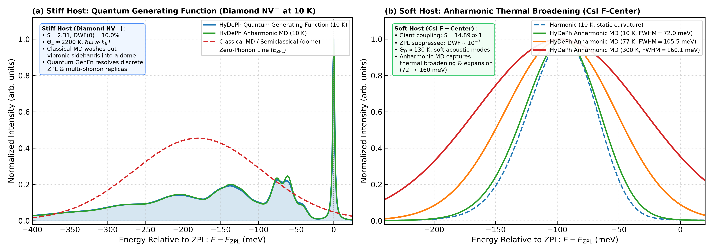
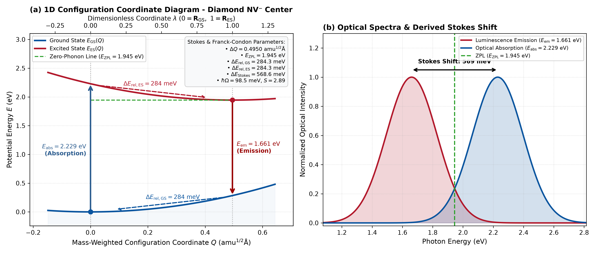
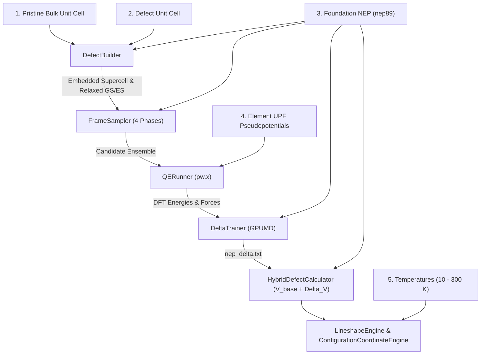
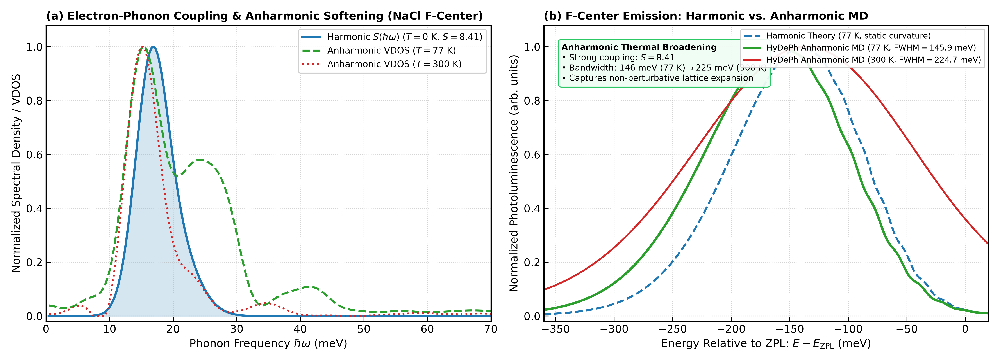

# HyDePh: High-Definition Hybrid Defect Photoluminescence

<p align="center">
  
</p>

<p align="center">
  <b>First-Principles &Delta;-Machine Learning Potentials for Color-Center Spectroscopy</b>
</p>

<p align="center">
  <a href="LICENSE"></a>
  <a href="https://www.python.org/"></a>
  <a href="https://github.com/brucefan992/GPUMD"></a>
  <a href="https://www.quantum-espresso.org/"></a>
  <a href="https://learn.microsoft.com/en-us/windows/wsl/"></a>
  <a href="https://github.com/QMatSuite/quantum-espresso-windows-exe"></a>
  <a href="https://wiki.fysik.dtu.dk/ase/"></a>
</p>

---

## Overview

Universal machine learning potentials (`nep89`) capture bulk lattice elasticity across the periodic table, while point defects require localized corrections for deep electronic states, Jahn-Teller distortions, and optical Franck-Condon relaxation.

**HyDePh** (**Hy**brid **De**fect **Ph**otoluminescence) trains a localized $\Delta$-Neuroevolution Potential ($\Delta$-NEP) on top of a universal foundation model:

$$
\begin{aligned}
V_{\mathrm{hybrid}}(\mathbf{R}) &= V_{\mathrm{foundation}}(\mathbf{R}) + \Delta V_{\mathrm{NEP}}(\mathbf{R}) \\
\mathbf{F}_{\mathrm{hybrid}}(\mathbf{R}) &= \mathbf{F}_{\mathrm{foundation}}(\mathbf{R}) + \Delta \mathbf{F}_{\mathrm{NEP}}(\mathbf{R})
\end{aligned}
$$

Key capabilities:
1. **Defect Embedding**: Vectorized tiling of pristine bulk unit cells around a defect unit cell and defect coordinate detection.
2. **4-Phase Active Sampling**: Generates candidate configurations across the Franck-Condon coordinate, defect-core rattling, and high-temperature foundation MD with incremental Farthest Point Sampling (FPS).
3. **DFT Labeling & Resumption**: Runs Quantum ESPRESSO (`pw.x` / `pw.exe`) with Gamma-point real wavefunctions (`K_POINTS gamma`), universal ASE atomic masses, disk caching, and type-balanced resumption.
4. **GPU $\Delta$-NEP Training**: Fits the residual potential in GPUMD with customizable architecture cutoffs and basis sizes.
5. **Multi-Regime Lineshapes**: Computes Huang-Rhys factors $S$, spectral densities $S(\hbar\omega)$, and multi-temperature emission spectra $A(E - E_{\mathrm{ZPL}}, T)$ via mass-weighted optical projection ($\mathbf{u}_{\mathrm{opt}}$), using quantum generating functions for weak/intermediate coupling ($S < 10$) and semiclassical Marcus convolution for strong coupling ($S \ge 10$).
6. **1D Configuration Coordinate & Stokes Shift**: Evaluates potential surfaces along $\mathbf{R}(\lambda) = \mathbf{R}_{\mathrm{GS}} + \lambda (\mathbf{R}_{\mathrm{ES}} - \mathbf{R}_{\mathrm{GS}})$ to extract $\Delta Q$, relaxation energies $\Delta E_{\mathrm{rel}}$, vertical transitions $E_{\mathrm{abs}}$ and $E_{\mathrm{em}}$, effective phonon energy $\hbar\Omega$, Stokes shift $\Delta E_{\mathrm{Stokes}}$, and auto-derived ZPL.
7. **Numerical Data Export**: Automatically exports publication-ready CSV and JSON data alongside figures.

See the **[Theoretical Walkthrough](docs/THEORY_WALKTHROUGH.md)** for the mathematical formulation and literature references, **[CHANGELOG.md](CHANGELOG.md)** for release notes, and **[CONTRIBUTING.md](CONTRIBUTING.md)** for developer setup.

---

## Quickstart

### 1. Installation

```bash
git clone https://github.com/gsurfer04/HyDePh.git
cd HyDePh
pip install -e .
```

For development dependencies (testing, linting, formatting):
```bash
pip install -e ".[dev]"
```

Prerequisites:
- [GPUMD / NEP](https://github.com/brucefan992/GPUMD) (`gpumd` and `nep` / `nep.exe` with CUDA support)
- [Quantum ESPRESSO](https://www.quantum-espresso.org/):
  - **Linux / Windows WSL2 (Strongly Recommended)**: GPU-accelerated `pw.x` (CUDA/OpenACC). Utilizing an NVIDIA GPU inside WSL2 delivers an order-of-magnitude speedup for supercell DFT labeling over CPU execution.
  - **Native Windows (CPU Fallback)**: `pw.exe` from [QMatSuite/quantum-espresso-windows-exe](https://github.com/QMatSuite/quantum-espresso-windows-exe) with Microsoft MPI.
- NVIDIA GPU with CUDA support (or CPU fallback for potential evaluation)

### 2. Command-Line Interface (CLI)

Run end-to-end calculations directly from a YAML or TOML configuration file:

```bash
hydeph config.yaml
```

Optional flags:
```bash
hydeph config.yaml --max-dft 25 --workers 2
```

### 3. Python API

```python
from hydeph import ToolkitConfig, run_pipeline

config = ToolkitConfig(
    pristine_cell_path="licl_pristine_unitcell.xyz",
    defect_cell_path="licl_defect_unitcell.xyz",
    supercell_repeat=(2, 2, 2),
    foundation_potential_path="/path/to/nep89_20250409.txt",
    pseudopotentials={
        "Li": "li_pbe_v1.4.uspp.F.UPF",
        "Cl": "cl_pbe_v1.4.uspp.F.UPF",
    },
    pseudo_dir="/path/to/quantumespresso/pseudo",
    temperatures=[10.0, 77.0, 150.0, 300.0],
    enable_anharmonic=True,
    anharmonic_md_steps=2000,
)

summary = run_pipeline(config)
```

### 4. Charged Defects & Spin States (e.g., $\text{NV}^-$ in Diamond)

```python
from hydeph import ToolkitConfig, run_pipeline

config = ToolkitConfig(
    pristine_cell_path="diamond_unitcell.xyz",
    defect_cell_path="diamond_nv_unitcell.xyz",
    supercell_repeat=(3, 3, 3),
    foundation_potential_path="nep89_20250409.txt",
    pseudopotentials={"C": "C.upf", "N": "N.upf"},
    pseudo_dir="./pseudo",
    charge=-1,
    spin_polarized=True,
    spin_multiplicity=3,  # Triplet (3A2, S=1 -> tot_magnetization=2)
    temperatures=[10.0, 77.0, 300.0],
    enable_anharmonic=True,
    workspace_dir="./nv_diamond_run",
)

summary = run_pipeline(config)
```

---

## Configuration Reference

### Electronic Structure & Geometry

| Parameter | Type | Default | Description |
|---|---|---|---|
| `supercell_repeat` | `tuple of int` | `(2, 2, 2)` | Supercell expansion multipliers `(nx, ny, nz)`. For stiff crystals, `(3, 3, 3)` ($\ge 140\text{--}200$ atoms) is recommended (see guidelines below). |
| `charge` / `tot_charge` | `float` | `0.0` | Net supercell charge in units of $e$ (`&SYSTEM tot_charge` in QE). |
| `spin_polarized` | `bool` | `True` | Spin-unrestricted calculation (`nspin=2` in QE). |
| `spin_multiplicity` | `int` | `2` | Spin multiplicity $2S+1$ ($1$: singlet, $2$: doublet, $3$: triplet). |
| `tot_magnetization` | `int` | `None` | Unpaired electrons $2S$; synchronized with `spin_multiplicity`. |
| `excited_cell_path` | `str` | `None` | Path to explicit excited-state cell or supercell; falls back to coordination-shell breathing when omitted. |
| `excited_state_displacement` | `float` | `None` | Radial breathing displacement (Å) for procedural excited states ($0.08\ \text{\AA}$ for covalent hosts, $0.15\ \text{\AA}$ for ionic hosts). |
| `substitutional_element` | `str` | `None` | Replacement species symbol when `defect_type="substitutional"` (or specify `"Host->Sub"` in `defect_site_element`). |
| `conv_thr` | `str` | `"1.0d-5"` | SCF convergence threshold in Quantum ESPRESSO. |
| `mixing_beta` | `float` | `0.4` | SCF charge density mixing factor. |
| `diagonalization` | `str` | `"david"` | Diagonalization method in Quantum ESPRESSO (`'david'`, `'cg'`). |

### Sampling & Resumption

| Parameter | Type | Default | Description |
|---|---|---|---|
| `random_seed` | `int` | `42` | RNG seed for rattling displacements and MD velocities. |
| `force_resample` | `bool` | `False` | Reuses existing `relaxed_gs.xyz`, `relaxed_es.xyz`, and `candidate_frames.xyz` when `False`; regenerates when `True`. |
| `force_retrain` | `bool` | `False` | Reuses `nep_delta.txt` when training dataset and hyperparameters match the SHA256 manifest; forces GPUMD retraining when `True`. |
| `max_dft_frames` | `int` | `None` | Target total converged DFT frames. On resume, runs $\max(0, \text{max\_dft\_frames} - N_{\mathrm{done}})$ frames prioritized by underrepresented sample types. |
| `max_new_dft_frames` | `int` | `None` | Maximum new DFT calculations to execute in the current run. |
| `dft_resume_mode` | `str` | `"target_total"` | `"target_total"` (reach `max_dft_frames` total) or `"max_new"` (run up to `max_new_dft_frames` new frames). |
| `retry_failed_dft` | `bool` | `True` | Tags failed or non-converged QE frames to retry with conservative mixing (`mixing_mode='local-TF'`, `mixing_beta=0.2`) after remaining frames finish. |
| `replace_failed_frames` | `bool` | `False` | When `True`, replaces a rattle or MD frame that fails a second time with a new frame of the same type to fulfill the quota; when `False`, ignores failed frames and continues with the rest. |
| `n_procs_qe` | `int` | `2` | Number of MPI processes per Quantum ESPRESSO worker. |
| `n_workers_qe` | `int` | `1` | Number of independent `pw.x` frame calculations to run concurrently. |
| `qe_timeout_s` | `float` | `None` | Optional wall-clock timeout (seconds) per `pw.x` run before terminating and queuing for retry. |

### Delta-NEP Architecture Hyperparameters

| Parameter | Type | Default | Description |
|---|---|---|---|
| `nep_neurons` | `int` | `30` | Number of neurons in Delta-NEP hidden layer. |
| `nep_batch` | `int` | `2000` | Batch size for Delta-NEP training. |
| `nep_steps` | `int` | `30000` | Number of training generations for Delta-NEP. |
| `nep_cutoff_radial` | `float` | `4.5` | Radial cutoff for Delta-NEP in Å. |
| `nep_cutoff_angular` | `float` | `3.5` | Angular cutoff for Delta-NEP in Å. |
| `nep_n_max_radial` | `int` | `6` | Radial expansion basis size for Delta-NEP. |
| `nep_n_max_angular` | `int` | `4` | Angular expansion basis size for Delta-NEP. |
| `nep_basis_size` | `int` | `8` | Descriptor basis size for Delta-NEP. |
| `nep_l_max` | `int` | `2` | Maximum angular momentum for Delta-NEP expansion. |

### Spectroscopy, Graphing & 1D Configuration Coordinate

| Parameter | Type | Default | Description |
|---|---|---|---|
| `smart_axis_scaling` | `bool` | `True` | Frames axes around active vibrational modes and emission envelopes. |
| `temperature_plot_mode` | `str` | `"both"` | `"combined"`, `"individual"`, or `"both"`. |
| `show_harmonic_in_anharmonic` | `bool` | `True` | Overlays the $0\ \text{K}$ harmonic curve as a dashed reference on anharmonic plots. |
| `individual_shared_x` | `bool` | `False` | Shares a uniform energy axis across per-temperature plots when `True`. |
| `phonon_hw_min` / `phonon_hw_max` | `float` | `None` | Manual bounds ($\text{meV}$) for the phonon frequency axis. |
| `lineshape_e_min` / `lineshape_e_max` | `float` | `None` | Manual bounds ($\text{meV}$) for emission energy relative to ZPL. |
| `lineshape_y_min` / `lineshape_y_max` | `float` | `None` | Manual bounds for lineshape intensity. |
| `lineshape_y_scale` | `str` | `"linear"` | `"linear"` or `"log"`. |
| `phonon_smearing_meV` | `float` | `None` | Gaussian smearing ($\text{meV}$) for $S(\hbar\omega)$; adapts to supercell mode spacing when `None`. |
| `dephasing_gamma_meV` | `float` | `None` | ZPL dephasing width ($\text{meV}$); defaults to $\gamma(T) = 1.5 + 2.0\times 10^{-4} T^2\ \text{meV}$. |
| `finite_size_acoustic_cutoff` | `bool` | `True` | Enforces $S(\hbar\omega) \to 0$ as $\omega \to 0$. |
| `plot_configuration_coordinate` | `bool` | `True` | Computes and plots the 2-panel 1D configuration coordinate and Stokes shift figure. |
| `zpl_energy_eV` | `float` | `None` | Zero-Phonon Line energy in $\text{eV}$. Auto-derived from ground/excited state energies when omitted. |
| `cc_figure_name` | `str` | `"configuration_coordinate.png"` | Filename for the 1D configuration coordinate diagram. |
| `cc_lambda_min` / `cc_lambda_max` | `float` | `-0.30` / `1.30` | Dimensionless coordinate range $\lambda$ along $\mathbf{R}(\lambda)$. |
| `cc_n_points` | `int` | `81` | Grid points along the 1D configuration coordinate path. |

<p align="center">
  
</p>

---

## Supercell Size & Convergence Guidelines

Choosing an adequate supercell size (`supercell_repeat`) is critical for obtaining physical photoluminescence lineshapes and avoiding unphysical finite-size discretization artifacts.

### 1. The Physics of Finite-Size Discretization
Under periodic boundary conditions:
1. **Phonon Momentum Sampling**: A finite supercell of edge length $L$ samples phonon momentum space on a discrete grid with spacing:
   $$\Delta q = \frac{2\pi}{L}$$
   In small supercells ($L < 10\ \text{\AA}$), $\Delta q$ is large. Acoustic phonon branches cannot disperse, and long-wavelength elastic strain fields are unphysically cut off.
2. **Defect-Host Mode Hybridization**: Optical excitation couples to localized defect breathing modes as well as propagating bulk acoustic and optical phonons. In small cells, the quasi-local mode cannot hybridize into the lattice continuum; instead, electron-phonon coupling is artificially concentrated into a single, isolated discrete vibrational mode.
3. **Periodic Image Interactions**: Periodic defect replicas interact via elastic strain ($E_{\mathrm{elastic}} \propto L^{-3}$) and Coulomb repulsion ($E_{\mathrm{Coulomb}} \propto L^{-1}$ for charged centers like $\text{NV}^-$), artificially constraining host relaxation.

### 2. Case Study: Diamond $\text{NV}^-$ Center ($2\times 2\times 2$ vs. $3\times 3\times 3$)
A direct comparison between supercell sizes for the diamond $\text{NV}^-$ center illustrates this finite-size effect (first documented by [Alkauskas et al., *New J. Phys.* 16, 073026 (2014)](https://doi.org/10.1088/1367-2630/16/7/073026)):

* **$2\times 2\times 2$ Supercell (63 atoms, $L = 7.15\ \text{\AA}$, 186 modes)**:
  - $\Delta q \approx 0.88\ \text{\AA}^{-1}$ (halfway to the diamond Brillouin zone edge).
  - **$\sim 85\%$ of the total Huang-Rhys factor ($S_k = 2.64$ out of $S = 3.11$)** is compressed into a single discrete mode at $72.6\ \text{meV}$.
  - In the optical lineshape, this single delta-mode generates an unphysical harmonic comb of sharp Poissonian spikes spaced by $72.6\ \text{meV}$ (at $-73, -145, -217, -290\ \text{meV}$). At $77\ \text{K}$, the 2-phonon replica at $-145\ \text{meV}$ artificially towers over the Zero-Phonon Line (ZPL).
* **$3\times 3\times 3$ Supercell (215 atoms, $L = 10.72\ \text{\AA}$, 642 modes)**:
  - Phonon mode density increases by $3.4\times$.
  - The localized breathing mode properly hybridizes with diamond bulk phonon branches, dispersing the spectral density $S(\hbar\omega)$ continuously across $57\text{--}140\ \text{meV}$ with the true experimental quasi-local resonance at $\sim 64\text{--}65\ \text{meV}$.
  - Multi-phonon auto-convolutions $[S * S]$ and $[S * S * S]$ spread out into a smooth, continuous phonon wing, correctly preserving the sharp ZPL as the dominant spectral feature across all temperatures.

### 3. Recommended Supercell Dimensions by Host Material

| Host Material Platform | Crystal Type | Recommended Supercell | Atom Count | Minimum Dimension $L$ | Guidelines & Expected Features |
|---|---|---|---|---|---|
| **Diamond** ($\text{NV}^-$, $\text{SiV}^-$, $\text{GeV}^-$) | Stiff covalent ($\Theta_D \approx 2200\ \mathrm{K}$) | `(3, 3, 3)` | $215$ atoms | $\ge 10.7\ \text{\AA}$ | Use $\ge 215$ atoms. $2\times 2\times 2$ (63 atoms) produces artificial $73\ \text{meV}$ multi-phonon spike combs. |
| **4H-SiC** ($kk$-$\mathrm{VV}^0$, $V_{\mathrm{Si}}$) | Polar covalent ($\Theta_D \approx 1200\ \mathrm{K}$) | `(3, 3, 2)` or `(4, 4, 2)` | $142\text{--}254$ atoms | $\ge 9.2\text{--}12.3\ \text{\AA}$ | Separates defect images across basal and $c$-axis hexagonal layers. |
| **3C-SiC** | Polar covalent ($\Theta_D \approx 1200\ \mathrm{K}$) | `(3, 3, 3)` | $215$ atoms | $\ge 13.1\ \text{\AA}$ | Captures smooth quasi-local breathing mode dispersion. |
| **Alkali Halides** (LiCl, NaCl) | Soft rocksalt ($\Theta_D \approx 300\text{--}420\ \mathrm{K}$) | `(2, 2, 2)` *(recommended)* | $63$ atoms | $\ge 11.4\ \text{\AA}$ | Large lattice constant ($a \approx 5.69\ \text{\AA}$) means `(2, 2, 2)` already exceeds $L \ge 10\ \text{\AA}$ ($L = 11.4\ \text{\AA}$) and fully converges in $q$-space with $< 1\ \text{GB}$ VRAM. `(3, 3, 3)` expands to $17.1\ \text{\AA}$ with 1,721 electrons ($Z_{\mathrm{val}}=9$ for Na), requiring $> 9\ \text{GB}$ RAM. |
| **Fluorites** (LiF, $\mathrm{CaF}_2$) | Fluorite ($\Theta_D \approx 730\ \mathrm{K}$) | `(2, 2, 2)` | $95\text{--}189$ atoms | $\ge 8.0\text{--}10.9\ \text{\AA}$ | Strong coupling ($S > 10$); Marcus Gaussian envelope dominates. |

> [!IMPORTANT]
> **Physical Cell Length $L$, Not Integer Repeat Count, Determines Convergence**
> The physical criterion for converging the vibrational continuum and avoiding sharp finite-size combs is the supercell edge length **$L \ge 10\text{--}11\ \text{\AA}$**, **not** a fixed integer repeat tuple like `(3, 3, 3)`:
> - For **compact covalent hosts** (diamond, $a = 3.57\ \text{\AA}$), a $2\times 2\times 2$ cell has $L = 7.15\ \text{\AA}$ (under-converged), so `(3, 3, 3)` ($L = 10.72\ \text{\AA}$, 215 atoms) is required.
> - For **large-lattice hosts** (rocksalt halides like NaCl with $a = 5.69\ \text{\AA}$), a **$2\times 2\times 2$ cell is already $L = 11.38\ \text{\AA}$**—physically larger than the 215-atom diamond cell! A $2\times 2\times 2$ cell of NaCl is already fully converged in $q$-space.
>
> **GPU VRAM & Semi-Core Pseudopotentials**:
> If a $3\times 3\times 3$ cell is used for NaCl ($L = 17.08\ \text{\AA}$), the system contains 215 atoms and 1,721 valence electrons because the standard Na pseudopotential treats semi-core $2s, 2p$ states as valence ($Z_{\mathrm{val}} = 9$). With 877 Kohn-Sham bands and 144k plane waves, Quantum ESPRESSO's default Davidson algorithm requires **$> 9.2\ \text{GB}$ of dynamical memory**, exceeding the 8 GB VRAM of consumer GPUs and triggering a CUDA Out-Of-Memory termination.
> - **Recommended**: Use `(2, 2, 2)` for rocksalt halides ($L = 11.4\ \text{\AA}$, 505 electrons, $< 1\ \text{GB}$ peak memory).
> - If supercells with $L > 15\ \text{\AA}$ are strictly required, set `diagonalization = 'cg'` in `ToolkitConfig` (reducing peak memory by $> 50\%$) or run on multi-core CPU where system RAM ($\ge 16\text{--}32\ \text{GB}$) accommodates the memory load.

> [!TIP]
> **Why HyDePh Makes Large Supercells Tractable**
> In conventional DFT lineshape methods, computing normal modes for a 215-atom cell requires hundreds of costly DFT displacement runs. In HyDePh, high-fidelity DFT labeling is performed on only **$\sim 30\text{--}40$ candidate frames**. The localized $\Delta$-NEP potential is trained in seconds on GPU, and the 215-atom normal modes and anharmonic Langevin MD trajectories are subsequently evaluated with sub-millisecond per-step speed.

---

## Windows, WSL2 & MPI Execution

### 🚀 Recommended: Windows Subsystem for Linux (WSL2) with GPU-Accelerated Quantum ESPRESSO

On Windows workstations and laptops equipped with an NVIDIA GPU, **running HyDePh inside WSL2 (e.g. Ubuntu) is strongly encouraged over native Windows CPU execution.**

> [!TIP]
> **Massive Speedup via GPU-Accelerated Quantum ESPRESSO in WSL2**
>
> In real-world defect benchmarks (such as the 142-atom 4H-SiC $kk$-divacancy supercell), running Quantum ESPRESSO with GPU support (`pw.x` compiled with NVIDIA HPC SDK / CUDA / OpenACC) inside WSL2 yields **massive speedups** over CPU-only execution. Turnaround time for the candidate DFT labeling stage drops from hours down to minutes.
>
> In addition, WSL2 seamlessly enables GPU acceleration for **both** the DFT labeling stage (`pw.x`) and the subsequent $\Delta$-NEP training stage (`gpumd` / `nep`), giving you an end-to-end GPU-accelerated pipeline on Windows hardware without requiring dual booting.

#### Quick WSL2 Setup:

1. **Install WSL2 & Linux Distribution** (in Windows PowerShell as Administrator, if not already installed):
   ```powershell
   wsl --install -d Ubuntu-24.04
   ```
2. **Verify GPU Passthrough**:
   NVIDIA Windows display drivers automatically provide CUDA passthrough to WSL2. Verify inside your WSL2 bash terminal:
   ```bash
   nvidia-smi
   ```
3. **Install GPU-Accelerated Quantum ESPRESSO & GPUMD**:
   Obtain or compile `pw.x` with CUDA support (e.g., via the [NVIDIA HPC SDK container](https://catalog.ngc.nvidia.com/orgs/hpc/containers/quantum_espresso), Spack, or manual `./configure --with-cuda`), and compile [GPUMD](https://github.com/brucefan992/GPUMD).
4. **Install HyDePh in WSL2**:
   ```bash
   git clone https://github.com/gsurfer04/HyDePh.git
   cd HyDePh
   pip install -e .
   ```

> [!IMPORTANT]
> **Best Practices for WSL2 Runs:**
> - **Filesystem Location:** Place your input structures and `workspace_dir` on the native Linux ext4 filesystem (e.g., `~/hydeph_workspace/`) rather than the Windows mount (`/mnt/c/...` or cloud-synced folders like Google Drive/OneDrive). Native Linux disk I/O is substantially faster and avoids cloud sync contention.
> - **Prevent Laptop Sleep:** During unattended DFT labeling runs, adjust Windows Power Settings to prevent the laptop from sleeping on AC power, avoiding interrupted SCF steps or timing outliers.

---

### Native Windows Execution (CPU Fallback via QMatSuite & MS-MPI)

For environments without an NVIDIA GPU or where WSL2 cannot be used, HyDePh also provides full out-of-the-box support for native Windows execution using [QMatSuite Quantum ESPRESSO binaries](https://github.com/QMatSuite/quantum-espresso-windows-exe) (built with Intel oneAPI, MKL, and Microsoft MPI).

| Feature | Linux / WSL2 (OpenMPI / MPICH / CUDA) | Windows (Microsoft MPI / QMatSuite) | HyDePh Handling |
|---|---|---|---|
| **Acceleration** | **NVIDIA GPU (CUDA / OpenACC)** or Multi-core CPU | Multi-core CPU (Intel MKL) | Automatically adapts OpenMP threads and MPI ranks across available CPU cores or GPU devices. |
| **MPI Launcher** | `mpirun` or `mpiexec` | `mpiexec.exe` | Auto-detects `mpiexec` on Windows and `mpirun` on Linux/WSL2; runs directly when `n_procs=1`. |
| **Process Count Flag** | `-np <N>` | `-n <N>` | Selects `-n` on Windows and `-np` on Linux/WSL2. |
| **Executable Name** | `pw.x` | `pw.exe` | Resolves `pw.exe` on Windows and `pw.x` on Linux/WSL2. |
| **Input File** | `-in pw.in` | `-in pw.in` | Passes `-in pw.in` via argument list. |
| **Shared Libraries** | `RPATH` / `LD_LIBRARY_PATH` | Colocated in `bin/` | Prepends `pw.exe` directory to subprocess `PATH` for MKL and MS-MPI DLLs on Windows. |
| **Namelist Paths** | `/` | `/` | Normalizes `pseudo_dir` separators to `/` in `&CONTROL`. |

```python
config = ToolkitConfig(
    pristine_cell_path=r"C:\data\licl_pristine.xyz",
    defect_cell_path=r"C:\data\licl_defect.xyz",
    foundation_potential_path=r"C:\potentials\nep89_20250409.txt",
    pseudo_dir=r"C:\QE\pseudo",
    pseudopotentials={"Li": "li_pbe_v1.4.uspp.F.UPF", "Cl": "cl_pbe_v1.4.uspp.F.UPF"},
    pw_exe=r"C:\QE\bin\pw.exe",
    mpi_command="mpiexec",
    mpi_args=["-env", "OMP_NUM_THREADS", "2"],
    nep_exe=r"C:\GPUMD\bin\nep.exe",
    temperatures=[10.0, 77.0, 150.0, 300.0],
    workspace_dir=r"C:\simulations\licl_run",
)
```

---

## Workflow & Benchmarks



| System | Host ($\Theta_D$) | $S$ | Regime | Key Result |
|---|---|---|---|---|
| **Diamond $\mathrm{NV}^-$** | Covalent ($2200\ \mathrm{K}$) | $3.166$ | Quantum ($S < 10$) | Sharp ZPL ($\mathrm{DWF} = 4.22\%$), resolved sidebands at $-65, -135, -205\ \mathrm{meV}$. |
| **4H-SiC $kk$-$\mathrm{VV}^0$** | Polar covalent ($1200\ \mathrm{K}$) | $4.766$ | Quantum ($S < 10$) | Sharp ZPL ($\mathrm{DWF} = 0.85\%$), quasi-local modes at $-38, -76\ \mathrm{meV}$; $\mathbf{u}_{\mathrm{opt}}$ filters $90\text{--}115\ \mathrm{meV}$ bulk modes. |
| **LiCl F-Center** | Rocksalt ($420\ \mathrm{K}$) | $3.999$ | Quantum ($S < 10$) | Captures $3.4\times$ bandwidth expansion ($265\ \mathrm{meV}$) and mode softening ($27.8 \to 19.8\ \mathrm{meV}$ vs. $19.7\ \mathrm{meV}$ exp.). |
| **LiF F-Center** | Fluorite ($730\ \mathrm{K}$) | $23.930$ | Marcus ($S \ge 10$) | Large relaxation ($\Delta Q = 2.39\ \mathrm{amu}^{1/2}\text{\AA}$) suppresses ZPL; reproduces broad Gaussian band ($490\text{--}1101\ \mathrm{meV}$). |

<p align="center">
  
</p>

### LiCl F-Center vs. Experiment (Takiyama 1978)

| Metric | Harmonic Theory | HyDePh Anharmonic MD | Takiyama (1978) Exp. |
|---|---|---|---|
| **$77\ \text{K}$ Emission FWHM** | $0.08\ \text{eV}$ ($78\ \text{meV}$) | **$0.27\ \text{eV}$ ($265\ \text{meV}$)** | **$0.46\ \text{eV}$ ($460\ \text{meV}$)** |
| **Coupling Phonon Mode** | $27.8\ \text{meV}$ | **$19.8\ \text{meV}$** ($77\ \text{K}$ VDOS) | **$19.7\ \text{meV}$** |
| **$300\ \text{K}$ Emission FWHM** | $0.15\ \text{eV}$ | **$0.28\ \text{eV}$ ($284\ \text{meV}$)** | Thermally quenched |

---

## Repository Structure

```
hydeph/
├── __init__.py                    # Package exports & logging configuration
├── __main__.py                    # Python module CLI entrypoint
├── config.py                      # ToolkitConfig dataclass, file I/O & validation
├── defect_builder.py              # Vectorized supercell embedding & defect locator
├── frame_sampler.py               # 4-phase frame sampler (FC, rattle, streamed MD+FPS)
├── qe_runner.py                   # Quantum ESPRESSO runner (Gamma-point, single-pass parser)
├── delta_trainer.py               # Baseline subtraction & GPUMD Delta-NEP trainer
├── calculator.py                  # HybridDefectCalculator with property gating
├── lineshape.py                   # Quantum generating function & numerical exporter
├── cc_diagram.py                  # 1D configuration coordinate & Stokes shift engine
└── pipeline.py                    # Turnkey pipeline orchestrator & CLI main
examples/
├── run_licl_fcenter.py            # Benchmark driver for LiCl F-center
└── plot_experimental_comparison.py
docs/
└── THEORY_WALKTHROUGH.md          # Theoretical formulation & literature citations
scripts/
├── make_github_diagram.py         # Generates LiCl F-center benchmark diagram
└── make_stiff_vs_soft_diagram.py  # Generates stiff vs. soft host comparison diagram
assets/                            # Benchmark figures
tests/                             # Automated test suite (52 unit tests)
CHANGELOG.md                       # Release notes and history
CONTRIBUTING.md                    # Developer and contribution guidelines
pyproject.toml                     # Project packaging, CLI script & dependencies
setup.py                           # Legacy setuptools installation entrypoint
```

## License

[MIT License](LICENSE)
