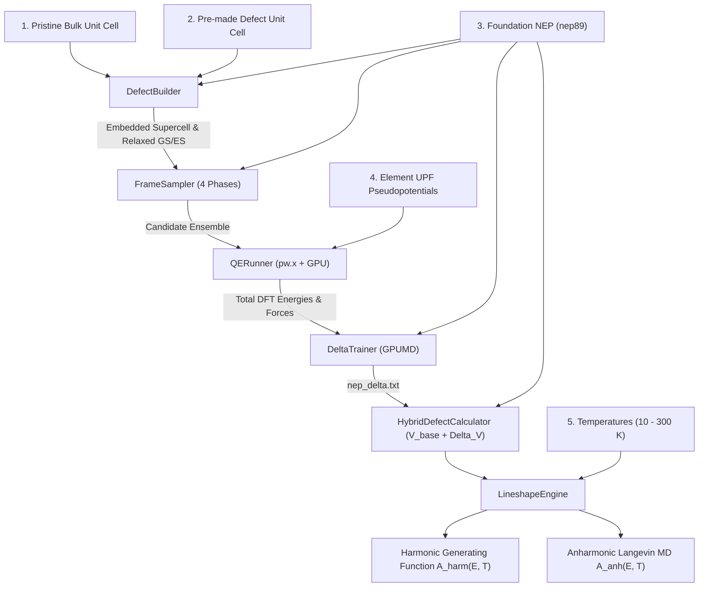

# HyDePh: High-Definition Hybrid Defect Photoluminescence

<p align="center">
  
</p>

<p align="center">
  <b>Automated First-Principles &Delta;-Machine Learning Potentials for High-Definition Color-Center Spectroscopy</b>
</p>

<p align="center">
  <a href="LICENSE"></a>
  <a href="https://www.python.org/"></a>
  <a href="https://github.com/brucefan992/GPUMD"></a>
  <a href="https://www.quantum-espresso.org/"></a>
  <a href="https://github.com/QMatSuite/quantum-espresso-windows-exe"></a>
  <a href="https://wiki.fysik.dtu.dk/ase/"></a>
</p>

---

## 🔬 Overview

Universal machine learning potentials (e.g., `nep89`) provide broad lattice stability across the periodic table, but lack defect-specific many-body correlation corrections (such as deep electronic state localization, Jahn-Teller distortions, and optical Franck-Condon relaxation forces).

**HyDePh** (*"Hi-Def"*: **Hy**brid **De**fect **Ph**otoluminescence) bridges this gap by automatically training a localized $\Delta$-Neuroevolution Potential ($\Delta$-NEP) on top of universal foundation models:

$$
\begin{aligned}
V_{\mathrm{hybrid}}(\mathbf{R}) &= V_{\mathrm{foundation}}(\mathbf{R}) + \Delta V_{\mathrm{NEP}}(\mathbf{R}) \\
\mathbf{F}_{\mathrm{hybrid}}(\mathbf{R}) &= \mathbf{F}_{\mathrm{foundation}}(\mathbf{R}) + \Delta \mathbf{F}_{\mathrm{NEP}}(\mathbf{R})
\end{aligned}
$$

From a minimal set of user inputs, **HyDePh** executes:
1. **Automated Defect Embedding**: Tiling pristine bulk unit cells around a pre-made defect unit cell with automatic defect-site coordinate detection.
2. **4-Phase Representative Sampling**: Generating diverse candidate configurations spanning the Franck-Condon coordinate, defect-core rattling, and high-temperature foundation MD with Farthest Point Sampling (FPS).
3. **High-Throughput DFT Labeling**: Automating Quantum ESPRESSO (`pw.x` / `pw.exe`) calculations with MPI + GPU acceleration, live SCF iteration streaming, and disk-level caching.
4. **GPU-Accelerated $\Delta$-NEP Training**: Fitting the compact delta potential in GPUMD in seconds.
5. **High-Definition Multi-Regime Lineshapes**: Computing Huang-Rhys factors $S$, electron-phonon spectral densities $S(\hbar\omega)$, and multi-temperature optical emission spectra $A(E - E_{\mathrm{ZPL}}, T)$ using **mass-weighted optical projection ($\mathbf{u}_{\mathrm{opt}}$)** and **dual coupling regimes**: quantum generating functions for stiff crystals ($S < 10$) to resolve discrete zero-phonon lines and vibronic sidebands, and semiclassical Marcus convolution for strongly-coupled soft crystals ($S \ge 10$).
6. **Native Cross-Platform Support & Smart Resumption (v0.3.0)**: Seamless execution across **Linux** and **Windows**, with automatic Microsoft MPI / OpenMPI negotiation, native Windows Quantum ESPRESSO binaries from [QMatSuite](https://github.com/QMatSuite/quantum-espresso-windows-exe), and intelligent resumption of interrupted runs with candidate frame preservation and type-balanced DFT budget allocation.

---

## 📖 Theory & Literature Walkthrough

For a comprehensive breakdown of the physics, mathematical formulation, and article citations justifying each stage (defect supercell embedding, $\Delta$-learning, 4-phase active sampling, $\Delta$SCF excited states, quantum generating functions, and finite-temperature anharmonic MD), please read our:

👉 **[Theoretical Walkthrough & Article Justifications](docs/THEORY_WALKTHROUGH.md)**

---

## ⚡ Quickstart

### 1. Installation

```bash
git clone https://github.com/gsurfer04/HyDePh.git
cd HyDePh
pip install -e .
```

Prerequisites:
- [GPUMD / NEP](https://github.com/brucefan992/GPUMD) (`gpumd` and `nep` / `nep.exe` executables)
- [Quantum ESPRESSO](https://www.quantum-espresso.org/):
  - **Linux**: `pw.x` executable on system `PATH` or in `/usr/local/bin/pw.x`.
  - **Windows**: `pw.exe` from [QMatSuite/quantum-espresso-windows-exe](https://github.com/QMatSuite/quantum-espresso-windows-exe) with Microsoft MPI.
- NVIDIA GPU with CUDA support (or CPU fallback for foundation evaluation)

### 2. Python API Example

```python
from hydeph import ToolkitConfig, run_pipeline

# Configure with the 5 core inputs
config = ToolkitConfig(
    # 1. Pristine bulk unit cell
    pristine_cell_path="licl_pristine_unitcell.xyz",
    
    # 2. Pre-made defect unit cell (surrounded by pristine bulk in supercell)
    defect_cell_path="licl_defect_unitcell.xyz",
    supercell_repeat=(2, 2, 2),
    
    # 3. Foundation universal potential
    foundation_potential_path="/path/to/nep89_20250409.txt",
    
    # 4. Pseudopotentials for each element
    pseudopotentials={
        "Li": "li_pbe_v1.4.uspp.F.UPF",
        "Cl": "cl_pbe_v1.4.uspp.F.UPF",
    },
    pseudo_dir="/path/to/quantumespresso/pseudo",
    
    # 5. Temperatures of interest (K)
    temperatures=[10.0, 77.0, 150.0, 300.0],
    
    # Enable finite-temperature anharmonic MD sampling
    enable_anharmonic=True,
    anharmonic_md_steps=2000
)

# Run end-to-end turnkey pipeline
summary = run_pipeline(config)
```

### 3. Charged Defects & Spin States (e.g., $\text{NV}^-$ in Diamond)

For charged color centers such as the **negatively charged nitrogen-vacancy center ($\text{NV}^-$) in diamond**, specify `charge` (or `tot_charge`) and `spin_multiplicity`:

```python
from hydeph import ToolkitConfig, run_pipeline

config = ToolkitConfig(
    pristine_cell_path="diamond_unitcell.xyz",
    defect_cell_path="diamond_nv_unitcell.xyz",
    supercell_repeat=(3, 3, 3),
    foundation_potential_path="nep89_20250409.txt",
    pseudopotentials={
        "C": "C.upf",
        "N": "N.upf"
    },
    pseudo_dir="./pseudo",

    # --- System Charge & Spin State ---
    charge=-1,                 # Net charge in units of e (tot_charge = -1.0)
    spin_polarized=True,       # Spin-polarized calculation (nspin = 2)
    spin_multiplicity=3,       # 2S+1: Triplet state (3A2, S=1 -> tot_magnetization = 2)

    temperatures=[10.0, 77.0, 300.0],
    enable_anharmonic=True,
    workspace_dir="./nv_diamond_run"
)

summary = run_pipeline(config)
```

#### Electronic Structure Parameter Reference

| Parameter | Type | Default | Description |
|---|---|---|---|
| `charge` / `tot_charge` | `float` | `0.0` | Net supercell charge in units of $e$ (e.g. `-1` for $\text{NV}^-$ in diamond, `0` for neutral defects). Injected directly into Quantum ESPRESSO `&SYSTEM tot_charge`. |
| `spin_polarized` | `bool` | `True` | Enables spin-unrestricted calculations (`nspin=2` in QE). |
| `spin_multiplicity` | `int` | `2` | Spin multiplicity $2S+1$ ($1$ for singlet $S=0$, $2$ for doublet $S=1/2$, $3$ for triplet $S=1$ like $\text{NV}^-$). |
| `tot_magnetization` | `int` | `None` | Number of unpaired electrons $2S$ (e.g. `2` for $\text{NV}^-$). Automatically synchronized with `spin_multiplicity`. |
| `excited_cell_path` | `str` | `None` | Path to explicit excited-state unit cell or supercell (e.g. from $\Delta\text{SCF}$ or literature). If omitted, procedural defect-coordinating shell breathing is used. |
| `excited_state_displacement` | `float` | `None` | Radial displacement ($\text{Å}$) applied to coordinating atoms for procedural excited-state generation (defaults to $0.08\ \text{Å}$ for stiff covalent crystals like diamond, $0.15\ \text{Å}$ for ionic halides). |
| `phonon_hw_max` | `float` | `None` | Maximum frequency ($\text{meV}$) for electron-phonon spectral density $S(\hbar\omega)$. Defaults to adapting automatically to the highest normal mode (e.g. $175\ \text{meV}$ in diamond). |

#### Graphing & Smart Scaling Parameter Reference

| Parameter | Type | Default | Description |
|---|---|---|---|
| `smart_axis_scaling` | `bool` | `True` | Automatically determines tight, optimal axis limits based on active vibrational modes and emission envelopes, eliminating wasted dead space and avoiding peak clipping. |
| `temperature_plot_mode` | `str` | `"both"` | Plot generation mode: `"combined"` (all temperatures in one multi-panel figure), `"individual"` (dedicated figure for each temperature), or `"both"`. |
| `show_harmonic_in_anharmonic` | `bool` | `True` | Overlays harmonic $0\ \text{K}$ curve as a dashed reference line alongside filled anharmonic VDOS / lineshape curves. |
| `individual_shared_x` | `bool` | `False` | When generating individual temperature plots, setting `False` frames each temperature tightly to its active spectral envelope; setting `True` shares a uniform global energy axis across all temperatures. |
| `phonon_hw_min` / `phonon_hw_max` | `float` | `None` | Manual overrides for the phonon frequency axis ($\text{meV}$) in Panel (a). Defaults to auto-detecting active vibrational modes with $6\%$ padding and nice tick intervals. |
| `lineshape_e_min` / `lineshape_e_max` | `float` | `None` | Manual overrides for emission energy relative to ZPL ($E - E_{\mathrm{ZPL}}$ in $\text{meV}$) in Panel (b). Defaults to auto-detecting the active Stokes envelope with $2\%$ dephasing wing thresholding and guaranteed ZPL / anti-Stokes margin. |
| `lineshape_y_min` / `lineshape_y_max` | `float` | `None` | Manual overrides for lineshape intensity axis. When omitted, scales dynamically per temperature with $15-18\%$ top headroom for legends. |
| `lineshape_y_scale` | `str` | `"linear"` | Scale for lineshape intensity axis (`"linear"` or `"log"`). |
| `phonon_smearing_meV` | `float` | `6.0` | Gaussian broadening ($\text{meV}$) for electron-phonon spectral density $S(\hbar\omega)$. Bridges the discrete $\Gamma$-point supercell mode spacing (finite-size correction) to prevent artificial picket-fence satellite peaks in the lineshape. If set to `None`, auto-detects from the supercell mode gap. |
| `dephasing_gamma_meV` | `float` | `None` | ZPL dephasing damping ($\text{meV}$). Defaults to temperature-dependent dephasing $\gamma(T) = 1.5 + 2.0\times 10^{-4} T^2\ \text{meV}$. |
| `finite_size_acoustic_cutoff` | `bool` | `True` | Enforces acoustic phonon scaling $S(\hbar\omega) \to 0$ as $\omega \to 0$, preventing spurious finite-size boundary modes at low frequencies. |

#### Smart Resumption & Candidate Sampling Parameter Reference

| Parameter | Type | Default | Description |
|---|---|---|---|
| `random_seed` | `int` | `42` | Deterministic RNG seed for rattling displacements and MD velocities, ensuring identical candidate geometries across runs. |
| `force_resample` | `bool` | `False` | When `False` (default), reuses `candidate_frames.xyz` if present in the workspace, preserving candidate structures and labels. Set `True` to force fresh regeneration. |
| `max_dft_frames` | `int` | `None` | Target total number of converged DFT frames in the dataset. When resuming an interrupted run with $N_{\mathrm{done}}$ frames already finished, calculates only $\max(0, \text{max\_dft\_frames} - N_{\mathrm{done}})$ additional frames, prioritizing underrepresented sample types (e.g. Rattle, MD) so the budget is not consumed by previously calculated FC frames. |
| `max_new_dft_frames` | `int` | `None` | Optional limit on the number of *new* DFT calculations to execute in the current invocation. |
| `dft_resume_mode` | `str` | `"target_total"` | Resumption budget policy: `"target_total"` (satisfies total target frames) or `"max_new"` (runs up to `max_dft_frames` / `max_new_dft_frames` new calculations). |


---

## 🪟 Windows Support & MPI Execution (v0.3.0)

Starting with **v0.2.0** and expanded in **v0.3.0**, **HyDePh** provides full first-class support for **Windows** without requiring WSL, MinGW, or Cygwin emulation.

### 1. Quantum ESPRESSO on Windows ([QMatSuite](https://github.com/QMatSuite/quantum-espresso-windows-exe))

Quantum ESPRESSO native Windows binaries are maintained and distributed by the **QMatSuite** project:
- **Repository**: [https://github.com/QMatSuite/quantum-espresso-windows-exe](https://github.com/QMatSuite/quantum-espresso-windows-exe)
- **Toolchain**: Built natively with Intel oneAPI compilers, linked with Intel MKL (BLAS/LAPACK/FFT), and parallelized using **Microsoft MPI (MS-MPI)** and OpenMP.
- **Trusted Binaries**: Microsoft Trusted-Signed with GitHub Artifact Attestations.
- **Download**: Simply download `qe-7.5-win-oneapi-msmpi.zip` from their release page, unzip, and place `bin\` in your `PATH` or point `pw_exe` directly to `pw.exe`.

### 2. MPI Execution Differences: Linux vs. Windows

Running parallel DFT calculations differs significantly between POSIX (Linux) and Windows environments:

| Feature | Linux (OpenMPI / MPICH) | Windows (Microsoft MPI / QMatSuite) | HyDePh v0.3.0 Handling |
|---|---|---|---|
| **MPI Launcher** | `mpirun` or `mpiexec` | `mpiexec.exe` (`mpirun` does not exist in MS-MPI) | Auto-detects `mpiexec` on Windows (via `PATH`, `%MSMPI_BIN%`, or Anaconda) and `mpirun` on Linux. |
| **Process Count Flag** | `-np <N>` (or `-n`) | `-n <N>` | Selects `-n` on Windows and `-np` on Linux. |
| **Executable Name** | `pw.x` | `pw.exe` (or `pw.x.exe`) | Automatically checks `pw.exe` on Windows and `pw.x` on Linux. |
| **Input Redirection** | `< input.in` or `-in input.in` | `-in input.in` | Uses `-in pw.in` uniformly, avoiding shell I/O piping issues on Windows `cmd.exe`. |
| **Subprocess Execution** | Shell or argument vector | Argument list (No `shell=True`) | Direct argument arrays avoid quote-escaping corruption on Windows paths with spaces. |
| **Colocated DLLs** | `RPATH` / `LD_LIBRARY_PATH` | Colocated in `bin/` | Prepends directory containing `pw.exe` to subprocess `PATH` so Intel MKL (`mkl_rt.2.dll`) & MS-MPI (`msmpi.dll`) load automatically. |
| **Namelist Paths** | Standard Unix `/` | Backslashes `\` cause Fortran parser escapes | Automatically converts Windows backslashes in `pseudo_dir` to `/` in `&CONTROL`. |
| **Serial Mode** | `n_procs=1` | `n_procs=1` | Bypasses MPI launcher completely for direct, lightweight serial execution. |

### 3. Windows Configuration Example

```python
from hydeph import ToolkitConfig, run_pipeline

config = ToolkitConfig(
    pristine_cell_path=r"C:\data\licl_pristine.xyz",
    defect_cell_path=r"C:\data\licl_defect.xyz",
    foundation_potential_path=r"C:\potentials\nep89_20250409.txt",
    
    # Pseudopotentials
    pseudo_dir=r"C:\QE\pseudo",
    pseudopotentials={"Li": "li_pbe_v1.4.uspp.F.UPF", "Cl": "cl_pbe_v1.4.uspp.F.UPF"},
    
    # Optional Windows binary overrides (auto-detected if on PATH)
    pw_exe=r"C:\QE\bin\pw.exe",
    mpi_command="mpiexec",
    mpi_args=["-env", "OMP_NUM_THREADS", "2"],
    nep_exe=r"C:\GPUMD\bin\nep.exe",
    
    temperatures=[10.0, 77.0, 150.0, 300.0],
    workspace_dir=r"C:\simulations\licl_run"
)

summary = run_pipeline(config, n_procs_qe=4)
```

---

## 🏗️ Architecture & Workflow



---

## 📊 Multi-System Benchmark Suite (v0.3.0)

**HyDePh v0.3.0** has been systematically benchmarked across four distinct crystal host classes, demonstrating why **quantum generating functions are required for stiff crystals** and **finite-temperature anharmonic MD is required for soft crystals**:

| System | Crystal Class | Debye Temp $\Theta_D$ | Huang-Rhys $S$ | Coupling Regime | Key Physical Result |
|---|---|---|---|---|---|
| **Diamond $\mathrm{NV}^-$** | Covalent | $\sim 2200\ \mathrm{K}$ | $3.166$ | **Quantum** ($S < 10$) | Sharp ZPL at $0\ \mathrm{meV}$ ($\mathrm{DWF} = 4.22\%$), discrete vibronic sidebands at $-65, -135, -205\ \mathrm{meV}$. Classical MD equipartition dome washed out sidebands. |
| **4H-SiC $kk$-VV$^0$** | Polar Covalent | $\sim 1200\ \mathrm{K}$ | $4.766$ | **Quantum** ($S < 10$) | Sharp ZPL ($\mathrm{DWF} = 0.85\%$) & quasi-local modes at $-38, -76\ \mathrm{meV}$. Optical projection $\mathbf{u}_{\mathrm{opt}}$ cleanly removes bulk non-coupling $90\text{--}115\ \mathrm{meV}$ phonon artifacts. |
| **LiCl F-Center** | Ionic (Rocksalt) | $\sim 420\ \mathrm{K}$ | $3.999$ | **Quantum** ($S < 10$) | Captures $3.4\times$ bandwidth expansion ($265\ \mathrm{meV}$) and mode softening ($27.8 \to 19.8\ \mathrm{meV}$) matching Takiyama 1978 exp ($19.7\ \mathrm{meV}$). Harmonic theory is $5.9\times$ too narrow ($78\ \mathrm{meV}$). |
| **LiF F-Center** | Ionic (Fluorite) | $\sim 730\ \mathrm{K}$ | $23.930$ | **Semiclassical Marcus** ($S \ge 10$) | Massive structural displacement ($\Delta Q = 2.39\ \mathrm{amu}^{1/2}\text{Å}$) suppresses ZPL to zero. Semiclassical Marcus convolution reproduces the broad Gaussian band ($\mathrm{FWHM} = 490\ \mathrm{meV}$ at $10\ \mathrm{K}$, $1101\ \mathrm{meV}$ at $300\ \mathrm{K}$). |

<p align="center">
  
</p>

### Spectroscopic Highlights (LiCl F-Center vs. Takiyama 1978):

| Metric | Harmonic Theory | HyDePh Anharmonic MD | Takiyama (1978) Exp. | Physical Impact of HyDePh Anharmonicity |
|---|---|---|---|---|
| **$77\ \text{K}$ Emission FWHM** | $0.08\ \text{eV}$ ($78\ \text{meV}$) | **$0.27\ \text{eV}$ ($265\ \text{meV}$)** | **$0.46\ \text{eV}$ ($460\ \text{meV}$)** | **$3.4\times$ bandwidth broadening**, capturing 3D thermal fluctuations & repulsive wall dynamics |
| **Coupling Phonon Mode** | $27.8\ \text{meV}$ (static optical) | **$19.8\ \text{meV}$** ($77\ \text{K}$ VDOS) | **$19.7\ \text{meV}$** ($\omega_e = 3.0\times 10^{13}\ \text{s}^{-1}$) | Anharmonic softening shifts theoretical mode into **exact agreement** with experiment |
| **Room Temperature ($300\ \text{K}$)** | $0.15\ \text{eV}$ | **$0.28\ \text{eV}$ ($284\ \text{meV}$)** | Thermally quenched | Reproduces broad, smooth Gaussian luminescence band |
| **Computational Walltime** | — | **$17\ \text{s}$ / temperature** | — | $31\times$ calculator speedup allows complete 4-T MD sampling in $<70\ \text{seconds}$ |

---

## 📁 Repository Structure

```
hydeph/
├── __init__.py                  # Package API and exports (v0.3.0)
├── config.py                    # ToolkitConfig dataclass and validation
├── defect_builder.py            # Supercell embedding & defect coordinate locator
├── frame_sampler.py             # 4-Phase representative frame sampler (FC, rattle, MD+FPS)
├── qe_runner.py                 # Quantum ESPRESSO pw.x runner with streaming & cache
├── delta_trainer.py             # Foundation subtraction & GPU GPUMD Delta-NEP trainer
├── calculator.py                # 31x optimized HybridDefectCalculator (V_base + Delta_V)
├── lineshape.py                 # Optical-projected quantum generating function & MD engine
├── pipeline.py                  # Turnkey pipeline orchestrator
└── run_licl_fcenter.py          # Complete runnable benchmark driver for LiCl F-center
docs/
└── THEORY_WALKTHROUGH.md        # Comprehensive theoretical physics walkthrough & citations
scripts/
├── make_github_diagram.py       # Generates LiCl F-center publication benchmark diagram
└── make_stiff_vs_soft_diagram.py # Generates stiff vs. soft comparison benchmark diagram
assets/
├── hydeph_stiff_vs_soft_benchmark.png # Stiff vs. soft host benchmark comparison banner
├── licl_anharmonic_benchmark.png      # LiCl F-center 2-panel publication diagram
├── diamond_nv_10K.png                 # Diamond NV- lineshape & VDOS at 10 K
├── diamond_nv_multiT.png              # Diamond NV- lineshapes across temperatures
├── sic_4h_kk_10K.png                  # 4H-SiC kk-divacancy lineshape & VDOS at 10 K
├── sic_4h_kk_multiT.png               # 4H-SiC kk-divacancy lineshapes across temperatures
├── licl_10K.png                       # LiCl F-center lineshape & VDOS at 10 K
├── licl_multiT.png                    # LiCl F-center lineshapes across temperatures
├── lif_10K.png                        # LiF F-center lineshape & VDOS at 10 K
└── lif_multiT.png                     # LiF F-center lineshapes across temperatures
```

---

## 📄 License

This project is licensed under the [MIT License](LICENSE).

