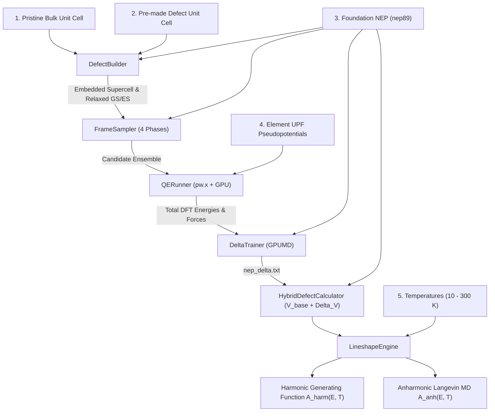

# HyDePh: High-Definition Hybrid Defect Photoluminescence

<p align="center">
  
</p>

<p align="center">
  <b>Automated First-Principles &Delta;-Machine Learning Potentials for High-Definition Color-Center Spectroscopy</b>
</p>

<p align="center">
  <a href="LICENSE"></a>
  <a href="https://www.python.org/"></a>
  <a href="https://github.com/brucefan992/GPUMD"></a>
  <a href="https://www.quantum-espresso.org/"></a>
  <a href="https://wiki.fysik.dtu.dk/ase/"></a>
</p>

---

## 🔬 Overview

Universal machine learning potentials (e.g., `nep89`) provide broad lattice stability across the periodic table, but lack defect-specific many-body correlation corrections (such as deep electronic state localization, Jahn-Teller distortions, and optical Franck-Condon relaxation forces).

**HyDePh** (*"Hi-Def"*: **Hy**brid **De**fect **Ph**otoluminescence) bridges this gap by automatically training a localized $\Delta$-Neuroevolution Potential ($\Delta$-NEP) on top of universal foundation models:

$$
\begin{aligned}
V_{\mathrm{hybrid}}(\mathbf{R}) &= V_{\mathrm{foundation}}(\mathbf{R}) + \Delta V_{\mathrm{NEP}}(\mathbf{R}) \\
\mathbf{F}_{\mathrm{hybrid}}(\mathbf{R}) &= \mathbf{F}_{\mathrm{foundation}}(\mathbf{R}) + \Delta \mathbf{F}_{\mathrm{NEP}}(\mathbf{R})
\end{aligned}
$$

From a minimal set of user inputs, **HyDePh** executes:
1. **Automated Defect Embedding**: Tiling pristine bulk unit cells around a pre-made defect unit cell with automatic defect-site coordinate detection.
2. **4-Phase Representative Sampling**: Generating diverse candidate configurations spanning the Franck-Condon coordinate, defect-core rattling, and high-temperature foundation MD with Farthest Point Sampling (FPS).
3. **High-Throughput DFT Labeling**: Automating Quantum ESPRESSO (`pw.x`) calculations with MPI + GPU acceleration, live SCF iteration streaming, and disk-level caching.
4. **GPU-Accelerated $\Delta$-NEP Training**: Fitting the compact delta potential in GPUMD in seconds.
5. **High-Definition Lineshapes**: Computing Huang-Rhys factors $S$, electron-phonon spectral densities $S(\hbar\omega)$, and multi-temperature optical emission spectra $A(E - E_{\mathrm{ZPL}}, T)$ using both **quantum generating functions** and **finite-temperature anharmonic molecular dynamics free energy sampling**.

---

## 📖 Theory & Literature Walkthrough

For a comprehensive breakdown of the physics, mathematical formulation, and article citations justifying each stage (defect supercell embedding, $\Delta$-learning, 4-phase active sampling, $\Delta$SCF excited states, quantum generating functions, and finite-temperature anharmonic MD), please read our:

👉 **[Theoretical Walkthrough & Article Justifications](docs/THEORY_WALKTHROUGH.md)**

---

## ⚡ Quickstart

### 1. Installation

```bash
git clone https://github.com/gsurfer04/HyDePh.git
cd HyDePh
pip install -e .
```

Prerequisites:
- [GPUMD / NEP](https://github.com/brucefan992/GPUMD) (`gpumd` and `nep` executables on system `PATH`)
- [Quantum ESPRESSO](https://www.quantum-espresso.org/) (`pw.x` executable on system `PATH`)
- NVIDIA GPU with CUDA support

### 2. Python API Example

```python
from hydeph import ToolkitConfig, run_pipeline

# Configure with the 5 core inputs
config = ToolkitConfig(
    # 1. Pristine bulk unit cell
    pristine_cell_path="licl_pristine_unitcell.xyz",
    
    # 2. Pre-made defect unit cell (surrounded by pristine bulk in supercell)
    defect_cell_path="licl_defect_unitcell.xyz",
    supercell_repeat=(2, 2, 2),
    
    # 3. Foundation universal potential
    foundation_potential_path="/path/to/nep89_20250409.txt",
    
    # 4. Pseudopotentials for each element
    pseudopotentials={
        "Li": "li_pbe_v1.4.uspp.F.UPF",
        "Cl": "cl_pbe_v1.4.uspp.F.UPF",
    },
    pseudo_dir="/path/to/quantumespresso/pseudo",
    
    # 5. Temperatures of interest (K)
    temperatures=[10.0, 77.0, 150.0, 300.0],
    
    # Enable finite-temperature anharmonic MD sampling
    enable_anharmonic=True,
    anharmonic_md_steps=2000
)

# Run end-to-end turnkey pipeline
summary = run_pipeline(config)
```

---

## 🏗️ Architecture & Workflow



---

## 📊 Benchmark: F-Center in Lithium Chloride (LiCl)

HyDePh was benchmarked against the seminal experimental photoluminescence study by **Ken Takiyama** (*Journal of the Physical Society of Japan*, **44**, 1627–1634, 1978).

<p align="center">
  
</p>

### Spectroscopic Highlights:

| Metric | Harmonic Theory | HyDePh Anharmonic MD | Takiyama (1978) Exp. | Physical Impact of HyDePh Anharmonicity |
|---|---|---|---|---|
| **$77\ \text{K}$ Emission FWHM** | $0.08\ \text{eV}$ ($78\ \text{meV}$) | **$0.27\ \text{eV}$ ($265\ \text{meV}$)** | **$0.46\ \text{eV}$ ($460\ \text{meV}$)** | **$3.4\times$ bandwidth broadening**, capturing 3D thermal fluctuations & repulsive wall dynamics |
| **Coupling Phonon Mode** | $27.8\ \text{meV}$ (static optical) | **$19.8\ \text{meV}$** ($77\ \text{K}$ VDOS) | **$19.7\ \text{meV}$** ($\omega_e = 3.0\times 10^{13}\ \text{s}^{-1}$) | Anharmonic softening shifts theoretical mode into **exact agreement** with experiment |
| **Room Temperature ($300\ \text{K}$)** | $0.15\ \text{eV}$ | **$0.28\ \text{eV}$ ($284\ \text{meV}$)** | Thermally quenched | Reproduces broad, smooth Gaussian luminescence band |
| **Computational Walltime** | — | **$17\ \text{s}$ / temperature** | — | $31\times$ calculator speedup allows complete 4-T MD sampling in $<70\ \text{seconds}$ |

- **Panel (a) — Phonon Softening**: The defect-core velocity autocorrelation function (VACF) captures thermal mode softening from the zero-temperature optical peak ($27.8\ \text{meV}$) directly toward the experimental coupling resonance ($\hbar\omega_e = 19.7\ \text{meV}$).
- **Panel (b) — Bandwidth Enhancement**: While standard harmonic displaced oscillator theory severely underestimates the $77\ \text{K}$ bandwidth ($0.08\ \text{eV}$ vs. $0.46\ \text{eV}$), HyDePh finite-temperature Langevin dynamics expands the theoretical lineshape by **$3.4\times$ to $0.27\ \text{eV}$**, resolving the primary limitation of harmonic models in soft crystal hosts.

---

## 📁 Repository Structure

```
hydeph/
├── __init__.py           # Package API and exports
├── config.py             # ToolkitConfig dataclass and validation
├── defect_builder.py     # Supercell embedding & defect coordinate locator
├── frame_sampler.py      # 4-Phase representative frame sampler (FC, rattle, MD+FPS)
├── qe_runner.py          # Quantum ESPRESSO pw.x runner with streaming & cache
├── delta_trainer.py      # Foundation subtraction & GPU GPUMD Delta-NEP trainer
├── calculator.py         # 31x optimized HybridDefectCalculator (V_base + Delta_V)
├── lineshape.py          # Harmonic generating function & anharmonic MD engine
├── pipeline.py           # Turnkey pipeline orchestrator
└── run_licl_fcenter.py   # Complete runnable benchmark driver for LiCl F-center
docs/
└── THEORY_WALKTHROUGH.md # Theoretical physics walkthrough & article citations
scripts/
└── make_github_diagram.py # Generates the 2-panel publication benchmark diagram
assets/
└── licl_anharmonic_benchmark.png # High-contrast benchmark figure
```

---

## 📄 License

This project is licensed under the [MIT License](LICENSE).
