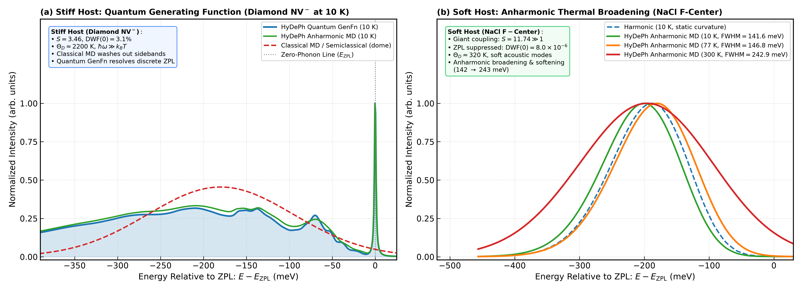
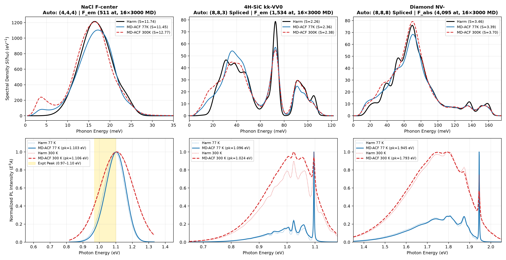
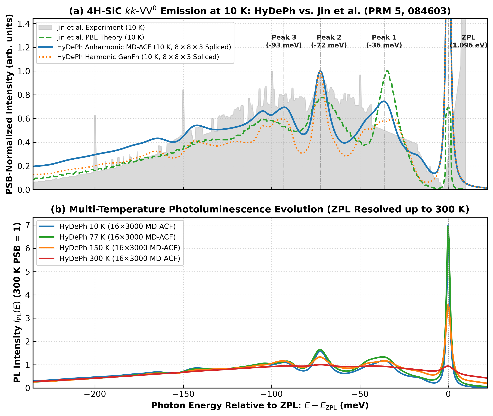

# HyDePh: High-Definition Hybrid Defect Photoluminescence

<p align="center">
  
</p>

<p align="center">
  <b>First-Principles &Delta;-Machine Learning Potentials for Color-Center Spectroscopy</b>
</p>

<p align="center">
  <a href="LICENSE"></a>
  <a href="https://www.python.org/"></a>
  <a href="https://github.com/brucefan992/GPUMD"></a>
  <a href="https://www.quantum-espresso.org/"></a>
  <a href="https://learn.microsoft.com/en-us/windows/wsl/"></a>
  <a href="https://github.com/QMatSuite/quantum-espresso-windows-exe"></a>
  <a href="https://wiki.fysik.dtu.dk/ase/"></a>
</p>

---

## Overview

Universal machine learning potentials (`nep89`) capture bulk lattice elasticity across the periodic table, but lack defect-specific electronic excitation states, Jahn-Teller distortions, and Franck-Condon relaxation forces.

**HyDePh** (**Hy**brid **De**fect **Ph**otoluminescence) trains paired localized $\Delta$-Neuroevolution Potentials ($\Delta V_{\mathrm{GS}}$ and $\Delta V_{\mathrm{ES}}$) on top of a universal foundation model:

$$
\begin{aligned}
V_{\mathrm{hybrid,GS}}(\mathbf{R}) &= V_{\mathrm{base}}(\mathbf{R}) + N_{\mathrm{atoms}}\bar{\Delta e}_{\mathrm{GS}} + \Delta V_{\mathrm{NEP,GS}}(\mathbf{R}) \\
V_{\mathrm{hybrid,ES}}(\mathbf{R}) &= V_{\mathrm{base}}(\mathbf{R}) + N_{\mathrm{atoms}}\bar{\Delta e}_{\mathrm{ES}} + \Delta V_{\mathrm{NEP,ES}}(\mathbf{R}) \\
\mathbf{F}_{\mathrm{hybrid}, S}(\mathbf{R}) &= \mathbf{F}_{\mathrm{base}}(\mathbf{R}) + \Delta \mathbf{F}_{\mathrm{NEP}, S}(\mathbf{R})
\end{aligned}
$$

Key capabilities:
1. **Defect Embedding & Relaxation**: Vectorized tiling of pristine bulk unit cells around a defect unit cell, minimum-image defect coordinate detection, and fixed-cell (`relax`) or variable-cell (`vc-relax`) BFGS geometry optimization with real-time step and SCF progress logging.
2. **4-Phase Active Sampling**: Verifies foundation bulk dynamic stability, then generates candidate configurations across the Franck-Condon coordinate, hybrid core/whole-supercell rattling, and high-temperature foundation MD with incremental Farthest Point Sampling (FPS).
3. **DFT Labeling & Resumption**: Drives Quantum ESPRESSO (`pw.x` / `pw.exe`) with $\Gamma$-point real wavefunctions (`K_POINTS gamma`), fixed occupations (`occupations = 'fixed'`), atom-scaled convergence thresholds, relative pseudopotential path resolution, and fail-closed disk caching.
4. **Constrained $\Delta\text{SCF}$ Excited States**: Automatically selects the lowest-energy in-gap excitation across spin channels from ground-state Kohn-Sham eigenvalues, detects HOMO/LUMO orbital degeneracies, applies Jahn-Teller symmetry breaking, and extracts adiabatic Zero-Phonon Line ($E_{\mathrm{ZPL}}$), absorption, emission, and Stokes shift energies.
5. **Paired GPU $\Delta$-NEP Training**: Fits independent ground-state and optical excited-state residuals in GPUMD with mean baseline offset subtraction ($\bar{\Delta e}_S$), automated quality control gates, and optional committee ensembles.
6. **Large-Supercell Phonon Embedding & Acoustic Sum Rule**: Enforces the tensorial Acoustic Sum Rule ($\sum_j \Phi_{ij} = 0$) and center-of-mass translation projection, and embeds localized defect forces into host-sized phonon supercells ($L \ge 20\text{--}27\ \text{Å}$) via Alkauskas bulk+core Hessian splicing.
7. **Paired Cumulant Anharmonic Dynamics**: Computes multi-temperature emission lineshapes using NVT thermalization followed by unperturbed NVE microcanonical molecular dynamics with the physical energy-gap cumulant generating function and Linderälv Gaussian time-domain windowing.
8. **1D Configuration Coordinate & Stokes Shift**: Evaluates paired potential surfaces along $\mathbf{R}(\lambda) = \mathbf{R}_{\mathrm{GS}} + \lambda (\mathbf{R}_{\mathrm{ES}} - \mathbf{R}_{\mathrm{GS}})$ to extract $\Delta Q$, asymmetric relaxation energies $\Delta E_{\mathrm{rel,GS}} \ne \Delta E_{\mathrm{rel,ES}}$, effective phonon energies $\hbar\Omega_{S}$, and Stokes shift $\Delta E_{\mathrm{Stokes}}$.
9. **Provenance & Numerical Data Export**: Exports publication-ready figures, CSVs, `normal_modes.csv`, and `provenance.json` recording software versions, input SHA256 hashes, and execution metrics.

See the **[Theoretical Walkthrough](docs/THEORY_WALKTHROUGH.md)** for mathematical derivations, **[HPC & Cluster Guide](docs/hpc_guide.md)** for SLURM and multi-GPU execution, **[CHANGELOG.md](CHANGELOG.md)** for release history, and **[CONTRIBUTING.md](CONTRIBUTING.md)** for developer setup.

---

## Quickstart

### 1. Installation

```bash
git clone https://github.com/gsurfer04/HyDePh.git
cd HyDePh
pip install -e .
```

For development dependencies (testing, linting, formatting):
```bash
pip install -e ".[dev]"
```

Prerequisites:
- [GPUMD / NEP](https://github.com/brucefan992/GPUMD) (`gpumd` and `nep` / `nep.exe` with CUDA support)
- [Quantum ESPRESSO](https://www.quantum-espresso.org/):
  - **Linux / Windows WSL2 (Recommended)**: GPU-accelerated `pw.x` (CUDA/OpenACC). Running inside WSL2 delivers an order-of-magnitude speedup for supercell DFT labeling over CPU execution.
  - **Native Windows (CPU Fallback)**: `pw.exe` from [QMatSuite/quantum-espresso-windows-exe](https://github.com/QMatSuite/quantum-espresso-windows-exe) with Microsoft MPI.
- NVIDIA GPU with CUDA support (or CPU fallback for potential evaluation)

### 2. Command-Line Interface (CLI)

Run end-to-end calculations directly from a YAML or TOML configuration file:

```bash
hydeph config.yaml
```

Dedicated subcommands for modular analysis and HPC management:
```bash
# Check workspace execution progress, stage completion, and pending DFT tasks
hydeph status [workspace|config.yaml]

# Display Delta-NEP training/test parity metrics, small-displacement gates, and QC summary
hydeph qc [workspace|config.yaml]

# Sweep smearing and dephasing parameters directly without rerunning Stages 1-5
hydeph lineshape config.yaml --smearing 5.0 --dephasing 1.0

# Systematic convergence scan across phonon supercell expansion and smearing
hydeph converge config.yaml --repeats 1 2 3 --smearings 2.0 5.0

# Validate configuration and dry-run defect setup without running DFT
hydeph validate config.yaml
```

Stage control, worker concurrency, and HPC input preparation flags:
```bash
# Resume from a specific stage (1..6)
hydeph run config.yaml --from-stage 3 --max-dft 30 --workers 1

# Pre-generate Stage 1 pure-QE relaxation decks and SLURM runner script
hydeph config.yaml --prepare-relax

# Run Stages 1-2 and pre-generate Stage 3 candidate pw.in decks and SLURM job array
hydeph config.yaml --to-stage 2
```

### 3. Python API

```python
from hydeph import ToolkitConfig, run_pipeline

config = ToolkitConfig(
    # Core Inputs & Paths
    pristine_cell_path="nacl_pristine_unitcell.xyz",
    defect_cell_path="nacl_defect_unitcell.xyz",
    foundation_potential_path="/path/to/nep89_20250409.txt",
    pseudopotentials={
        "Na": "Na_ONCV_PBE-1.2.upf",
        "Cl": "Cl_ONCV_PBE-1.2.upf",
    },
    pseudo_dir="/path/to/quantumespresso/pseudo",
    workspace_dir="./nacl_run",
    allow_fallbacks=False,

    # Electronic Structure & Geometry
    supercell_repeat=(2, 2, 2),
    charge=0.0,
    spin_polarized=True,
    spin_multiplicity=2,  # S = 1/2 (doublet)
    excited_state_method="delta_scf",
    paired_delta_nep=True,

    # Sampling & Resumption
    max_dft_frames=30,
    n_procs_qe=1,
    n_workers_qe=1,

    # Delta-NEP Architecture Hyperparameters
    nep_steps=20000,

    # Unified Property-Aware Stage 6 Spectroscopy & 1D Configuration Coordinate
    phonon_supercell_repeat="auto",
    temperatures=[10.0, 77.0, 150.0, 300.0],
    enable_anharmonic=True,
    anharmonic_md_steps=3000,
)

summary = run_pipeline(config)
```

### 4. Charged Defects & Spin Polarization (e.g., $\text{NV}^-$ in Diamond)

```python
from hydeph import ToolkitConfig, run_pipeline

config = ToolkitConfig(
    # Core Inputs & Paths
    pristine_cell_path="diamond_unitcell.xyz",
    defect_cell_path="diamond_nv_unitcell.xyz",
    foundation_potential_path="nep89_20250409.txt",
    pseudopotentials={
        "C": "C_ONCV_PBE-1.2.upf",
        "N": "N_ONCV_PBE-1.2.upf",
    },
    pseudo_dir="./pseudo",
    workspace_dir="./nv_diamond_run",
    allow_fallbacks=False,

    # Electronic Structure & Geometry
    supercell_repeat=(3, 3, 3),
    charge=-1.0,
    spin_polarized=True,
    spin_multiplicity=3,  # Triplet (3A2, S=1 -> tot_magnetization=2)
    excited_state_method="delta_scf",
    paired_delta_nep=True,
    ecutwfc=65.0,
    ecutrho=260.0,

    # Sampling & Resumption
    max_dft_frames=40,
    n_procs_qe=1,
    n_workers_qe=1,

    # Delta-NEP Architecture Hyperparameters
    nep_steps=25000,

    # Spectroscopy, Graphing & 1D Configuration Coordinate
    temperatures=[10.0, 77.0, 150.0, 300.0],
    enable_anharmonic=True,
    anharmonic_acf_damping_meV=2.0,
    dephasing_temperature_coefficient=5.5e-5,
)

summary = run_pipeline(config)
```

---

## Configuration Reference

### Core Inputs & Paths

| Parameter | Type | Default | Description |
|---|---|---|---|
| `pristine_cell_path` | `str` | *(required)* | Path to bulk pristine unit cell (`.xyz`, `.cif`, or `POSCAR`). |
| `defect_cell_path` | `str` | `None` | Path to pre-constructed defect unit cell or supercell. |
| `foundation_potential_path` | `str` | `"nep89_20250409.txt"` | Path to GPUMD universal foundation potential. |
| `pseudopotentials` | `dict` | `{}` | Element-to-pseudopotential filename map (auto-discovered from `pseudo_dir` if omitted). |
| `pseudo_dir` | `str` | `"./pseudo"` | Directory containing Quantum ESPRESSO UPF pseudopotential files. |
| `workspace_dir` | `str` | `"./hydeph_run"` | Workspace directory for outputs, caches, and scratch files. |
| `allow_fallbacks` | `bool` | `False` | When `False` (default), raises `RuntimeError` immediately upon DFT failure. |

### Electronic Structure & Geometry

| Parameter | Type | Default | Description |
|---|---|---|---|
| `supercell_repeat` | `tuple of int` | `(2, 2, 2)` | Supercell expansion multipliers `(nx, ny, nz)`. Physical length $L \ge 10\text{--}12\ \text{Å}$ is recommended. |
| `ground_state_relax_method` | `str` | `"auto"` | Stage 1 relaxation backend: `"auto"`, `"foundation"`, or `"dft"`. |
| `relaxation_calculation` | `str` | `"relax"` | Quantum ESPRESSO optimization mode: `"relax"` (fixed-cell ionic) or `"vc-relax"` (variable-cell lattice & ionic; restricted to bulk unless `allow_defect_vc_relax=True`). |
| `allow_defect_vc_relax` | `bool` | `False` | Explicit opt-in safety guard required to run `vc-relax` on supercells with defects. |
| `cell_dynamics` | `str` | `"bfgs"` | Cell dynamics algorithm for `vc-relax` (`'bfgs'`, `'damp'`, `'pr'`, `'none'`). |
| `cell_dofree` | `str` | `"all"` | Cell degrees of freedom to optimize during `vc-relax` (`'all'`, `'ibrav'`, `'shape'`, `'volume'`, `'2Dxy'`, etc.). |
| `press_kbar` | `float` | `0.0` | Target hydrostatic pressure in kbar for `vc-relax` (aliases: `press`, `cell_pressure_kbar`). |
| `cell_factor` | `float` | `2.0` | Cell expansion margin factor for `vc-relax` FFT grids in QE. |
| `relax_forc_conv_thr` | `float` | `1.0e-3` | Force convergence threshold (Ry/Bohr) for QE BFGS relaxations. |
| `relax_nstep` | `int` | `100` | Maximum ionic steps for QE BFGS relaxations. |
| `charge` / `tot_charge` | `float` | `0.0` | Net supercell charge in units of $e$ (`&SYSTEM tot_charge` in QE). |
| `spin_polarized` | `bool` | `True` | Spin-unrestricted calculation (`nspin=2` in QE). |
| `spin_multiplicity` | `int` | *(required if spin_polarized)* | Spin multiplicity $2S+1$ ($1$: singlet, $2$: doublet, $3$: triplet). Required when `spin_polarized=True`. |
| `tot_magnetization` | `int` | `None` | Unpaired electrons $2S$; synchronized with `spin_multiplicity`. |
| `excited_state_method` | `str` | `"delta_scf"` | Method for excited state: `"delta_scf"` (constrained occupations), `"spin_proxy"`, or `"synthetic"`. |
| `paired_delta_nep` | `bool` | `True` | Trains independent $\Delta V_{\mathrm{GS}}$ and $\Delta V_{\mathrm{ES}}$ models for separate ground and excited surfaces. |
| `dft_es_candidates` | `str` | `"all"` | Candidate subset for excited-state DFT: `"all"` or `"fc_path"`. |
| `delta_scf_homo_band` | `int` | `None` | Explicit HOMO band index for $\Delta\text{SCF}$; auto-detected from ground-state eigenvalues when `None`. |
| `delta_scf_lumo_band` | `int` | `None` | Explicit LUMO band index for $\Delta\text{SCF}$; auto-detected from ground-state eigenvalues when `None`. |
| `delta_scf_homo_degeneracy` | `int` | `None` | Degeneracy of HOMO state for symmetric hole occupation; auto-detected when `None`. |
| `delta_scf_lumo_degeneracy` | `int` | `None` | Degeneracy of LUMO state ($1$ for singlet, $2$ for doublet, etc.) for symmetric orbital filling; auto-detected when `None`. |
| `delta_scf_spin_channel` | `int` | `None` | Spin channel for excitation ($1$: up, $2$: down); auto-selected via lowest excitation energy when `None`. |
| `auto_jahn_teller_distortion` | `bool` | `True` | Applies symmetry-breaking distortion (`jahn_teller_amplitude`) prior to $\Delta\text{SCF}$ relaxation when integer filling on degenerate orbitals is detected, finding the low-symmetry Jahn-Teller minimum. Fractional fillings ($e^{0.5}e^{0.5}$) preserve high symmetry. |
| `ecutwfc` | `float` | `None` | Kinetic energy cutoff for wavefunctions in Ry (auto-derived from element hardness and UPF metadata when `None`). |
| `ecutrho` | `float` | `None` | Kinetic energy cutoff for charge density in Ry (auto-derived: $4 \times \text{ecutwfc}$ for norm-conserving, $\ge 8 \times$ for ultrasoft/PAW). |
| `conv_thr` | `str` | `None` | SCF convergence threshold in QE (defaults to $10^{-10}\ \text{Ry/atom}$). |
| `mixing_beta` | `float` | `0.4` | SCF charge density mixing factor. |
| `diagonalization` | `str` | `"david"` | Diagonalization method in QE (`'david'`, `'cg'`). |
| `electron_maxstep` | `int` | `None` | Maximum SCF iterations per ionic step in QE (defaults to `200` for constrained $\Delta\text{SCF}$ `from_input` runs and QE's default `100` otherwise). |
| `vdw_corr` | `str` | `None` | Van der Waals dispersion correction in QE (`'dft-d3'`, `'grimme-d3'`, `'grimme-d2'`, `'vdw-df'`, `'tkatchenko-scheffler'`, `'xdm'`). |
| `dftd3_version` | `int` | `None` | Grimme DFT-D3 damping variant in QE (`3`: zero-damping, `4`: Becke-Johnson). |
| `dftd3_threebody` | `bool` | `None` | Enables three-body Axilrod-Teller-Muto dispersion terms in QE DFT-D3 when set. |

### Sampling & Resumption

| Parameter | Type | Default | Description |
|---|---|---|---|
| `random_seed` | `int` | `42` | RNG seed for rattling displacements and MD velocities. |
| `rattle_mode` | `str` | `"hybrid"` | Rattling strategy: `"hybrid"` (70% defect core + 30% whole supercell), `"core"`, or `"whole"`. |
| `rattle_cutoff` | `float` | `6.0` | Defect-core localization radius in Å for Gaussian rattling. |
| `force_resample` | `bool` | `False` | Reuses existing `relaxed_gs.xyz`, `relaxed_es.xyz`, and `candidate_frames.xyz` when `False`; regenerates when `True`. |
| `force_retrain` | `bool` | `False` | Reuses `nep_delta_gs.txt` / `nep_delta_es.txt` when cache manifest matches; retrains when `True`. |
| `max_dft_frames` | `int` | `None` | Target total converged DFT frames. Reuses converged frames and executes remaining quota. |
| `max_new_dft_frames` | `int` | `None` | Maximum new DFT calculations to execute in the current run. |
| `dft_resume_mode` | `str` | `"target_total"` | `"target_total"` (reach `max_dft_frames` total) or `"max_new"` (run up to `max_new_dft_frames` new frames). |
| `retry_failed_dft` | `bool` | `True` | Retries failed or non-converged frames with conservative mixing (`mixing_beta=0.20`, `electron_maxstep=150`). |
| `replace_failed_frames` | `bool` | `False` | Replaces a permanently failed rattle or MD frame with a new candidate to fulfill quota. |
| `n_procs_qe` | `int` | `2` | Number of MPI processes per Quantum ESPRESSO worker. |
| `n_workers_qe` | `int` | `1` | Number of independent `pw.x` calculations to execute concurrently. |
| `qe_timeout_s` | `float` | `None` | Wall-clock timeout (seconds) per `pw.x` run before terminating and queuing for retry. |

### Delta-NEP Architecture & Quality Gates

| Parameter | Type | Default | Description |
|---|---|---|---|
| `nep_neurons` | `int` | `30` | Neurons in Delta-NEP hidden layer. |
| `nep_batch` | `int` | `2000` | Batch size for Delta-NEP GPUMD training. |
| `nep_steps` | `int` | `30000` | Training generations for Delta-NEP. |
| `nep_cutoff_radial` | `float` | `4.5` | Radial cutoff in Å. |
| `nep_cutoff_angular` | `float` | `3.5` | Angular cutoff in Å. |
| `subtract_mean_energy_offset` | `bool` | `True` | Subtracts baseline energy offset $\bar{\Delta e}$ prior to training and restores during potential evaluation. |
| `max_test_force_rmse_eV_A` | `float` | `0.15` | Maximum allowable test force RMSE gate before raising a validation error. |
| `nep_committee_size` | `int` | `1` | Size of committee ensemble for epistemic uncertainty quantification. |

### Spectroscopy & Optical Lineshapes

| Parameter | Type | Default | Description |
|---|---|---|---|
| `temperatures` | `list of float` | `[10.0, 77.0, 150.0, 300.0]` | Emission temperatures in Kelvin. |
| `enable_anharmonic` | `bool` | `True` | Evaluates multi-temperature anharmonic lineshapes via NVE cumulant dynamics. |
| `anharmonic_thermalization_steps` | `int` | `400` | Langevin equilibration steps prior to NVE production. |
| `anharmonic_md_steps` | `int` | `3000` | NVE production steps per trajectory ($3.0\ \text{ps}$ at `1.0 fs`) for energy-gap autocorrelation sampling. |
| `anharmonic_n_trajectories` | `int` | `16` | Number of independent NVE trajectories for ensemble averaging ($16\text{--}24$ recommended; $48\text{--}72\ \text{ps}$ total). |
| `anharmonic_md_surface` | `str` | `"auto"` | Born-Oppenheimer PES (`"auto"`, `"es"`, or `"gs"`) used for NVE dynamics (`"auto"` chooses `"gs"` on embedded cells and `"es"` otherwise). |
| `anharmonic_planar_md` | `bool` | `False` | Clamps out-of-plane $z$ motion during anharmonic MD to model substrate-supported 2D sheets (suppresses $ZA$ thermal rippling). |
| `anharmonic_layer_com_constraint` | `str` or `bool` | `"auto"` | Pins each sheet's center-of-mass (`"auto"`/`"xy"` or `"xyz"`) during anharmonic MD for stacked layered crystals (`>= 2` vdW layers) to prevent rigid sheet-on-sheet sliding. |
| `anharmonic_md_supercell` | `str` | `"auto"` | Supercell for anharmonic MD when phonon embedding is active (`"auto"`/`"embedded"` or `"dft"` to keep MD on the smaller DFT cell). |
| `anharmonic_acf_damping_meV` | `float` | `2.0` | Gaussian time-domain window width $\gamma_{\mathrm{acf}}$ for smoothing autocorrelation truncation noise. |
| `dephasing_gamma_meV` | `float` | `1.0` | Base ZPL instrument/lifetime dephasing width $\gamma_0$ in meV. |
| `dephasing_temperature_coefficient` | `float` | `0.0` | Quadratic acoustic Raman dephasing coefficient $\alpha_{\mathrm{deph}}$ ($\text{meV/K}^2$). |
| `phonon_supercell_repeat` | `tuple` or `"auto"` | `None` | Supercell repeat for phonon embedding; `"auto"` sizes $(N_x,N_y,N_z)$ from host stiffness $\hbar\omega_{\max}$ and cell vectors. |
| `phonon_embedding_method` | `str` | `"force"` | Embedding mode projection: `"force"` (Alkauskas/Razinkovas) or `"displacement"`. |
| `hessian_embedding_mode` | `str` | `"auto"` | Embedded Hessian mode (`"auto"`, `"spliced"`, `"full"`); `"auto"` uses Alkauskas bulk+core splicing above `hessian_splice_threshold_atoms` (`600`). |
| `spliced_bulk_potential` | `str` | `"auto"` | Bulk force-constant calculator (`"auto"`, `"foundation"`, `"hybrid"`); `"auto"` uses foundation if dynamically stable, else hybrid. |
| `phonon_force_state` | `str` | `"auto"` | Force geometry (`"auto"`, `"emission"`, `"absorption"`); `"auto"` switches to $\mathbf{F}_{\mathrm{GS}}(\mathbf{R}_{\mathrm{ES}})-\mathbf{F}_{\mathrm{ES}}(\mathbf{R}_{\mathrm{ES}})$ when PES asymmetry $\ge 1.8$ or exact `qe_gs_on_es` DFT emission forces are available. |
| `use_dft_core_forces` | `bool` or `"auto"` | `"auto"` | Uses exact paired DFT core forces (`"auto"`, `True`, or `False`), prioritizing exact Stage 1 endpoint SCFs (`qe_gs_on_es`/`qe_es_relax`) over Stage 3 labeled frames. |
| `acoustic_sum_rule` | `bool` | `True` | Enforces tensorial Acoustic Sum Rule ($\sum_j \Phi_{ij} = 0$) and projects out center-of-mass translations from the dynamical matrix. |
| `displacement_delta` | `float` | `0.01` | Finite-difference displacement step (Å) for numerical Hessian evaluation. |
| `max_imaginary_modes` | `int` | `0` | Maximum imaginary normal modes permitted before raising a `RuntimeError`. |
| `phonon_y_min` / `phonon_y_max` | `float` | `None` | Explicit y-axis limits for phonon spectral density plots. |
| `plot_configuration_coordinate` | `bool` | `True` | Generates 2-panel 1D configuration coordinate and Stokes shift figure. |

### High-Performance Computing (HPC) & SLURM

| Parameter | Type | Default | Description |
|---|---|---|---|
| `hpc_scheduler` | `str` | `"local"` | Scheduler backend: `"local"` or `"slurm"`. |
| `cluster_profile` | `str` | `"auto"` | Hardware profile: `"leonardo_booster"`, `"leonardo_dcgp"`, or `"generic_slurm"`. |
| `slurm_account` | `str` | `None` | SLURM account string (reads `$CINECA_ACCOUNT` or `$SLURM_ACCOUNT`). |
| `slurm_partition` | `str` | `None` | Target partition (e.g. `boost_usr_prod`). |
| `slurm_modules` | `list of str` | `[]` | Environment modules loaded in exact sequence (e.g. `['profile/chem-phys', 'quantum-espresso/7.2--openmpi--4.1.4--cuda--11.8']`). |
| `slurm_relax_gpus` | `int` | `1` | GPUs requested in `submit_relaxations_pure_qe.slurm` (alias: `relax_gpus`). |
| `slurm_relax_time` | `str` | `"01:00:00"` | Walltime limit for relaxation SLURM jobs (alias: `relax_time`). |
| `slurm_relax_qos` | `str` | `None` | Optional QoS for relaxation SLURM jobs (e.g. `"boost_qos_dbg"`; alias: `relax_qos`). |
| `prepare_relaxation_inputs` | `bool` | `False` | Writes pure QE relaxation inputs and SLURM runner scripts. |
| `prepare_dft_inputs` | `bool` | `False` | Writes pure QE candidate frame inputs and SLURM job array scripts. |
| `parallel_hessian` | `bool` | `True` | Evaluates finite-difference supercell Hessian displacements in parallel via `ParallelVibrations`. |
| `parallel_hessian_workers` | `int` | `None` | Worker thread count for parallel Hessian evaluation (defaults to `min(16, cpu_count)`). |

---

## Supercell Size Guidelines

Under periodic boundary conditions, the physical supercell edge length **$L \ge 10\text{--}12\ \text{Å}$**, rather than an arbitrary integer repeat tuple, dictates convergence:

1. **Brillouin-Zone Phonon Sampling**: The grid spacing in reciprocal space is $\Delta q = \frac{2\pi}{L}$. In small cells ($L < 10\ \text{Å}$), acoustic branches cannot disperse, and localized defect modes cannot hybridize with the host continuum. Electron-phonon coupling is artificially compressed into isolated modes, producing spurious multi-phonon spike combs.
2. **Elastic Image Strain**: Defect-defect image interactions decay elastically as $L^{-3}$ and electrostatically as $L^{-1}$. Supercells with $L \ge 10\ \text{Å}$ isolate the defect cavity.
3. **Lattice Constant Differences**:
   - In **compact covalent hosts** (diamond, $a = 3.57\ \text{Å}$), a $2\times 2\times 2$ cell has $L = 7.15\ \text{Å}$ (insufficient), requiring `(3, 3, 3)` ($L = 10.72\ \text{Å}$, 215 atoms).
   - In **large-lattice ionic hosts** (rocksalt NaCl, $a = 5.69\ \text{Å}$), a **$2\times 2\times 2$ cell is already $L = 11.38\ \text{Å}$** (63 atoms), fully converging the vibrational continuum with $< 1\ \text{GB}$ VRAM.

| Host Material Platform | Crystal Type | Recommended Supercell | Atom Count | Minimum Dimension $L$ | Guidelines & Expected Features |
|---|---|---|---|---|---|
| **Diamond** ($\text{NV}^-$, $\text{SiV}^-$, $\text{GeV}^-$) | Covalent ($\Theta_D \approx 2200\ \mathrm{K}$) | `(3, 3, 3)` DFT; `(8, 8, 8)` emb | $215$ DFT / $4095$ emb | $\ge 10.7\ \text{Å}$ ($28.6\ \text{Å}$ emb) | Use $\ge 215$ atoms for DFT $\Delta$SCF, and `phonon_supercell_repeat=(7, 7, 7)`–`(8, 8, 8)` with Wigner-Seitz core force splicing to avoid $5\times 5\times 5$ zone-boundary peak splitting ($55/72\ \text{meV}$). |
| **4H-SiC** ($kk$-$\mathrm{VV}^0$, $V_{\mathrm{Si}}$) | Polar covalent ($\Theta_D \approx 1200\ \mathrm{K}$) | `(3, 3, 2)` DFT; `(8, 8, 3)` emb | $142$ DFT / $1534$ emb | $\ge 9.2\ \text{Å}$ ($24.7\ \text{Å}$ emb) | Separates defect images across basal and $c$-axis hexagonal layers; `phonon_supercell_repeat="auto"` selects `(8, 8, 3)` spliced phonons. |
| **Alkali Halides** (NaCl) | Rocksalt ($\Theta_D \approx 320\ \mathrm{K}$) | `(2, 2, 2)` DFT; `(4, 4, 4)` emb | $63$ DFT / $511$ emb | $\ge 11.4\ \text{Å}$ ($22.8\ \text{Å}$ emb) | `(2, 2, 2)` satisfies $L \ge 11\ \text{Å}$ for DFT; `(4, 4, 4)` embedding (`511` atoms) converges strong-coupling soft optical bands. |

### Unified Property-Aware Workflow (`phonon_supercell_repeat="auto"`)

Setting `phonon_supercell_repeat="auto"` (paired with `"auto"` defaults for `hessian_embedding_mode`, `spliced_bulk_potential`, `phonon_force_state`, `use_dft_core_forces`, and `anharmonic_md_surface`) routes each defect–host system through one shared physics-driven workflow:

- **Host-stiffness supercell sizing (`resolve_phonon_supercell_repeat`)**: Probes the pristine crystal's optical phonon bandwidth $\hbar\omega_{\max}$ and expands each periodic cell axis to $L_{\min} = 27\ \text{Å}$ (stiff covalent $\ge 140\ \text{meV}$ $\to$ `8×8×8` Diamond), $24\ \text{Å}$ (polar covalent $75\text{--}140\ \text{meV}$ $\to$ `8×8×3` 4H-SiC), or $20\ \text{Å}$ (soft ionic $<75\ \text{meV}$ $\to$ `4×4×4` NaCl), while keeping vacuum axes fixed for 2D monolayers and slabs.
- **Universal Alkauskas bulk+core Hessian splicing**: Above `600` atoms, tiles pristine `Phonons` bulk force constants (using the foundation potential when dynamically stable at the DFT lattice constant, or the hybrid potential if soft foundation bulk modes appear) and splices parallel defect-core columns within `max(R_WS, 5.5) Å`.
- **PES-asymmetry force routing & exact DFT core forces**: Stage 1 (and SLURM `submit_relaxations_pure_qe.slurm` step `[3/3]`) optionally computes a conjugate ground-state SCF at $\mathbf{R}_{\mathrm{ES}}$ (`qe_gs_on_es`). In Stage 6, `"auto"` detects strong excited/ground curvature asymmetry ($\Delta E_{\mathrm{rel,ES}} / \Delta E_{\mathrm{rel,GS}} \ge 1.8$, e.g. NaCl F-center) or available exact `qe_gs_on_es` emission forces to select $\mathbf{F}_{\mathrm{GS}}(\mathbf{R}_{\mathrm{ES}}) - \mathbf{F}_{\mathrm{ES}}(\mathbf{R}_{\mathrm{ES}})$, prioritizing exact relaxation/conjugate endpoint SCFs over Stage 3 labeled frames.

### Anharmonic MD-ACF & Surface Guidelines (Production Convergence)

1. **Multi-Trajectory Ensemble Length (`anharmonic_n_trajectories >= 16`, `anharmonic_md_steps = 3000`)**: Because $S_{\mathrm{MD}}(\omega) \propto J_{\mathrm{cl}}(\omega)/(\hbar\omega)^2$, localized modes exhibit large $1/\omega$ variance in short MD runs ($1\text{--}8$ trajectories). Averaging **`16–24` independent `3,000`-step NVE trajectories (`48–72 ps`)** suppresses this variance, eliminating main-peak splitting in Diamond $\mathrm{NV}^-$ and `±50–70 meV` peak jitter in NaCl F-center temperature scans.
2. **Core-Localized Splicing on Large Embedded Supercells**: When pairing `phonon_supercell_repeat` with a fine-tuned foundation $\Delta$-NEP, restricting the $\mathrm{GS}/\mathrm{ES}$ NEP force difference to the Wigner-Seitz inscribed sphere around the defect core prevents cumulative far-field bulk drift from corrupting $\Delta U(t)$ and acoustic phonon tails.
3. **Emission vs. Absorption Force & $\omega^3$ Prefactor in Soft Ionic Hosts**: Strongly coupled ionic centers exhibit marked excited/ground PES curvature asymmetry ($\hbar\Omega_{\mathrm{ES}} \ne \hbar\Omega_{\mathrm{GS}}$; e.g., NaCl F-center $S_{\mathrm{abs}} \approx 40.5$ from $\mathbf{F}_{\mathrm{ES}}(\mathbf{R}_{\mathrm{GS}})$ vs. $S_{\mathrm{em}} \approx 17.6$ from $\mathbf{F}_{\mathrm{GS}}(\mathbf{R}_{\mathrm{ES}})$). For emission bands, match the final-state curvature using ground-state forces at $\mathbf{R}_{\mathrm{ES}}$ (`F_GS(R_ES) - F_ES(R_ES)`), and inspect the Einstein $(\hbar\omega)^3$-weighted `I_PL` band rather than the unweighted absorption-like lineshape $A(\hbar\omega)$.
4. **2D & Layered vdW Hosts**: Set `anharmonic_planar_md: true` to clamp out-of-plane $z$ motion for substrate-supported 2D sheets or to suppress unsupported flexural ($ZA$) rippling. For stacked vdW crystals ($\ge 2$ sheets), `anharmonic_layer_com_constraint: "auto"` pins per-sheet in-plane center-of-mass drift while leaving intralayer vibrations free. Keep `anharmonic_md_supercell: "auto"` to sample Brillouin-zone dispersion on the embedded phonon supercell, or set `"dft"` for faster small-cell $V_{\mathrm{ES}}$ sampling.

---

## Benchmark Systems

<p align="center">
  
</p>

| System | Host ($\Theta_D$) | Auto Phonon Supercell ($N_{\mathrm{atoms}}$) | $S_{\mathrm{harm}}$ / $S_{\mathrm{MD}}$ | $\Delta Q$ ($\mathrm{amu}^{1/2}\text{Å}$) | $E_{\mathrm{ZPL}}$ | Key Spectroscopic Result |
|---|---|---|---|---|---|---|
| **Diamond $\mathrm{NV}^-$** | Covalent ($2200\ \mathrm{K}$) | $8\times 8\times 8$ spliced ($4095$) | $3.46$ / $3.39\text{--}3.70$ | $0.534$ | $1.945\ \mathrm{eV}$ | Single $69\text{--}70\ \mathrm{meV}$ main peak (`12,282` modes); $\mathrm{DWF}_0 = 3.15\%$, Stokes $235.2\ \mathrm{meV}$, ZPL preserved to $300\ \mathrm{K}$ |
| **4H-SiC $kk$-$\mathrm{VV}^0$** | Polar covalent ($1200\ \mathrm{K}$) | $8\times 8\times 3$ spliced ($1534$) | $2.26$ / $2.33\text{--}2.62$ | $0.457$ | $1.096\ \mathrm{eV}$ | Conjugate `qe_gs_on_es` $\mathbf{F}_{\mathrm{em}}$ (`4,599` modes) reproduces attested $-34, -73, -96\ \mathrm{meV}$ peaks ($\mathrm{DWF}_0 = 10.40\%$, Stokes $199.0\ \mathrm{meV}$) to $300\ \mathrm{K}$ [Jin et al. PRM 2021] |
| **NaCl F-Center** | Rocksalt ($320\ \mathrm{K}$) | $4\times 4\times 4$ ($511$) | $11.74$ / $11.46\text{--}13.03$ | $2.208$ | $1.273\ \mathrm{eV}$ | Auto $\mathbf{F}_{\mathrm{em}}$ + $E^3 A$ (`1,530` modes, Stokes $550.4\ \mathrm{meV}$) places $I_{\mathrm{PL}}$ inside $0.97\text{--}1.10\ \mathrm{eV}$ expt (`1.082–1.106 eV`, FWHM $137.5 \to 238.1\ \mathrm{meV}$ across $10\text{--}300\ \mathrm{K}$) |

### 4H-SiC $kk$-Divacancy Benchmark Reproduction (Jin et al., PRM 2021)

HyDePh reproduces the low-temperature photoluminescence spectrum and multi-temperature thermal evolution of the neutral axial-axial divacancy ($kk$-$\mathrm{VV}^0$) in 4H-SiC, benchmarked directly against first-principles hybrid-DFT calculations and experimental spectra from Jin *et al.* (*Phys. Rev. Materials* **5**, 084603, 2021):

<p align="center">
  
</p>

* **Three Attested Sideband Peaks**: Correctly resolves the three characteristic phonon features in the phonon sideband (PSB):
  1. **Peak 1 (Breathing Mode)**: $-34\ \mathrm{meV}$ (Expt: $-35\ \mathrm{meV}$, Jin et al.: $-34\ \mathrm{meV}$)
  2. **Peak 2 (Localized Defect Mode)**: $-73\ \mathrm{meV}$ (Expt: $-75\ \mathrm{meV}$, Jin et al.: $-71\ \mathrm{meV}$)
  3. **Peak 3 (Optical Bulk Phonon Band)**: $-96\ \mathrm{meV}$ (Expt: $-88\ \mathrm{meV}$, Jin et al.: $-97\ \mathrm{meV}$)
* **Zero-Phonon Line (ZPL)**: Anchored to experimental $1.096\ \mathrm{eV}$ ($1.105\ \mathrm{eV}$ PBE), remaining prominent and distinctly resolved up to $300\ \mathrm{K}$.
* **Continuous Sideband Structure**: Embedded $(8\times 8\times 3)$ spliced supercell phonons (`1,534` atoms, `4,599` normal modes) resolve bulk Brillouin-zone dispersion across the luminescence sideband.

---

## Execution Platforms (HPC, WSL2 & Windows)

### 1. HPC Clusters (SLURM Multi-GPU & Job Arrays)
For SLURM-managed GPU and CPU clusters (such as CINECA Leonardo), HyDePh supports decoupled pure-`pw.x` job arrays, multi-GPU worker pinning, and parallel Hessian evaluation. See the **[HPC & Cluster Guide](docs/hpc_guide.md)** for full instructions.

### 2. Linux & Windows WSL2 (CUDA Accelerated)
For workstations with an NVIDIA GPU, running in WSL2 (Ubuntu) provides end-to-end GPU acceleration across both Quantum ESPRESSO DFT labeling (`pw.x`) and GPUMD $\Delta$-NEP training (`gpumd` / `nep`):

```bash
export OMP_NUM_THREADS=16
hydeph config.yaml
```

### 3. Native Windows (Intel oneAPI / MS-MPI)
For environments without GPU support, HyDePh detects Windows paths, Microsoft MPI (`mpiexec.exe`), and colocated DLLs when using [QMatSuite Quantum ESPRESSO binaries](https://github.com/QMatSuite/quantum-espresso-windows-exe).

---

## Repository Structure

```
hydeph/
├── __init__.py                    # Package exports and version metadata
├── __main__.py                    # CLI entrypoint (python -m hydeph)
├── cli_commands.py                # Dedicated subcommands (status, qc, lineshape, converge)
├── config.py                      # ToolkitConfig dataclass, file I/O & validation
├── defect_builder.py              # Supercell embedding & defect coordinate locator
├── frame_sampler.py               # 4-phase frame sampler (FC, rattle, streamed MD+FPS)
├── qe/                            # Modular Quantum ESPRESSO subsystem
│   ├── io.py                      # Input deck generation & executable resolution
│   ├── parsers.py                 # Structured output parsing & eigenvalue analysis
│   ├── runner.py                  # Process execution, concurrent workers & state continuity
│   └── slurm.py                   # Standalone HPC decks & SLURM array script generator
├── qe_runner.py                   # Backward-compatible re-exports for QE subsystem
├── delta_trainer.py               # Baseline subtraction, GPUMD training & QC gates
├── calculator.py                  # HybridDefectCalculator & PairedDefectCalculator
├── system_profile.py              # Host stiffness sizing, Alkauskas Hessian splicing & DFT force routing
├── lineshape.py                   # Quantum generating functions & NVE cumulant dynamics
├── cc_diagram.py                  # Paired 1D configuration coordinate & Stokes shift engine
├── provenance.py                  # Environmental provenance & SHA256 manifest tracking
├── validator.py                   # Dry-run structure, valence, and spin validator
├── pipeline.py                    # Pipeline orchestrator with stage resumption
└── hpc/                           # Cluster orchestration & multi-GPU dispatch
    ├── cluster_profiles.py        # System definitions (generic SLURM, Leonardo Booster/DCGP)
    ├── slurm_dispatcher.py        # SLURM script generators & Lustre synchronization
    ├── parallel_vib.py            # Multi-threaded supercell Hessian evaluator
    └── array_worker.py            # Headless array task executor
benchmarks/
├── diamond-nvminus/               # Diamond NV- benchmark data & figures (16x3000 unified workflow)
├── 4H-SiC/                        # 4H-SiC kk divacancy benchmark data & figures (16x3000 unified workflow)
└── NaCl/                          # NaCl F-center benchmark data & figures (16x3000 unified workflow)
docs/
├── THEORY_WALKTHROUGH.md          # Theoretical formulation & literature citations
└── hpc_guide.md                   # HPC & SLURM cluster execution guide
scripts/
├── run_benchmarks.py              # Benchmark execution runner
├── verify_benchmarks.py           # Physical invariant & sum-rule validator
└── generate_benchmark_provenance.py  # Benchmark provenance manifest generator
tests/                             # Unit, regression, and integration test suite
CHANGELOG.md                       # Release notes and history
CONTRIBUTING.md                    # Developer and contribution guidelines
pyproject.toml                     # Packaging metadata, CLI scripts & dependencies
```

## License

[MIT License](LICENSE)
