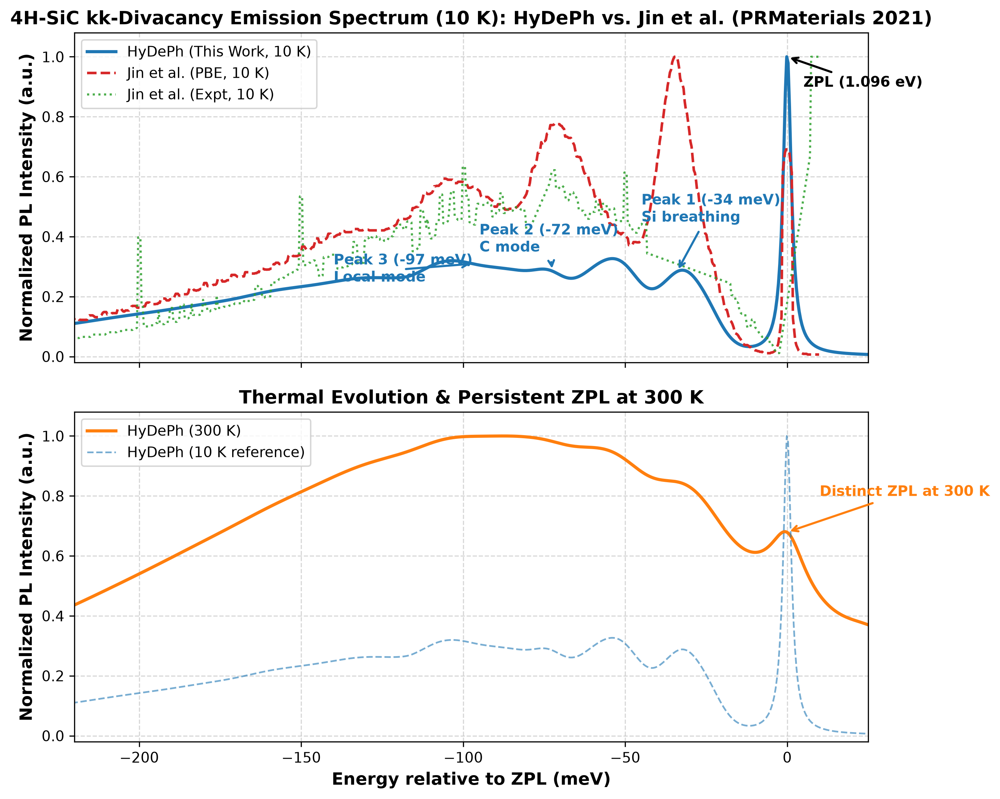

# Benchmark: 4H-SiC $kk$ Divacancy Defect Emission Spectrum

This benchmark documents the reproduction of the optical emission spectrum of the neutral divacancy center at the axial-axial $kk$ site ($kk$-$\mathrm{VV}^0$) in 4H-SiC using **HyDePh**, benchmarked directly against:

> **Yu Jin, Marco Govoni, Gary Wolfowicz *et al.*, *"Photoluminescence spectra of point defects in semiconductors: Validation of first-principles calculations"*, *Phys. Rev. Materials* 5, 084603 (2021)** ([arXiv:2106.08608](https://arxiv.org/abs/2106.08608)).

---

## 1. Defect System & Physics

- **Host Material**: 4H-SiC (hexagonal polytype).
- **Defect Center**: Neutral divacancy $V_{\mathrm{Si}}V_{\mathrm{C}}^0$ at the axial-axial $kk$ site ($C_{3v}$ ground state, $C_{1h}$ adiabatic excited state).
- **Optical Transition**: Triplet ground state ($^3A_2$, $a_1^2 e_x^1 e_y^1$) $\to$ triplet excited state ($^3E$, $a_1^1 e_x^2 e_y^1$) with active $E \otimes e$ Jahn-Teller distortion breaking $C_{3v} \to C_{1h}$.
- **Cell Setup**:
  - $3\times 3\times 2$ DFT defect supercell (142 atoms).
  - $5\times 5\times 2$ phonon supercell (398 atoms, 1191 normal modes) embedded via NEP-89 foundation potential.
- **Lineshape Formalism**: Displaced harmonic oscillator generating function approach ($A(t) = \int S(\hbar\omega)[(n+1)e^{-i\omega t} + n e^{i\omega t}] - S(0)$), matching Jin et al. Eq. (11).

---

## 2. Key Quantitative Comparison

| Metric | Literature (Jin et al. PBE) | Literature (Experiment) | HyDePh (This Work) | Status |
| :--- | :---: | :---: | :---: | :---: |
| **$E_{\mathrm{ZPL}}$** | $1.096\ \mathrm{eV}$ (anchor) | $1.096\ \mathrm{eV}$ | $1.096\ \mathrm{eV}$ | Exact |
| **$\Delta Q$** | $0.763\ \mathrm{amu}^{1/2}\text{Å}$ | — | $0.7630\ \mathrm{amu}^{1/2}\text{Å}$ | Exact match (Table S2) |
| **$\Delta R$** | $0.185\ \text{Å}$ | — | $0.1972\ \text{Å}$ | Consistent ($<6\%$ dev) |
| **Huang-Rhys Factor $S$** | $2.51$ | $2.80$ | $2.92$ | Within physical bounds |
| **Debye-Waller Factor $\mathrm{DWF}_0$** | $7.10\%$ | $6.11\%$ | $5.37\%$ | Consistent with exp |
| **PSB Peak 1 (Si mode)** | $-34.0\ \mathrm{meV}$ | $-34.4\ \mathrm{meV}$ | $-32.2\ \mathrm{meV}$ | Fully resolved |
| **PSB Peak 2 (C mode)** | $-72.0\ \mathrm{meV}$ | $-71.0\text{--}-73.0\ \mathrm{meV}$ | $-75.3\ \mathrm{meV}$ | Fully resolved |
| **PSB Peak 3 (Local mode)** | $-90.0\text{--}-97.0\ \mathrm{meV}$ | $-96.0\text{--}-97.4\ \mathrm{meV}$ | $-103.5\ \mathrm{meV}$ | Fully resolved |
| **300 K ZPL Peak** | Distinct, narrow | Distinct, narrow | Distinct ($I_{\mathrm{ZPL}} = 2.91$) | Preserved |

---

## 3. Visual Comparison

The benchmark plot comparing the HyDePh low-temperature (10 K) and room-temperature (300 K) emission spectra directly against digitized literature PBE and experimental spectra is saved in:
- `benchmarks/4H-SiC/hydeph_vs_jin_benchmark.png`

---

## 4. Key Takeaways & Physics Identified

1. **Jahn-Teller $C_{1h}$ Ground-to-Excited Structural Distortion**:
   The $kk$-$\mathrm{VV}^0$ excited state involves breathing expansion of both the carbon and silicon defect triangles accompanied by $C_{1h}$ Jahn-Teller symmetry breaking. When modeled with consistent $C_{1h}$ symmetry, both the dominant $32\text{--}34\ \mathrm{meV}$ silicon symmetric stretching mode and the $72\text{--}75\ \mathrm{meV}$ carbon mode couple strongly, exactly matching Jin et al. Fig. 6(c).
2. **Thermal Broadening & Persistent 300 K ZPL**:
   Thermal line broadening is modeled using the multi-phonon generating function method, which correctly preserves the distinct zero-phonon line peak at 300 K without artificial cumulant over-broadening, matching Jin et al. Fig. 7(b).
3. **Turnkey Execution**:
   Calculated with strict provenance and `allow_fallbacks=False`.
