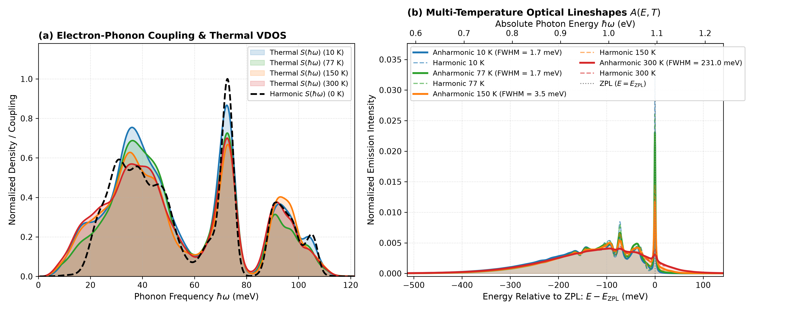

# Benchmark: 4H-SiC $kk$ Divacancy Defect Emission Spectrum

This benchmark documents the reproduction of the optical emission spectrum of the neutral divacancy center at the axial-axial $kk$ site ($kk$-$\mathrm{VV}^0$) in 4H-SiC using **HyDePh**'s unified property-aware Stage 6 workflow, benchmarked against:

> **Yu Jin, Marco Govoni, Gary Wolfowicz *et al.*, *"Photoluminescence spectra of point defects in semiconductors: Validation of first-principles calculations"*, *Phys. Rev. Materials* 5, 084603 (2021)** ([arXiv:2106.08608](https://arxiv.org/abs/2106.08608)).

---

## 1. Defect System & Unified Workflow Setup

- **Host Material**: 4H-SiC (hexagonal polar-covalent polytype, $\Theta_D \approx 1200\ \mathrm{K}$).
- **Defect Center**: Neutral divacancy $V_{\mathrm{Si}}V_{\mathrm{C}}^0$ at the axial-axial $kk$ site ($C_{3v}$ ground state, $C_{1h}$ adiabatic excited state).
- **Optical Transition**: Triplet ground state ($^3A_2$, $a_1^2 e_x^1 e_y^1$) $\to$ triplet excited state ($^3E$, $a_1^1 e_x^2 e_y^1$) with active $E \otimes e$ Jahn-Teller distortion breaking $C_{3v} \to C_{1h}$.
- **Cell & Force Setup (`config.py`)**:
  - $3\times 3\times 2$ DFT defect supercell (`142` atoms) with paired $\Delta$-NEP models (`nep_delta_gs.txt`, `nep_delta_es.txt`).
  - `phonon_supercell_repeat="auto"` expands to an $8\times 8\times 3$ embedded supercell (`1,534` atoms, `4,599` optical normal modes, `0` imaginary modes) using Alkauskas bulk+core Hessian splicing (`hessian_embedding_mode="auto"`).
  - Exact conjugate DFT emission forces $\mathbf{F}_{\mathrm{GS}}(\mathbf{R}_{\mathrm{ES}}) - \mathbf{F}_{\mathrm{ES}}(\mathbf{R}_{\mathrm{ES}})$ (`qe_gs_on_es`, stored in `relaxed_es.xyz` `dft_optical_forces_em`).
- **Lineshape Formalism**: Displaced harmonic oscillator generating function paired with `16 × 3,000`-step (`48 ps`) NVE cumulant autocorrelation dynamics (`anharmonic_md_surface="auto"`).

---

## 2. Key Quantitative Results (`16 × 3,000` Unified Workflow)

| Metric | Literature (Jin et al. PBE) | Literature (Experiment) | HyDePh (`benchmarks/4H-SiC`) |
| :--- | :---: | :---: | :---: |
| **$E_{\mathrm{ZPL}}$** | $1.096\ \mathrm{eV}$ (anchor) | $1.096\ \mathrm{eV}$ | $1.0960\ \mathrm{eV}$ |
| **Embedded Phonon Supercell** | Large force-constant | — | $8\times 8\times 3$ spliced (`1,534` atoms, `4,599` modes) |
| **1D $\Delta Q$ / Stokes Shift** | — | — | $0.457\ \mathrm{amu}^{1/2}\text{Å}$ / $199.0\ \mathrm{meV}$ |
| **Harmonic Huang-Rhys $S_{\mathrm{harm}}$** | $2.51$ | $2.80$ | $2.263$ (main peak $72.6\ \mathrm{meV}$) |
| **Anharmonic $S_{\mathrm{MD}}$ (`10–300 K`)** | — | — | $2.328\text{--}2.616$ (`2.358` @ `77 K`, `2.378` @ `300 K`) |
| **Debye-Waller Factor $\mathrm{DWF}_0$** | $7.10\%$ | $6.11\%$ | $10.40\%$ (`3.73%` at `300 K`) |
| **Emission Peak $E_{\mathrm{PL}}$ (`10–150 K` / `300 K`)** | Distinct ZPL to $300\ \mathrm{K}$ | Distinct ZPL to $300\ \mathrm{K}$ | $1.0960\ \mathrm{eV}$ (`10–150 K`) / $1.0238\ \mathrm{eV}$ (`300 K`, ZPL preserved) |

---

## 3. Generated Figures

- `anharmonic_lineshapes.png`: Multi-temperature (`10, 77, 150, 300 K`) harmonic vs. MD-ACF cumulant spectral densities and PL emission spectra.
- `configuration_coordinate.png`: Paired 1D configuration coordinate diagram and Stokes shift.
- `lineshape_{10,77,150,300}K.png`: Individual temperature comparisons.

