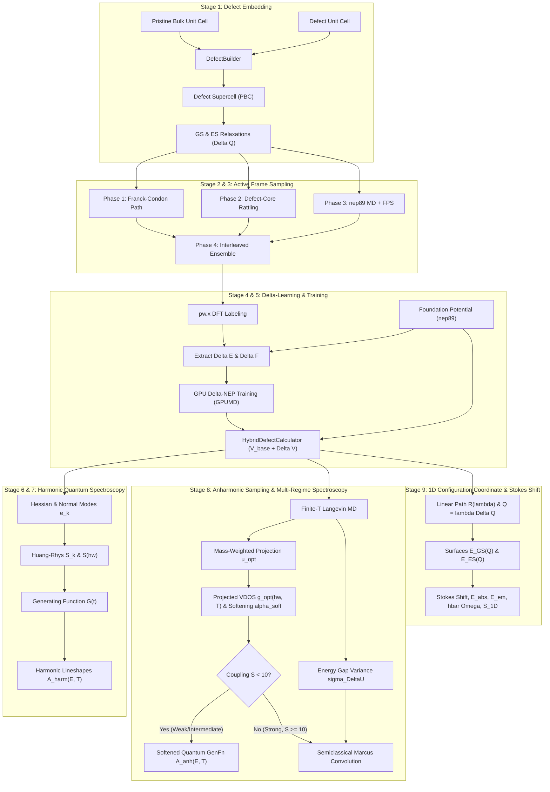

# HyDePh Theoretical Walkthrough

**HyDePh** (**Hy**brid **De**fect **Ph**otoluminescence) combines a $\Delta$-machine learning potential ($\Delta$-NEP) with quantum generating functions and finite-temperature molecular dynamics to compute optical spectra of point defects in solids.

---

## 1. The Multi-Scale Defect Spectroscopy Problem

Point defects in crystalline solids (color centers) are leading platforms for quantum repeaters, single-photon sources, and nanoscale sensors [1–4]. Identifying and characterizing these centers relies on photoluminescence (PL) spectroscopy, which probes electronic transitions coupled to host lattice vibrations [5, 6].

First-principles modeling of color-center PL faces four competing demands:
1. **Electronic localization**: Deep defect states involve localized correlations, charge reorganization, and Jahn-Teller distortions that require density functional theory (DFT) or constrained $\Delta$SCF [5–8].
2. **Long-range elastic strain**: Defects couple to acoustic and optical phonons across thousands of atoms. Converging periodic image strain requires supercells ($>10^3$ atoms) that are expensive for direct DFT [5, 6, 9].
3. **Finite-temperature anharmonicity**: In soft lattices (e.g., alkali halides, perovskites), optical relaxation drives large displacements into cubic and quartic repulsive walls ($V \sim k_3 Q^3 + k_4 Q^4$), breaking harmonic approximations and requiring picosecond molecular dynamics (MD) [10–13].
4. **Foundation model gaps**: Universal machine-learned potentials (`nep89`) capture bulk elasticity and phonons across the periodic table, but lack defect-specific excited-state forces and Franck-Condon relaxation paths [14, 15].

HyDePh bridges these scales by training a localized $\Delta$-NEP correction on top of a universal foundation potential, then evaluating lineshapes through normal-mode generating functions and anharmonic Langevin dynamics.

---

## 2. Pipeline Architecture

---

## 3. Stage-by-Stage Formulation

### Stage 1: Defect Embedding & Supercell Mechanics

Under periodic boundary conditions (PBC), a point defect interacts with its periodic images via elastic strain fields decaying as $L^{-3}$ [5, 9]:

$$
E_{\mathrm{elastic}}(L) = E_{\mathrm{dilute}} + \frac{\alpha_{\mathrm{el}}}{L^3} + \mathcal{O}(L^{-5})
$$

where $L$ is the supercell dimension and $\alpha_{\mathrm{el}}$ is the elastic dipole parameter. In addition to elastic ($L^{-3}$) and electrostatic ($L^{-1}$) image interactions, supercell size directly dictates the resolution of the vibrational spectrum. A supercell of linear dimension $L$ samples the phonon Brillouin zone on a discrete grid of spacing $\Delta q = \frac{2\pi}{L}$. When $L < 10\ \text{Å}$ (such as in a 64-atom diamond cell), the absence of long-wavelength acoustic modes prevents the localized defect breathing mode from hybridizing with the host lattice continuum. This artificially concentrates electron-phonon coupling into an isolated discrete mode and produces an unphysical comb of Poissonian multi-phonon spikes [5]. Converging sideband spectra to the continuous dilute limit requires supercells with physical dimension $L \ge 10\text{--}12\ \text{Å}$ [5, 6, 9]. Depending on the lattice constant of the host crystal, this corresponds to $2\times 2\times 2$ for large-lattice systems ($a > 5.5\ \text{Å}$, e.g. rocksalt halides $\ge 63$ atoms, $L \approx 11.4\ \text{Å}$) or $3\times 3\times 3$ for compact covalent crystals ($a \approx 3.5\text{--}4.5\ \text{Å}$, e.g. diamond $\ge 215$ atoms, $L \approx 10.7\ \text{Å}$).

[`DefectBuilder`](../hydeph/defect_builder.py) tiles an $N_1 \times N_2 \times N_3$ array of pristine bulk unit cells around a central defect unit cell, locates the defect site, and relaxes the Ground State ($\mathbf{R}_{\mathrm{GS}}$) and Excited State ($\mathbf{R}_{\mathrm{ES}}$) geometries. These define the Franck-Condon displacement vector and total mass-weighted displacement [5]:

$$
\Delta \mathbf{R} = \mathbf{R}_{\mathrm{ES}} - \mathbf{R}_{\mathrm{GS}}, \qquad \Delta Q = \sqrt{\sum_{i=1}^N M_i \vert \Delta \mathbf{R}_i \vert^2}
$$

where $M_i$ is the mass of atom $i$.

---

### Stage 2: Hybrid $\Delta$-Learning Potential

[`HybridDefectCalculator`](../hydeph/calculator.py) decomposes total energy and forces into a universal baseline (`nep89` [14, 15]) and a defect-specific neural correction [16, 17]:

$$
\begin{aligned}
V_{\mathrm{hybrid}}(\mathbf{R}) &= V_{\mathrm{base}}(\mathbf{R}) + \Delta V_{\mathrm{NEP}}(\mathbf{R}) \\
\mathbf{F}_{\mathrm{hybrid}}(\mathbf{R}) &= \mathbf{F}_{\mathrm{base}}(\mathbf{R}) + \Delta \mathbf{F}_{\mathrm{NEP}}(\mathbf{R})
\end{aligned}
$$

The $\Delta$-model is trained on the residuals between DFT and the foundation baseline:

$$
\Delta V_{\mathrm{target}}(\mathbf{R}_k) = E_{\mathrm{DFT}}(\mathbf{R}_k) - V_{\mathrm{base}}(\mathbf{R}_k), \qquad \Delta \mathbf{F}_{\mathrm{target}}(\mathbf{R}_k) = \mathbf{F}_{\mathrm{DFT}}(\mathbf{R}_k) - \mathbf{F}_{\mathrm{base}}(\mathbf{R}_k)
$$

Because $V_{\mathrm{base}}$ already captures bulk acoustic phonons and short-range repulsion, learning the smooth residual $\Delta V$ converges with $10\text{--}100\times$ fewer DFT frames than training from scratch [16, 17, 21].

---

### Stage 3: Four-Phase Active Frame Sampling

[`FrameSampler`](../hydeph/frame_sampler.py) builds a compact training set across four physical regimes:

1. **Franck-Condon Coordinate Scan**: Linear interpolation along the optical relaxation path [18]:

$$
\mathbf{R}(\lambda) = \mathbf{R}_{\mathrm{GS}} + \lambda \Delta \mathbf{R}, \quad \lambda \in [-0.2, 1.2]
$$

2. **Defect-Core Rattling**: Gaussian displacements applied within $r_{\mathrm{core}} < 6.0\ \text{Å}$ of the defect site to sample local harmonic and anharmonic force constants ($k_2, k_3, k_4$) [19]:

$$
\mathbf{R}_i' = \mathbf{R}_i + \boldsymbol{\eta}_i, \quad \boldsymbol{\eta}_i \sim \mathcal{N}(0, \sigma_r^2), \quad \sigma_r \in [0.08, 0.14]\ \text{Å}
$$

3. **Foundation MD + Farthest Point Sampling (FPS)**: An NVT trajectory ($T = 500\ \text{K}$) driven by `nep89`, subsampled via FPS in descriptor space $\mathbf{q}_i$ to maximize phase-space coverage [20]:

$$
d(i, j) = \Vert \mathbf{q}_i - \mathbf{q}_j \Vert_2
$$

4. **Interleaved Priority Queue**: Balances frames across Phases 1–3 so tight DFT budgets cover all three manifolds.

---

### Stage 4: First-Principles DFT Labeling

For each sampled frame $\mathbf{R}_k$, [`QERunner`](../hydeph/qe_runner.py) runs Quantum ESPRESSO (`pw.x`) [22] to obtain Kohn-Sham energies and Hellmann-Feynman forces:

$$
\mathbf{F}_{i, \mathrm{DFT}} = -\nabla_i E_{\mathrm{DFT}} = -\langle \Psi \vert \nabla_i \hat{H} \vert \Psi \rangle
$$

Excited-state geometries and manifolds are modeled via constrained orbital occupations ($\Delta$SCF), which reproduce experimental Stokes shifts and TD-DFT lineshapes for deep defects at ground-state DFT cost [6, 8, 23].

---

### Stage 5: GPU $\Delta$-NEP Training

[`DeltaTrainer`](../hydeph/delta_trainer.py) fits the $\Delta$-NEP model in GPUMD [14, 15]. Atomic environments within cutoff $r_c$ are encoded into Chebyshev radial ($q_n^i$) and Legendre angular ($q_{nl}^i$) descriptors:

$$
q_n^i = \sum_{j \ne i} g_n(r_{ij}), \qquad q_{nl}^i = \sum_{j, k \ne i} g_n(r_{ij}) g_n(r_{ik}) P_l(\cos \theta_{ijk})
$$

A single-hidden-layer neural network predicts site energy residuals $\Delta E_i(\mathbf{q}^i)$:

$$
\Delta E_{\mathrm{NEP}} = \sum_{i=1}^N \Delta E_i(\mathbf{q}^i), \qquad \Delta \mathbf{F}_{i, \mathrm{NEP}} = -\sum_{j} \frac{\partial \Delta E_j}{\partial \mathbf{R}_i}
$$

Weights $\mathbf{w}$ are optimized via Separable Natural Evolution Strategies (SNES) [14] by minimizing:

$$
\mathcal{L}(\mathbf{w}) = \frac{\lambda_e}{N_{\mathrm{frames}}} \sum_{k} \vert \Delta E_{\mathrm{NEP}}^{(k)} - \Delta E_{\mathrm{DFT}}^{(k)} \vert^2 + \frac{\lambda_f}{3N_{\mathrm{atoms}}} \sum_{i} \vert \Delta \mathbf{F}_{\mathrm{NEP}}^{(i)} - \Delta \mathbf{F}_{\mathrm{DFT}}^{(i)} \vert^2 + \lambda_{\mathrm{reg}} \Vert \mathbf{w} \Vert_2^2
$$

---

### Stage 6: Normal Modes & Electron-Phonon Spectral Density

[`LineshapeEngine`](../hydeph/lineshape.py) computes the finite-difference Hessian around $\mathbf{R}_{\mathrm{GS}}$ and diagonalizes the mass-weighted dynamical matrix:

$$
H_{i\alpha, j\beta} = \frac{\partial^2 V_{\mathrm{hybrid}}}{\partial R_{i\alpha} \partial R_{j\beta}}, \qquad D_{i\alpha, j\beta} = \frac{H_{i\alpha, j\beta}}{\sqrt{M_i M_j}}, \qquad \sum_{j\beta} D_{i\alpha, j\beta} e_{k, j\beta} = \omega_k^2 e_{k, i\alpha}
$$

Projecting $\Delta \mathbf{R}$ onto normal mode eigenvectors $\mathbf{e}_k$ yields the mode-resolved displacement $\Delta Q_k$ and partial Huang-Rhys factor $S_k$ [5, 7, 24]:

$$
\Delta Q_k = \sum_{i=1}^N \sqrt{M_i} \Delta \mathbf{R}_i \cdot \mathbf{e}_{k, i}, \qquad S_k = \frac{\omega_k}{2\hbar} (\Delta Q_k)^2, \qquad S = \sum_k S_k
$$

Gaussian smearing of width $\sigma$ bridges the discrete supercell mode spacing to form the continuous spectral density [5]:

$$
S(\hbar\omega) = \sum_k S_k \frac{1}{\sqrt{2\pi}\sigma} \exp\left[ -\frac{(\hbar\omega - \hbar\omega_k)^2}{2\sigma^2} \right]
$$

---

### Stage 7: Quantum Generating Function Lineshape

Direct evaluation of multidimensional Franck-Condon overlaps in Fermi's Golden Rule is intractable:

$$
A(E, T) = \sum_{m, n} p_m(T) \vert \langle \chi_{g, n} \vert \chi_{e, m} \rangle \vert^2 \delta(E_{\mathrm{ZPL}} - m\hbar\omega_m + n\hbar\omega_n - E)
$$

HyDePh instead Fourier-transforms the time-domain generating function $G(t) = \exp[g(t) - g(0)]$ [5, 25, 26]:

$$
A(E, T) = \frac{1}{2\pi\hbar} \int_{-\infty}^{\infty} dt \, \exp\left[ \frac{i(E - E_{\mathrm{ZPL}})t}{\hbar} \right] G(t) \exp\left[ -\frac{\gamma(T)\vert t \vert}{\hbar} \right]
$$

where the phase function $g(t)$ integrates over the Bose-Einstein occupation $\bar{n}(\hbar\omega, T) = [\exp(\hbar\omega / k_B T) - 1]^{-1}$:

$$
g(t) = \int_0^{\infty} d(\hbar\omega) \, S(\hbar\omega) \left[ (\bar{n}(\hbar\omega, T) + 1) e^{-i\omega t} + \bar{n}(\hbar\omega, T) e^{i\omega t} \right]
$$

The Debye-Waller factor (ZPL weight) is $\mathrm{DWF}(T) = \exp[-g(0)]$, and $\gamma(T) = \gamma_0 + \alpha T^2$ accounts for acoustic phonon dephasing [6].

---

### Stage 8: Finite-Temperature Anharmonic Dynamics & Dual Regimes

Harmonic theory assumes static $0\ \text{K}$ parabolic potentials, missing thermal expansion and repulsive-wall stiffening ($V \sim k_3 Q^3 + k_4 Q^4$) in soft hosts [10–13]. Conversely, applying classical MD energy-gap convolution to stiff covalent hosts washes out quantized vibronic sidebands. HyDePh addresses both limits via optical-coordinate projection and coupling-regime branching.

#### (A) Mass-Weighted Optical Projection
Unprojected velocity autocorrelation functions (VACF) are dominated by delocalized bulk phonons with $S_k \approx 0$ [27]. HyDePh isolates optically coupled vibrations by projecting atomic velocities onto the normalized mass-weighted Franck-Condon unit vector:

$$
\mathbf{u}_{\mathrm{opt}, i} = \frac{M_i \Delta \mathbf{R}_i}{\sqrt{\sum_j M_j \vert \Delta \mathbf{R}_j \vert^2}}, \qquad v_{\mathrm{opt}}(t) = \sum_{i=1}^N \mathbf{v}_i(t) \cdot \mathbf{u}_{\mathrm{opt}, i}
$$

Windowing the autocorrelation $C_{\mathrm{opt}}(t) = \langle v_{\mathrm{opt}}(t) v_{\mathrm{opt}}(0) \rangle / \langle |v_{\mathrm{opt}}(0)|^2 \rangle$ with a Hann filter $W_{\mathrm{Hann}}(t)$ gives the optically active vibrational density of states and thermal mode-softening ratio:

$$
g_{\mathrm{opt}}(\hbar\omega, T) = \int_0^{\infty} dt \, C_{\mathrm{opt}}(t) W_{\mathrm{Hann}}(t) \cos(\omega t), \qquad \alpha_{\mathrm{soft}}(T) = \frac{\Omega(T)}{\Omega_0}
$$

where $\Omega(T)$ and $\Omega_0$ are the finite-$T$ and $0\ \mathrm{K}$ effective frequencies.

#### (B) Dual Coupling Regimes ($S < 10$ vs. $S \ge 10$)
1. **Quantum Regime ($S < 10$; e.g., Diamond $\mathrm{NV}^-$, 4H-SiC divacancy, LiCl F-center)**:
   Lineshapes are evaluated via the quantum generating function using the thermally softened spectral density and anharmonic collision damping:

$$
S_{\mathrm{anh}}(\hbar\omega, T) = \frac{1}{\alpha_{\mathrm{soft}}(T)} S\left( \frac{\hbar\omega}{\alpha_{\mathrm{soft}}(T)} \right), \qquad \gamma_{\mathrm{total}}(T) = \gamma_{\mathrm{base}}(T) + 0.3 \sqrt{\frac{T}{10}}\ \mathrm{meV}
$$

2. **Semiclassical Marcus Regime ($S \ge 10$; e.g., LiF F-center, $S = 23.93$)**:
   When $\mathrm{DWF} = e^{-S} \approx 0$, HyDePh samples the vertical energy gap $\Delta U(t) = V_{\mathrm{ES}}(\mathbf{R}(t)) - V_{\mathrm{GS}}(\mathbf{R}(t))$ during MD and convolves the $0\ \text{K}$ spectrum with the thermal fluctuation distribution $P_{\mathrm{anh}}(\Delta U, T)$ of variance $\sigma_{\Delta U}^2(T)$ [10, 18]:

$$
A_{\mathrm{anh}}(E, T) = \int d(\Delta U) \, P_{\mathrm{anh}}(\Delta U, T) \, A_{\mathrm{quant}}(E - \Delta U, T=0)
$$

#### (C) Justification of the Langevin Thermostat
The Langevin equation $M_i \ddot{\mathbf{R}}_i = -\nabla_i V(\mathbf{R}) - \gamma_{\mathrm{lang}} M_i \dot{\mathbf{R}}_i + \mathbf{\Xi}_i(t)$ is suited to defect spectroscopy for four reasons:
- **Exact configurational marginals**: Integrating momenta out of the stationary Fokker-Planck density yields the exact Boltzmann distribution $P(\mathbf{R}) = Z_R^{-1} \exp[-V(\mathbf{R})/k_B T]$, giving unbiased cumulants $\langle \Delta U \rangle_T$ and $\sigma_{\Delta U}^2(T)$ [10, 25].
- **Ergodicity**: Deterministic thermostats (e.g., Nosé-Hoover) suffer from KAM invariant-tori trapping in quasi-harmonic defect cavities at low $T$, whereas stochastic white noise $\mathbf{\Xi}_i(t)$ mixes vibrational phases within $2\text{--}5\ \text{ps}$ [29].
- **Open-bath physics**: Projecting bulk lattice phonon degrees of freedom out of the crystal Hamiltonian via the Mori-Zwanzig / Caldeira-Leggett formalism yields the Generalized Langevin Equation, which reduces to standard Langevin dynamics in the Markovian wide-band limit [28, 30, 31].
- **Unperturbed VDOS**: With weak damping $\tau_{\mathrm{lang}} = \gamma_{\mathrm{lang}}^{-1} \ge 100\ \text{fs}$ ($\gamma_{\mathrm{lang}}/\omega_0 \le 0.05$), the oscillator frequency shift is $|\Delta\omega|/\omega_0 \approx \gamma_{\mathrm{lang}}^2 / (8\omega_0^2) < 0.03\%$ ($< 0.006\ \text{meV}$ at $20\ \text{meV}$), leaving physical mode softening $\alpha_{\mathrm{soft}}(T)$ intact.

---

### Stage 9: 1D Configuration Coordinate & Stokes Shift Analysis

[`ConfigurationCoordinateEngine`](../hydeph/cc_diagram.py) projects the nuclear potential energy surfaces onto the 1D mass-weighted coordinate $Q = \lambda \Delta Q$ along $\mathbf{R}(\lambda)$ [5, 6, 8, 32]:

$$
E_{\mathrm{GS}}(\lambda) = V_{\mathrm{hybrid}}(\mathbf{R}(\lambda)) - V_{\mathrm{hybrid}}(\mathbf{R}_{\mathrm{GS}}), \qquad \Delta E_{\mathrm{rel,GS}} = E_{\mathrm{GS}}(\lambda = 1)
$$

In the equal-curvature Franck-Condon model ($\Delta E_{\mathrm{rel,ES}} = \Delta E_{\mathrm{rel,GS}}$), the excited-state surface with minimum $E_{\mathrm{ZPL}}$ at $Q = \Delta Q$ is:

$$
E_{\mathrm{ES}}(Q) = E_{\mathrm{ZPL}} + \Delta E_{\mathrm{rel,ES}} (1 - \lambda)^2
$$

Vertical transitions yield the absorption energy, emission energy, and Stokes shift:

$$
E_{\mathrm{abs}} = E_{\mathrm{ZPL}} + \Delta E_{\mathrm{rel,ES}}, \qquad E_{\mathrm{em}} = E_{\mathrm{ZPL}} - \Delta E_{\mathrm{rel,GS}}, \qquad \Delta E_{\mathrm{Stokes}} = E_{\mathrm{abs}} - E_{\mathrm{em}} = 2 \Delta E_{\mathrm{rel,GS}}
$$

From the harmonic curvature $K = 2 \Delta E_{\mathrm{rel,GS}} / (\Delta Q)^2$, the effective phonon energy and 1D Huang-Rhys factor are:

$$
\hbar\Omega \text{ (meV)} = 91.4348 \frac{\sqrt{\Delta E_{\mathrm{rel,GS}} \text{ (eV)}}}{\Delta Q \text{ (amu}^{1/2}\text{Å)}}, \qquad S_{\mathrm{1D}} = \frac{\Delta E_{\mathrm{rel,GS}}}{\hbar\Omega}
$$

  

---

## 4. Stiff vs. Soft Host Benchmarks

  

- **Stiff covalent hosts (Diamond $\mathrm{NV}^-$, 4H-SiC $kk$-$\mathrm{VV}^0$)**: High Debye temperatures ($\Theta_D \approx 1200\text{--}2200\ \mathrm{K}$) mean $\hbar\omega \gg k_B T$ up to $300\ \mathrm{K}$. Classical MD equipartition ($\sigma_{\Delta U} \sim \sqrt{2 k_B T E_{\mathrm{rel}}}$) smears the spectrum into a Gaussian dome; the quantum generating function is required to resolve the sharp ZPL and discrete multi-phonon sidebands.
- **Soft ionic hosts (LiCl and LiF F-centers)**: Low Debye temperatures ($\Theta_D \approx 420\text{--}730\ \mathrm{K}$) and large displacements ($\Delta Q = 1.63\text{--}2.39\ \mathrm{amu}^{1/2}\text{Å}$) drive cations into steep anharmonic walls. In LiCl at $77\ \mathrm{K}$, static harmonic theory predicts a $78\ \mathrm{meV}$ FWHM ($5.9\times$ narrower than the $460\ \mathrm{meV}$ experiment [13]), whereas anharmonic MD captures mode softening ($27.8 \to 19.8\ \mathrm{meV}$ vs. $19.7\ \mathrm{meV}$ exp.) and broadens the band $3.4\times$ to $265\ \mathrm{meV}$.

| System | Host ($\Theta_D$) | $S$ | $\Delta Q$ ($\mathrm{amu}^{1/2}\text{Å}$) | Regime | Key Result |
|---|---|---|---|---|---|
| **Diamond $\mathrm{NV}^-$** | Covalent ($2200\ \mathrm{K}$) | $3.166$ | $0.627$ | Quantum ($S < 10$) | Sharp ZPL ($\mathrm{DWF} = 4.22\%$), resolved sidebands at $-65, -135, -205\ \mathrm{meV}$ |
| **4H-SiC $kk$-$\mathrm{VV}^0$** | Polar covalent ($1200\ \mathrm{K}$) | $4.766$ | $0.812$ | Quantum ($S < 10$) | Sharp ZPL ($\mathrm{DWF} = 0.85\%$), sidebands at $-38, -76\ \mathrm{meV}$; $\mathbf{u}_{\mathrm{opt}}$ removes $100\ \mathrm{meV}$ bulk artifact |
| **LiCl F-Center** | Rocksalt ($420\ \mathrm{K}$) | $3.999$ | $1.632$ | Quantum ($S < 10$) | Mode softens $27.8 \to 19.8\ \mathrm{meV}$ ($19.7\ \mathrm{meV}$ exp.); $3.4\times$ anharmonic broadening ($265\ \mathrm{meV}$) |
| **LiF F-Center** | Fluorite ($730\ \mathrm{K}$) | $23.930$ | $2.391$ | Marcus ($S \ge 10$) | ZPL suppressed ($\mathrm{DWF} \approx 0$); broad Gaussian band ($\mathrm{FWHM} = 490\text{--}1101\ \mathrm{meV}$) |

---

## 5. References

1. **D. D. Awschalom, R. Hanson, J. Wrachtrup, and B. B. Zhou**, *"Quantum technologies with optically interfaced nitrogen-vacancy centers in diamond"*, *Science* **361**, eaat8989 (2018). [DOI: 10.1126/science.aat8989](https://doi.org/10.1126/science.aat8989)
2. **G. Wolfowicz, F. J. Heremans, C. P. Anderson, S. Kanai, H. Seo, A. Gali, and D. D. Awschalom**, *"Quantum guidelines for solid-state spin qubits"*, *Nat. Rev. Mater.* **6**, 655–673 (2021). [DOI: 10.1038/s41578-021-00306-y](https://doi.org/10.1038/s41578-021-00306-y)
3. **M. Atatüre, D. Englund, N. Vamivakas, S. Y. Lee, and J. Wrachtrup**, *"Material platforms for spin-based photonic quantum technologies"*, *Nat. Rev. Mater.* **3**, 38–51 (2018). [DOI: 10.1038/s41578-018-0008-9](https://doi.org/10.1038/s41578-018-0008-9)
4. **W. B. Gao, A. Imamoglu, H. Bernien, and R. Hanson**, *"Coherent manipulation, measurement and entanglement of individual solid-state spins using optical fields"*, *Nat. Photonics* **9**, 363–373 (2015). [DOI: 10.1038/nphoton.2015.58](https://doi.org/10.1038/nphoton.2015.58)
5. **A. Alkauskas, B. B. Buckley, D. D. Awschalom, and C. G. Van de Walle**, *"First-principles theory of luminescence lineshapes of color centers in semiconductors and insulators"*, *New J. Phys.* **16**, 073026 (2014). [DOI: 10.1088/1367-2630/16/7/073026](https://doi.org/10.1088/1367-2630/16/7/073026)
6. **Y. Jin, M. Govoni, G. Wolfowicz, S. E. Sullivan, F. J. Heremans, D. D. Awschalom, and G. Galli**, *"Photoluminescence spectra of point defects in semiconductors: Validation of first-principles calculations"*, *Phys. Rev. Materials* **5**, 084603 (2021). [DOI: 10.1103/PhysRevMaterials.5.084603](https://doi.org/10.1103/PhysRevMaterials.5.084603)
7. **A. Alkauskas, J. L. Lyons, D. Steiauf, and C. G. Van de Walle**, *"First-principles calculations of luminescence spectrum line shapes for defects in semiconductors: the role of phonons and Jahn-Teller effect"*, *Phys. Rev. Lett.* **109**, 267401 (2012). [DOI: 10.1103/PhysRevLett.109.267401](https://doi.org/10.1103/PhysRevLett.109.267401)
8. **A. Gali, M. Fyta, and E. Kaxiras**, *"Ab initio supercell calculations on nitrogen-vacancy center in diamond: Electronic structure and hyperfine tensors"*, *Phys. Rev. B* **79**, 235203 (2009). [DOI: 10.1103/PhysRevB.79.235203](https://doi.org/10.1103/PhysRevB.79.235203)
9. **C. Freysoldt, B. Grabowski, T. Hickel, J. Neugebauer, G. Kresse, A. Janotti, and C. G. Van de Walle**, *"First-principles calculations for point defects in solids"*, *Rev. Mod. Phys.* **86**, 253–305 (2014). [DOI: 10.1103/RevModPhys.86.253](https://doi.org/10.1103/RevModPhys.86.253)
10. **S. Mukamel**, *Principles of Nonlinear Optical Spectroscopy*, Oxford University Press, New York (1995). [ISBN: 978-0195104479]
11. **M. Zacharias and F. Giustino**, *"One-shot calculation of temperature-dependent optical spectra and phonon-induced band-gap renormalization"*, *Phys. Rev. B* **94**, 075125 (2016). [DOI: 10.1103/PhysRevB.94.075125](https://doi.org/10.1103/PhysRevB.94.075125)
12. **M. Zacharias, M. Scheffler, and F. Giustino**, *"Theory of the temperature-dependent optical absorption and emission spectra of solids from first principles"*, *Phys. Rev. Res.* **2**, 013202 (2020). [DOI: 10.1103/PhysRevResearch.2.013202](https://doi.org/10.1103/PhysRevResearch.2.013202)
13. **K. Takiyama**, *"The F-Center Emission in LiCl"*, *J. Phys. Soc. Jpn.* **44**, 1627–1634 (1978). [DOI: 10.1143/JPSJ.44.1627](https://doi.org/10.1143/JPSJ.44.1627)
14. **Z. Fan, Z. Chen, V. L. Deringer, C. S. Ramanan, A. C. T. van Duin, and T. Ala-Nissila**, *"Neuroevolution machine learning potentials: Combining high accuracy and low cost in atomistic simulations and application to carbon"*, *Phys. Rev. B* **104**, 104309 (2021). [DOI: 10.1103/PhysRevB.104.104309](https://doi.org/10.1103/PhysRevB.104.104309)
15. **Z. Fan et al.**, *"GPUMD: A highly efficient graphics processing unit code for molecular dynamics with the neuroevolution potential"*, *J. Chem. Phys.* **157**, 114801 (2022). [DOI: 10.1063/5.0106617](https://doi.org/10.1063/5.0106617)
16. **P. Ramakrishnan, P. O. Dral, M. Rupp, and O. A. von Lilienfeld**, *"$\Delta$-Machine Learning to Accurately Predict Quantum Chemical Properties"*, *J. Chem. Theory Comput.* **11**, 2087–2096 (2015). [DOI: 10.1021/acs.jctc.5b00099](https://doi.org/10.1021/acs.jctc.5b00099)
17. **S. Chmiela, H. E. Sauceda, K. R. Müller, and A. Tkatchenko**, *"Towards exact molecular dynamics simulations with machine-learned force fields"*, *Nat. Commun.* **9**, 3887 (2018). [DOI: 10.1038/s41467-018-06169-2](https://doi.org/10.1038/s41467-018-06169-2)
18. **R. A. Marcus**, *"Electron transfer reactions in chemistry. Theory and experiment"*, *Rev. Mod. Phys.* **65**, 599–610 (1993). [DOI: 10.1103/RevModPhys.65.599](https://doi.org/10.1103/RevModPhys.65.599)
19. **F. Knoop, M. Purcell, M. Scheffler, and C. Carbogno**, *"Anharmonic properties of solids from first principles: A high-throughput study"*, *Phys. Rev. Materials* **4**, 083809 (2020). [DOI: 10.1103/PhysRevMaterials.4.083809](https://doi.org/10.1103/PhysRevMaterials.4.083809)
20. **M. Ceriotti, G. A. Tribello, and M. Parrinello**, *"Demonstrating the power of sketches for molecular simulation"*, *J. Chem. Theory Comput.* **9**, 1521–1532 (2013). [DOI: 10.1021/ct3010563](https://doi.org/10.1021/ct3010563)
21. **V. L. Deringer, M. A. Caro, and G. Csányi**, *"Machine learning potentials for atomistic simulations"*, *Chem. Rev.* **121**, 10073–10141 (2021). [DOI: 10.1021/acs.chemrev.1c00022](https://doi.org/10.1021/acs.chemrev.1c00022)
22. **P. Giannozzi et al.**, *"QUANTUM ESPRESSO: a modular and open-source software project for quantum simulations of materials"*, *J. Phys.: Condens. Matter* **21**, 395502 (2009). [DOI: 10.1088/0953-8984/21/39/395502](https://doi.org/10.1088/0953-8984/21/39/395502)
23. **A. Görling**, *"Density-functional theory for excited states"*, *Phys. Rev. A* **59**, 3359–3374 (1999). [DOI: 10.1103/PhysRevA.59.3359](https://doi.org/10.1103/PhysRevA.59.3359)
24. **K. Huang and A. Rhys**, *"Theory of light absorption and non-radiative transitions in F-centres"*, *Proc. R. Soc. London A* **204**, 406–423 (1950). [DOI: 10.1098/rspa.1950.0184](https://doi.org/10.1098/rspa.1950.0184)
25. **M. Lax**, *"The Franck-Condon principle and its application to crystals"*, *J. Chem. Phys.* **20**, 1752–1760 (1952). [DOI: 10.1063/1.1700283](https://doi.org/10.1063/1.1700283)
26. **R. Kubo and Y. Toyozawa**, *"Application of the method of generating function to radiative and non-radiative transitions of a trapped electron in a crystal"*, *Prog. Theor. Phys.* **13**, 160–182 (1955). [DOI: 10.1143/PTP.13.160](https://doi.org/10.1143/PTP.13.160)
27. **B. J. Berne and R. Pecora**, *Dynamic Light Scattering: With Applications to Chemistry, Biology, and Physics*, John Wiley & Sons, New York (1976). [ISBN: 978-0486411552]
28. **R. Zwanzig**, *Nonequilibrium Statistical Mechanics*, Oxford University Press, New York (2001). [DOI: 10.1093/oso/9780195140187.001.0001](https://doi.org/10.1093/oso/9780195140187.001.0001)
29. **M. E. Tuckerman**, *Statistical Mechanics: Theory and Molecular Simulation*, Oxford University Press, Oxford (2010). [ISBN: 978-0198525264]
30. **A. O. Caldeira and A. J. Leggett**, *"Path integral approach to degree of freedom in a dissipative quantum system"*, *Ann. Phys.* **149**, 374–456 (1983). [DOI: 10.1016/0003-4916(83)90202-6](https://doi.org/10.1016/0003-4916(83)90202-6)
31. **H. Mori**, *"Transport, collective motion, and Brownian motion"*, *Prog. Theor. Phys.* **33**, 423–455 (1965). [DOI: 10.1143/PTP.33.423](https://doi.org/10.1143/PTP.33.423)
32. **A. Gali**, *"Ab initio theory of point defects as single photon emitters in wide band gap semiconductors"*, *Nanophotonics* **12**, 589–609 (2023). [DOI: 10.1515/nanoph-2022-0599](https://doi.org/10.1515/nanoph-2022-0599)
