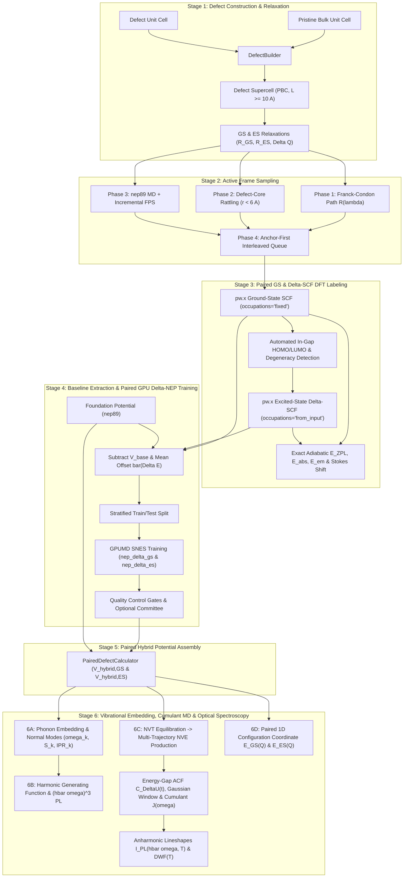

# HyDePh Theoretical Walkthrough

**HyDePh** (**Hy**brid **De**fect **Ph**otoluminescence) combines paired $\Delta$-machine learning potentials ($\Delta$-NEP) with quantum generating functions, large-supercell phonon embedding, and finite-temperature microcanonical cumulant dynamics to compute first-principles optical spectra of point defects in solids.

---

## 1. The Multi-Scale Defect Spectroscopy Problem

Point defects in crystalline solids (color centers) are leading platforms for quantum repeaters, single-photon sources, and nanoscale sensors [1–4]. Identifying and characterizing these centers relies on photoluminescence (PL) spectroscopy, which probes electronic transitions coupled to host lattice vibrations [5, 6].

First-principles modeling of color-center PL faces four competing demands:
1. **Electronic localization & excited-state rearrangement**: Deep defect states involve localized correlations, charge reorganization, and Jahn-Teller distortions across distinct ground-state (GS) and excited-state (ES) potential energy surfaces (PES) that require spin-polarized density functional theory (DFT) and constrained orbital occupations ($\Delta$SCF) [5–8, 23].
2. **Long-range elastic strain & Brillouin-zone sampling**: Defects couple to acoustic and optical phonons across thousands of atoms. Converging periodic image strain ($L^{-3}$) and eliminating discrete finite-size mode-comb artifacts requires supercells with physical edge length $L \ge 10\text{--}12\ \text{Å}$ (or large-supercell phonon embedding) that are expensive for direct ab initio molecular dynamics [5, 6, 9, 35].
3. **Finite-temperature anharmonicity & quadratic dephasing**: In soft lattices (e.g., alkali halides, perovskites) or at elevated temperatures, thermal motion samples cubic and quartic anharmonicity ($V \sim k_3 Q^3 + k_4 Q^4$) and curvature differences between the GS and ES manifolds ($\hbar\Omega_{\mathrm{GS}} \ne \hbar\Omega_{\mathrm{ES}}$), requiring picosecond molecular dynamics (MD) and time-domain cumulant expansions [10–13, 33].
4. **Foundation model gaps**: Universal machine-learned potentials (`nep89`) capture bulk elasticity and phonons across the periodic table, but lack defect-specific Kohn-Sham electronic states, $\Delta$SCF excited-state forces, and Franck-Condon relaxation paths [14, 15].

HyDePh bridges these scales by training **paired localized $\Delta$-NEP corrections** ($\Delta V_{\mathrm{GS}}$ and $\Delta V_{\mathrm{ES}}$) on top of a universal foundation potential, then evaluating optical lineshapes through normal-mode generating functions and ensemble-averaged NVE energy-gap autocorrelation functions [5, 10, 33].

---

## 2. Pipeline Architecture

The workflow is organized into six stages (matching the CLI `--from-stage 1..6` and `--force-stage` controls in [`pipeline.py`](../hydeph/pipeline.py)):

---

## 3. Stage-by-Stage Formulation

### Stage 1: Defect Embedding & Supercell Mechanics

Under periodic boundary conditions (PBC), a point defect interacts with its periodic images via elastic strain fields decaying as $L^{-3}$ [5, 9]:

$$
E_{\mathrm{elastic}}(L) = E_{\mathrm{dilute}} + \frac{\alpha_{\mathrm{el}}}{L^3} + \mathcal{O}(L^{-5})
$$

where $L$ is the supercell dimension and $\alpha_{\mathrm{el}}$ is the elastic dipole tensor parameter. Beyond elastic ($L^{-3}$) and electrostatic ($L^{-1}$) image interactions, supercell size directly dictates the resolution of the vibrational spectrum. A supercell of linear dimension $L$ samples the phonon Brillouin zone on a discrete grid of spacing $\Delta q = \frac{2\pi}{L}$. When $L < 10\ \text{Å}$ (such as in a 64-atom diamond cell), the absence of long-wavelength acoustic modes prevents the localized defect breathing mode from hybridizing with the host lattice continuum. This artificially concentrates electron-phonon coupling into an isolated discrete mode and produces an unphysical comb of Poissonian multi-phonon spikes [5, 35]. Converging sideband spectra to the continuous dilute limit requires supercells with physical dimension $L \ge 10\text{--}12\ \text{Å}$ [5, 6, 9]:
- **Compact covalent crystals** ($a \approx 3.5\text{--}4.5\ \text{Å}$): `(3, 3, 3)` for diamond ($215$ atoms, $L = 10.72\ \text{Å}$) or `(3, 3, 2)` for 4H-SiC ($142$ atoms, $L \approx 9.2\text{--}10.1\ \text{Å}$).
- **Large-lattice ionic crystals** ($a > 5.5\ \text{Å}$): `(2, 2, 2)` for rocksalt alkali halides such as NaCl or LiCl ($63$ atoms, $L = 11.38\ \text{Å}$).

[`DefectBuilder`](../hydeph/defect_builder.py) tiles an $N_1 \times N_2 \times N_3$ array of pristine bulk unit cells around the defect cell, locates the defect site via minimum-image coordinate matching, and optimizes the Ground State ($\mathbf{R}_{\mathrm{GS}}$) and Excited State ($\mathbf{R}_{\mathrm{ES}}$) equilibrium geometries. Using minimum-image displacements $\Delta \mathbf{R}_{\mathrm{MIC}}$, these define the Franck-Condon displacement vector and total mass-weighted configurational displacement [5]:

$$
\Delta \mathbf{R}_i = \mathrm{MIC}(\mathbf{R}_{\mathrm{ES}, i} - \mathbf{R}_{\mathrm{GS}, i}), \qquad \Delta Q = \sqrt{\sum_{i=1}^N M_i \vert \Delta \mathbf{R}_i \vert^2}
$$

where $M_i$ is the atomic mass of site $i$. When `allow_fallbacks = False` (default), DFT optimization failures raise an immediate `RuntimeError`, and structural origins are recorded in `provenance.json`.

---

### Stage 2: Four-Phase Active Frame Sampling

[`FrameSampler`](../hydeph/frame_sampler.py) constructs a compact, diverse candidate dataset across four physical regimes:

1. **Franck-Condon Coordinate Scan**: Linear interpolation and extrapolation along the optical transition path [5, 18]:

$$
\mathbf{R}(\lambda) = \mathbf{R}_{\mathrm{GS}} + \lambda \Delta \mathbf{R}, \quad \lambda \in [-0.2, 1.2]
$$

   The ground-state minimum ($\lambda = 0$, `fc_00`) and excited-state minimum ($\lambda = 1$, `fc_01`) are tagged as **optical anchor frames**.

2. **Defect-Core Rattling**: Two-tier Gaussian displacements applied within $r_{\mathrm{core}} < 6.0\ \text{Å}$ of the defect center to sample local harmonic and anharmonic force constants ($k_2, k_3, k_4$) [19]:

$$
\mathbf{R}_i' = \mathbf{R}_i + \boldsymbol{\eta}_i, \quad \boldsymbol{\eta}_i \sim \mathcal{N}(0, \sigma_r^2), \quad \sigma_r \in \{0.08, 0.14\}\ \text{Å}
$$

3. **Foundation MD + Incremental Farthest Point Sampling (FPS)**: A finite-temperature NVT trajectory ($T = 500\ \text{K}$) driven by `nep89`, subsampled via FPS in structural descriptor space $\mathbf{q}_i$ to maximize bulk and local phase-space coverage [20]:

$$
d(i, j) = \Vert \mathbf{q}_i - \mathbf{q}_j \Vert_2
$$

4. **Anchor-Prioritized Interleaved Queue**: Guarantees that the $\lambda = 0$ and $\lambda = 1$ optical anchor frames are selected first, followed by balanced round-robin sampling across Franck-Condon, core-rattle, and MD-FPS manifolds.

---

### Stage 3: First-Principles GS & $\Delta$SCF Excited-State Labeling

For each selected candidate frame $\mathbf{R}_k$, [`QERunner`](../hydeph/qe_runner.py) drives Quantum ESPRESSO (`pw.x`) [22] at the $\Gamma$-point (`K_POINTS gamma`) to compute Kohn-Sham total energies and Hellmann-Feynman forces:

$$
\mathbf{F}_{i, \mathrm{DFT}} = -\nabla_i E_{\mathrm{DFT}} = -\langle \Psi \vert \nabla_i \hat{H} \vert \Psi \rangle
$$

#### (A) Ground-State Rigor & Cutoff Verification
- **Fixed Occupations**: Gapped defect supercells default to `occupations = 'fixed'` with explicit integer spin magnetization `tot_magnetization` (and strict spin-parity verification against total valence electron count $N_e$) to prevent artificial metallic smearing across degenerate defect states.
- **Size-Scaled Convergence & Cutoffs**: The SCF threshold `conv_thr` scales with supercell size ($10^{-10}\ \text{Ry/atom}$) to ensure clean Hellmann-Feynman forces, while UPF pseudopotential headers are automatically inspected for norm-conserving vs. ultrasoft/PAW metadata and recommended plane-wave cutoffs (`ecutwfc`, `ecutrho`).
- **Hybrid Functionals**: Supports semilocal (PBE) as well as hybrid exchange-correlation functionals (`input_dft = 'HSE06'` or `'PBE0'`, `exx_fraction`, `nqx1..3`) so that $\Delta$-NEP models can be trained directly on hybrid-DFT forces and energetics.

#### (B) Constrained $\Delta$SCF Optical Excited States
By default (`excited_state_method = "delta_scf"`, `paired_delta_nep = True`), HyDePh labels the optical excited-state manifold using constrained orbital occupations (`occupations = 'from_input'`) [6, 8, 23]:
1. **Automated In-Gap Orbital Detection**: [`parse_qe_band_gap`](../hydeph/qe_runner.py) inspects the ground-state Kohn-Sham eigenvalues at $\mathbf{R}_{\mathrm{GS}}$ to identify the highest occupied defect orbital ($\mathrm{HOMO}$, band $b_{\mathrm{H}}$) and lowest unoccupied defect orbital ($\mathrm{LUMO}$, band $b_{\mathrm{L}}$) within the active spin channel (`delta_scf_spin_channel`).
2. **Degenerate LUMO Symmetrization**: For high-symmetry defects where promoting an electron into a degenerate $e$-doublet or $t_2$-triplet LUMO (e.g., the ${}^3E$ excited state of Diamond $\mathrm{NV}^-$ or 4H-SiC $kk$-$\mathrm{VV}^0$) would cause SCF charge sloshing, [`build_delta_scf_occupations`](../hydeph/qe_runner.py) distributes the promoted electron equally across the $g_{\mathrm{L}}$-fold degenerate LUMO manifold ($f_{b_{\mathrm{H}}} = 0$, $f_{b_{\mathrm{L}} + m} = 1/g_{\mathrm{L}}$ for $m = 0, \dots, g_{\mathrm{L}}-1$).
3. **Exact Adiabatic Energetics**: Evaluating both ground-state and $\Delta$SCF excited-state energies at the $\lambda = 0$ ($\mathbf{R}_{\mathrm{GS}}$) and $\lambda = 1$ ($\mathbf{R}_{\mathrm{ES}}$) anchor frames yields the exact first-principles adiabatic Zero-Phonon Line ($E_{\mathrm{ZPL}}$), vertical absorption ($E_{\mathrm{abs}}$), vertical emission ($E_{\mathrm{em}}$), and asymmetric relaxation energies without empirical parameters:

$$
\begin{aligned}
E_{\mathrm{ZPL}} &= E_{\mathrm{DFT,ES}}(\mathbf{R}_{\mathrm{ES}}) - E_{\mathrm{DFT,GS}}(\mathbf{R}_{\mathrm{GS}}) \\
E_{\mathrm{abs}} &= E_{\mathrm{DFT,ES}}(\mathbf{R}_{\mathrm{GS}}) - E_{\mathrm{DFT,GS}}(\mathbf{R}_{\mathrm{GS}}), \qquad \Delta E_{\mathrm{rel,ES}} = E_{\mathrm{DFT,ES}}(\mathbf{R}_{\mathrm{GS}}) - E_{\mathrm{DFT,ES}}(\mathbf{R}_{\mathrm{ES}}) \\
E_{\mathrm{em}} &= E_{\mathrm{DFT,ES}}(\mathbf{R}_{\mathrm{ES}}) - E_{\mathrm{DFT,GS}}(\mathbf{R}_{\mathrm{ES}}), \qquad \Delta E_{\mathrm{rel,GS}} = E_{\mathrm{DFT,GS}}(\mathbf{R}_{\mathrm{ES}}) - E_{\mathrm{DFT,GS}}(\mathbf{R}_{\mathrm{GS}}) \\
\Delta E_{\mathrm{Stokes}} &= E_{\mathrm{abs}} - E_{\mathrm{em}} = \Delta E_{\mathrm{rel,ES}} + \Delta E_{\mathrm{rel,GS}}
\end{aligned}
$$

---

### Stage 4 & 5: Paired $\Delta$-NEP Training & Hybrid Assembly

[`DeltaTrainer`](../hydeph/delta_trainer.py) and [`PairedDefectCalculator`](../hydeph/calculator.py) decompose the ground- and excited-state potential energy surfaces $S \in \{\mathrm{GS}, \mathrm{ES}\}$ into the universal foundation baseline (`nep89` [14, 15]), a constant per-atom reference energy offset $\bar{\Delta e}_S$, and a localized neural residual $\Delta V_{\mathrm{NEP}, S}$ [16, 17, 21]:

$$
\begin{aligned}
V_{\mathrm{hybrid}, S}(\mathbf{R}) &= V_{\mathrm{base}}(\mathbf{R}) + N_{\mathrm{atoms}} \bar{\Delta e}_S + \Delta V_{\mathrm{NEP}, S}(\mathbf{R}) \\
\mathbf{F}_{\mathrm{hybrid}, S}(\mathbf{R}) &= \mathbf{F}_{\mathrm{base}}(\mathbf{R}) + \Delta \mathbf{F}_{\mathrm{NEP}, S}(\mathbf{R})
\end{aligned}
$$

#### (A) Mean Baseline Energy Offset Subtraction
Raw pseudopotential DFT total energies differ from foundation potential energies by hundreds of eV per atom. Prior to training (`subtract_mean_energy_offset = True`), HyDePh removes the dataset-mean per-atom energy offset:

$$
\bar{\Delta e}_S = \frac{1}{N_{\mathrm{frames}}} \sum_{k=1}^{N_{\mathrm{frames}}} \frac{E_{\mathrm{DFT}, S}(\mathbf{R}_k) - V_{\mathrm{base}}(\mathbf{R}_k)}{N_{\mathrm{atoms}}^{(k)}}
$$

so that GPUMD trains strictly on zero-mean configurational energy fluctuations ($\sim \text{meV/atom}$) and force residuals:

$$
\Delta V_{\mathrm{target}, S}(\mathbf{R}_k) = E_{\mathrm{DFT}, S}(\mathbf{R}_k) - V_{\mathrm{base}}(\mathbf{R}_k) - N_{\mathrm{atoms}}^{(k)} \bar{\Delta e}_S, \qquad \Delta \mathbf{F}_{\mathrm{target}, S}(\mathbf{R}_k) = \mathbf{F}_{\mathrm{DFT}, S}(\mathbf{R}_k) - \mathbf{F}_{\mathrm{base}}(\mathbf{R}_k)
$$

The exact offset $\bar{\Delta e}_S$ is stored in `nep_delta_gs.offset` / `nep_delta_es.offset` and automatically restored during potential evaluation, preserving the exact adiabatic separation $E_{\mathrm{ZPL}}$ between the two hybrid surfaces.

#### (B) Descriptor Encoding, SNES Optimization & Quality Gates
Atomic environments within radial cutoff $r_c^{\mathrm{rad}}$ and angular cutoff $r_c^{\mathrm{ang}}$ are encoded into Chebyshev radial ($q_n^i$) and Legendre angular ($q_{nl}^i$) descriptors [14, 15]:

$$
q_n^i = \sum_{j \ne i} g_n(r_{ij}), \qquad q_{nl}^i = \sum_{j, k \ne i} g_n(r_{ij}) g_n(r_{ik}) P_l(\cos \theta_{ijk})
$$

A single-hidden-layer neural network predicts site energy residuals $\Delta E_{i, S}(\mathbf{q}^i)$, and network parameters $\mathbf{w}$ are optimized on GPU via Separable Natural Evolution Strategies (SNES) [14]:

$$
\mathcal{L}(\mathbf{w}) = \frac{\lambda_e}{N_{\mathrm{train}}} \sum_{k} \left\vert \frac{\Delta E_{\mathrm{NEP}}^{(k)} - \Delta V_{\mathrm{target}}^{(k)}}{N_{\mathrm{atoms}}^{(k)}} \right\vert^2 + \frac{\lambda_f}{3\sum_k N_{\mathrm{atoms}}^{(k)}} \sum_{k, i} \vert \Delta \mathbf{F}_{\mathrm{NEP}, i}^{(k)} - \Delta \mathbf{F}_{\mathrm{target}, i}^{(k)} \vert^2 + \lambda_{\mathrm{reg}} \Vert \mathbf{w} \Vert_2^2
$$

- **Stratified Train/Test Split & Quality Control Gates**: Candidate frames are partitioned by sample type (`franck_condon`, `core_rattle`, `foundation_md_fps`) while keeping anchor frames in the training set. [`evaluate_delta_nep_quality_control`](../hydeph/delta_trainer.py) evaluates energy/force RMSEs on both splits, checks residual forces at $\mathbf{R}_{\mathrm{GS}}$, exports parity plots (`delta_nep_parity.png`) and `delta_nep_qc_report.json`, and enforces configurable quality gates (`max_test_force_rmse_eV_A`, `max_gs_residual_force_eV_A`).
- **Committee Ensembles**: Setting `nep_committee_size > 1` trains an ensemble of independent $\Delta$-NEP models with distinct random seeds to propagate epistemic uncertainty onto $S$ and optical lineshapes.

---

### Stage 6A: Normal Modes, Large-Supercell Phonon Embedding & Spectral Density

[`LineshapeEngine`](../hydeph/lineshape.py) computes the finite-difference Hessian around the ground-state equilibrium geometry and diagonalizes the mass-weighted dynamical matrix:

$$
H_{i\alpha, j\beta} = \frac{\partial^2 V_{\mathrm{hybrid,GS}}}{\partial R_{i\alpha} \partial R_{j\beta}}, \qquad D_{i\alpha, j\beta} = \frac{H_{i\alpha, j\beta}}{\sqrt{M_i M_j}}, \qquad \sum_{j\beta} D_{i\alpha, j\beta} e_{k, j\beta} = \omega_k^2 e_{k, i\alpha}
$$

- **Imaginary Mode Guardrails & Localization ($\mathrm{IPR}_k$)**: Any mode with $\omega_k^2 < 0$ is flagged (raising a fail-loud error if imaginary modes exceed `max_imaginary_modes` or `imaginary_freq_tol_meV`). For every mode $k$, HyDePh computes the Inverse Participation Ratio:

$$
\mathrm{IPR}_k = \sum_{i=1}^N \left( \sum_{\alpha=x,y,z} \vert e_{k, i\alpha} \vert^2 \right)^2
$$

  which distinguishes localized defect modes ($\mathrm{IPR}_k \sim \mathcal{O}(10^{-1})$) from delocalized bulk phonons ($\mathrm{IPR}_k \sim N^{-1}$), exporting the full table to `normal_modes.csv`.

- **Direct & Large-Supercell Phonon Embedding**:
  When `phonon_supercell_repeat` is specified, HyDePh embeds the relaxed defect core into an expanded bulk supercell evaluated with the fast hybrid potential [5, 35]. Mode-resolved electron-phonon displacements $\Delta Q_k$ are obtained via either:
  1. **Direct Displacement Projection** (`phonon_embedding_method = "displacement"`):
     $$\Delta Q_k = \sum_{i=1}^N \sqrt{M_i} \Delta \mathbf{R}_i \cdot \mathbf{e}_{k, i}$$
  2. **Alkauskas–Razinkovas Force Projection** (`phonon_embedding_method = "force"` [5, 35]), using the excited-state force $\mathbf{F}_i = -\nabla_i V_{\mathrm{hybrid,GS}}(\mathbf{R}_{\mathrm{ES}})$ mapped onto the phonon supercell:
     $$\Delta Q_k = \frac{\sum_{i=1}^N M_i^{-1/2} \mathbf{F}_i \cdot \mathbf{e}_{k, i}}{\omega_k^2}$$

The partial Huang-Rhys factor $S_k$ and total Huang-Rhys factor $S$ follow as [5, 7, 24]:

$$
S_k = \frac{\omega_k}{2\hbar} (\Delta Q_k)^2, \qquad S = \sum_k S_k
$$

Adaptive Gaussian smearing of width $\sigma(\hbar\omega)$ bridges the discrete supercell mode spacing to form the continuous spectral density $S(\hbar\omega)$, with post-smearing renormalization enforcing the exact sum rule $\int_0^{\infty} S(\hbar\omega) \, d(\hbar\omega) = S$:

$$
S(\hbar\omega) = \sum_k S_k \frac{1}{\sqrt{2\pi}\sigma} \exp\left[ -\frac{(\hbar\omega - \hbar\omega_k)^2}{2\sigma^2} \right]
$$

---

### Stage 6B: Quantum Generating Function Lineshape & $\omega^3$ Prefactor

HyDePh evaluates optical lineshapes by Fourier-transforming the time-domain generating function $G(t, T) = \exp[g(t, T) - g(0, T)]$ [5, 25, 26]:

$$
A(\hbar\omega - E_{\mathrm{ZPL}}, T) = \frac{1}{2\pi\hbar} \int_{-\infty}^{\infty} dt \, \exp\left[ \frac{i(\hbar\omega - E_{\mathrm{ZPL}})t}{\hbar} \right] G(t, T) \exp\left[ -\frac{\gamma(T)\vert t \vert}{\hbar} \right]
$$

where the cumulant phase function $g(t, T)$ integrates over the Bose-Einstein thermal occupation $\bar{n}(\hbar\omega, T) = [\exp(\hbar\omega / k_B T) - 1]^{-1}$:

$$
g(t, T) = \int_0^{\infty} d(\hbar\omega') \, S(\hbar\omega') \left[ (\bar{n}(\hbar\omega', T) + 1) e^{-i\omega' t} + \bar{n}(\hbar\omega', T) e^{i\omega' t} \right]
$$

- **Finite-Temperature Debye-Waller Factor**: The zero-phonon line (ZPL) optical weight is evaluated at each temperature $T$ as:

$$
\mathrm{DWF}(T) = \exp[-g(0, T)] = \exp\left( -\sum_k S_k \left[ 2\bar{n}(\hbar\omega_k, T) + 1 \right] \right)
$$

- **Homogeneous Acoustic Dephasing**: $\gamma(T) = \gamma_0 + \alpha_{\mathrm{deph}} T^2$ accounts for two-phonon Raman acoustic scattering at the defect site [6, 34], controlled by `dephasing_gamma_meV` ($\gamma_0$) and `dephasing_temperature_coefficient` ($\alpha_{\mathrm{deph}}$, default $5.5\times 10^{-5}\ \text{meV/K}^2$).
- **Spontaneous Emission $(\hbar\omega)^3$ Prefactor**: On the absolute photon energy axis $\hbar\omega = E_{\mathrm{ZPL}} + \Delta E$, the macroscopic photoluminescence emission spectrum incorporates the Einstein spontaneous emission density-of-states prefactor [5, 6]:

$$
I_{\mathrm{PL}}(\hbar\omega, T) = \mathcal{N} \, (\hbar\omega)^3 A(\hbar\omega - E_{\mathrm{ZPL}}, T)
$$

where $\mathcal{N}$ normalizes the integrated photon flux to unity.

---

### Stage 6C: Paired Cumulant Anharmonic NVE Dynamics

At finite temperatures, thermal lattice expansion, cubic/quartic repulsive walls ($V \sim k_3 Q^3 + k_4 Q^4$), and state-dependent curvature shifts sample anharmonic regions of the potential energy surface [10–13].

Following the time-dependent cumulant formalism of Mukamel [10] and Linderälv, Erhart *et al.* (*npj Comput. Mater.* **11**, 101, 2025) [33], HyDePh implements a microcanonical cumulant generating function that spans both stiff covalent crystals and soft ionic hosts:

#### (A) NVT Thermalization $\to$ Multi-Trajectory NVE Production
For each target temperature $T$:
1. **Stochastic Langevin Equilibration**: The defect supercell is initialized at $\mathbf{R}_{\mathrm{GS}}$ with Maxwell-Boltzmann velocities and equilibrated under a Langevin thermostat (`anharmonic_equil_steps`) to sample the exact canonical configurational distribution $P(\mathbf{R}) \propto \exp[-V_{\mathrm{hybrid,GS}}(\mathbf{R})/k_B T]$ without KAM invariant-tori trapping [28, 29].
2. **Unperturbed NVE Production Ensemble**: The thermostat is detached and $N_{\mathrm{traj}}$ independent **microcanonical (NVE) Velocity-Verlet trajectories** (`anharmonic_n_trajectories`, `anharmonic_md_steps`) are propagated on $V_{\mathrm{hybrid,GS}}(\mathbf{R})$, guaranteeing strictly conservative Hamiltonian phase-space evolution free of thermostat friction.

#### (B) Paired Energy-Gap Fluctuation & Autocorrelation Function
At each NVE timestep $t_m$, both the ground-state and excited-state hybrid potentials are evaluated to obtain the instantaneous vertical transition energy gap $\Delta U(t)$ and its thermal fluctuation $\delta\Delta U(t)$ [10, 33]:

$$
\Delta U(t) = V_{\mathrm{hybrid,ES}}(\mathbf{R}(t)) - V_{\mathrm{hybrid,GS}}(\mathbf{R}(t)), \qquad \delta\Delta U(t) = \Delta U(t) - \langle \Delta U \rangle_T
$$

*(If only a single ground-state potential is provided, HyDePh falls back to the linear force-displacement projection $\delta\Delta U(t) \approx -\mathbf{F}_{\mathrm{FC}} \cdot \delta\mathbf{R}(t)$).*

The classical energy-gap autocorrelation function (ACF) is ensemble-averaged across all $N_{\mathrm{traj}}$ trajectories using FFT-accelerated cross-correlation:

$$
C_{\Delta U}(t) = \frac{1}{N_{\mathrm{traj}}} \sum_{r=1}^{N_{\mathrm{traj}}} \langle \delta\Delta U^{(r)}(t + t_0) \, \delta\Delta U^{(r)}(t_0) \rangle_{t_0}
$$

#### (C) Linderälv Gaussian Window, Quantum Correction & Low-T Anchor
Finite-length NVE trajectories exhibit statistical tail noise in $C_{\Delta U}(t)$ at long lag times $t$, which produces unphysical high-frequency oscillations ("spiky" sidebands) if transformed with a raw rectangular cutoff. Following Linderälv *et al.* [33], HyDePh applies a physical Gaussian damping window in the time domain controlled by `anharmonic_acf_damping_meV` ($\gamma_{\mathrm{acf}}$, default $2.0\ \text{meV}$):

$$
W_{\mathrm{Gauss}}(t) = \exp\left[ -\frac{1}{2} \left( \frac{\gamma_{\mathrm{acf}} t}{\hbar} \right)^2 \right]
$$

Because $W_{\mathrm{Gauss}}(t) > 0$ everywhere and its Fourier transform is strictly positive, it provides uniform Gaussian spectral resolution without Gibbs ringing or negative spectral density artifacts.

Transforming the windowed ACF yields the classical energy-gap fluctuation power spectrum $J_{\mathrm{cl}}(\omega)$:

$$
J_{\mathrm{cl}}(\omega) = \int_0^{\infty} dt \, C_{\Delta U}(t) \, W_{\mathrm{Gauss}}(t) \cos(\omega t)
$$

Because classical MD obeys classical equipartition ($\langle E_k \rangle = k_B T$) rather than Bose-Einstein statistics, the classical spectrum is rescaled by the symmetric harmonic quantum correction factor $\mathcal{Q}(\hbar\omega, T)$ [10, 33]:

$$
\mathcal{Q}(\hbar\omega, T) = \frac{\hbar\omega / k_B T}{2\tanh(\hbar\omega / 2 k_B T)} \xrightarrow{k_B T \ll \hbar\omega} \frac{\hbar\omega}{2 k_B T}
$$

Converting the energy-gap fluctuation spectrum into the effective Huang-Rhys spectral density and applying acoustic mode filtering $f_{\mathrm{ac}}(\omega) = 1 - \exp[-(\omega / \omega_{\mathrm{cut}})^4]$ yields:

$$
S_{\mathrm{MD}}(\hbar\omega, T) = \frac{J_{\mathrm{cl}}(\omega) \, \mathcal{Q}(\hbar\omega, T) \, f_{\mathrm{ac}}(\omega)}{(\hbar\omega)^2}
$$

- **Sum-Rule Normalization**: When `normalize_anharmonic_s = True` (default), the integrated intensity is normalized to the Franck-Condon Huang-Rhys factor $\int_0^{\infty} S_{\mathrm{MD}}(\hbar\omega, T) \, d(\hbar\omega) = S$, eliminating stochastic single-trajectory amplitude variance across temperatures while preserving all physical mode shifts $\Delta\omega_{\mathrm{anh}}(T)$, lifetime broadening, and thermal renormalization.
- **Low-Temperature Quantum Anchor**: Below $\sim 50\ \text{K}$, classical trajectories lack quantum zero-point fluctuations ($k_B T \ll \hbar\omega_0$). HyDePh smoothly anchors $S_{\mathrm{anh}}(\hbar\omega, T) = (1 - w_{\mathrm{MD}}) S_{\mathrm{harm}}(\hbar\omega) + w_{\mathrm{MD}} S_{\mathrm{MD}}(\hbar\omega, T)$ with $w_{\mathrm{MD}} = \mathrm{clip}(T / 77\ \text{K}, 0, 1)$, recovering the exact harmonic normal-mode spectrum as $T \to 0$ and transitioning seamlessly to full MD cumulant dynamics at finite temperatures.

#### (D) Unified Cumulant Generating Function Across All Coupling Regimes
Substituting $S_{\mathrm{anh}}(\hbar\omega, T)$ directly into the second-order cumulant phase integral:

$$
g_{\mathrm{anh}}(t, T) = \int_0^{\infty} d(\hbar\omega) \, S_{\mathrm{anh}}(\hbar\omega, T) \left[ (\bar{n}(\hbar\omega, T) + 1) e^{-i\omega t} + \bar{n}(\hbar\omega, T) e^{i\omega t} \right]
$$

naturally spans weak, intermediate, and strong electron-phonon coupling within a single generating function:
- **Weak/Intermediate Coupling ($S < 10$; Diamond $\mathrm{NV}^-$, 4H-SiC $kk$-$\mathrm{VV}^0$)**: Preserves the quantized Bose-Einstein multi-phonon sideband progression and sharp room-temperature ZPL peak ($\mathrm{DWF}(T) = \exp[-g_{\mathrm{anh}}(0, T)]$), while incorporating anharmonic mode shifts and thermal broadening [33, 34].
- **Strong Coupling / Marcus Limit ($S \ge 10$; NaCl and LiF F-centers)**: When $S \gg 1$, $\mathrm{DWF}(T) \to 0$ and the short-time stationary-phase expansion of $\exp[g_{\mathrm{anh}}(t, T) - g_{\mathrm{anh}}(0, T)]$ automatically converges to the broadened semiclassical Marcus Gaussian/skewed envelope of variance $\sigma_{\Delta U}^2(T) = \int d(\hbar\omega) \, (\hbar\omega)^2 S_{\mathrm{anh}}(\hbar\omega, T) (2\bar{n} + 1)$ [10, 18].

---

### Stage 6D: Paired 1D Configuration Coordinate & Asymmetric Stokes Shift

[`ConfigurationCoordinateEngine`](../hydeph/cc_diagram.py) projects the paired hybrid potential energy surfaces onto the 1D mass-weighted configuration coordinate $Q = \lambda \Delta Q$ along $\mathbf{R}(\lambda) = \mathbf{R}_{\mathrm{GS}} + \lambda \Delta \mathbf{R}$ [5, 6, 8, 32]:

$$
\begin{aligned}
E_{\mathrm{GS}}(Q) &= V_{\mathrm{hybrid,GS}}(\mathbf{R}(\lambda)) - V_{\mathrm{hybrid,GS}}(\mathbf{R}_{\mathrm{GS}}) \\
E_{\mathrm{ES}}(Q) &= E_{\mathrm{ZPL}} + V_{\mathrm{hybrid,ES}}(\mathbf{R}(\lambda)) - V_{\mathrm{hybrid,ES}}(\mathbf{R}_{\mathrm{ES}})
\end{aligned}
$$

Evaluating both $\Delta V_{\mathrm{NEP,GS}}$ and $\Delta V_{\mathrm{NEP,ES}}$ along $\mathbf{R}(\lambda)$ resolves state-dependent curvature asymmetry ($\hbar\Omega_{\mathrm{ES}} \ne \hbar\Omega_{\mathrm{GS}}$) and asymmetric relaxation energies:

$$
\Delta E_{\mathrm{rel,GS}} = E_{\mathrm{GS}}(Q = \Delta Q), \qquad \Delta E_{\mathrm{rel,ES}} = E_{\mathrm{ES}}(Q = 0) - E_{\mathrm{ZPL}}
$$

$$
E_{\mathrm{abs}} = E_{\mathrm{ZPL}} + \Delta E_{\mathrm{rel,ES}}, \qquad E_{\mathrm{em}} = E_{\mathrm{ZPL}} - \Delta E_{\mathrm{rel,GS}}, \qquad \Delta E_{\mathrm{Stokes}} = E_{\mathrm{abs}} - E_{\mathrm{em}} = \Delta E_{\mathrm{rel,ES}} + \Delta E_{\mathrm{rel,GS}}
$$

From the state-specific harmonic curvatures $K_{S} = 2 \Delta E_{\mathrm{rel}, S} / (\Delta Q)^2$, the effective 1D phonon frequencies and Huang-Rhys factors are:

$$
\hbar\Omega_{S} \text{ (meV)} = 91.4348 \frac{\sqrt{\Delta E_{\mathrm{rel}, S} \text{ (eV)}}}{\Delta Q \text{ (amu}^{1/2}\text{Å)}}, \qquad S_{\mathrm{1D}, S} = \frac{\Delta E_{\mathrm{rel}, S}}{\hbar\Omega_{S}}
$$

  

---

## 4. Stiff vs. Soft Host Benchmarks

  

- **Stiff covalent hosts (Diamond $\mathrm{NV}^-$, 4H-SiC $kk$-$\mathrm{VV}^0$)**: High Debye temperatures ($\Theta_D \approx 1200\text{--}2200\ \mathrm{K}$) mean $\hbar\omega \gg k_B T$ up to $300\ \mathrm{K}$. The paired NVE cumulant generating function with Linderälv Gaussian windowing ($\gamma_{\mathrm{acf}} = 2.0\ \mathrm{meV}$) and physical quadratic Raman dephasing ($\alpha_{\mathrm{deph}} = 5.5\times 10^{-5}\ \mathrm{meV/K}^2$) resolves both the discrete $64.6\ \mathrm{meV}$ quasi-local vibronic progression and the persistent room-temperature ZPL spike observed experimentally by Carbery *et al.* (2024) [33, 34].
- **Soft ionic hosts (NaCl, LiCl, and LiF F-centers)**: Low Debye temperatures ($\Theta_D \approx 320\text{--}730\ \mathrm{K}$) and large Franck-Condon displacements ($\Delta Q = 1.63\text{--}2.39\ \mathrm{amu}^{1/2}\text{Å}$) place these centers in the strong electron-phonon coupling regime ($S \approx 4\text{--}24$). In NaCl ($S = 11.58$, $\Delta Q = 2.22\ \mathrm{amu}^{1/2}\text{Å}$), the ZPL is exponentially suppressed ($\mathrm{DWF} = 9.4\times 10^{-6}$ at $0\ \mathrm{K}$) and the cumulant generating function smoothly broadens the multi-phonon emission envelope from $\mathrm{FWHM} = 163.8\ \mathrm{meV}$ ($10\ \mathrm{K}$) to $263.1\ \mathrm{meV}$ ($300\ \mathrm{K}$). In LiCl ($S = 4.00$), anharmonic MD captures thermal mode softening ($27.8 \to 19.8\ \mathrm{meV}$ vs. $19.7\ \mathrm{meV}$ exp. [13]).

| System | Host ($\Theta_D$) | Supercell ($N_{\mathrm{atoms}}$) | $S$ | $\Delta Q$ ($\mathrm{amu}^{1/2}\text{Å}$) | Adiabatic $E_{\mathrm{ZPL}}$ | Key Spectroscopic Result |
|---|---|---|---|---|---|---|
| **Diamond $\mathrm{NV}^-$** | Covalent ($2200\ \mathrm{K}$) | $3\times 3\times 3$ ($215$) | $2.91$ | $0.562$ | $1.716\ \mathrm{eV}$ | Sharp ZPL ($\mathrm{DWF}_0 = 5.46\%$) visible up to $300\ \mathrm{K}$; $64.6\ \mathrm{meV}$ $a_1$ resonance & smooth sideband wing |
| **4H-SiC $kk$-$\mathrm{VV}^0$** | Polar covalent ($1200\ \mathrm{K}$) | $3\times 3\times 2$ ($142$) | $4.77$ | $0.812$ | $1.10\ \mathrm{eV}$ | Sharp ZPL ($\mathrm{DWF}_0 = 0.85\%$), resolved sidebands at $-38, -76\ \mathrm{meV}$ across basal/$c$-axis modes |
| **LiCl F-Center** | Rocksalt ($420\ \mathrm{K}$) | $2\times 2\times 2$ ($63$) | $4.00$ | $1.632$ | $2.15\ \mathrm{eV}$ | Mode softens $27.8 \to 19.8\ \mathrm{meV}$ ($19.7\ \mathrm{meV}$ exp. [13]); anharmonic broadening to $265\ \mathrm{meV}$ |
| **NaCl F-Center** | Rocksalt ($320\ \mathrm{K}$) | $2\times 2\times 2$ ($63$) | $11.58$ | $2.220$ | $1.274\ \mathrm{eV}$ | Strong coupling ($\Delta E_{\mathrm{Stokes}} = 0.671\ \mathrm{eV}$); smooth FWHM broadening $163.8 \to 263.1\ \mathrm{meV}$ ($10\text{--}300\ \mathrm{K}$) |
| **LiF F-Center** | Rocksalt ($730\ \mathrm{K}$) | $2\times 2\times 2$ ($63$) | $23.93$ | $2.391$ | $3.42\ \mathrm{eV}$ | Deep Marcus regime ($\mathrm{DWF} \approx 0$); broad Gaussian band ($\mathrm{FWHM} = 490\text{--}1101\ \mathrm{meV}$) |

---

## 5. References

1. **D. D. Awschalom, R. Hanson, J. Wrachtrup, and B. B. Zhou**, *"Quantum technologies with optically interfaced nitrogen-vacancy centers in diamond"*, *Science* **361**, eaat8989 (2018). [DOI: 10.1126/science.aat8989](https://doi.org/10.1126/science.aat8989)
2. **G. Wolfowicz, F. J. Heremans, C. P. Anderson, S. Kanai, H. Seo, A. Gali, and D. D. Awschalom**, *"Quantum guidelines for solid-state spin qubits"*, *Nat. Rev. Mater.* **6**, 655–673 (2021). [DOI: 10.1038/s41578-021-00306-y](https://doi.org/10.1038/s41578-021-00306-y)
3. **M. Atatüre, D. Englund, N. Vamivakas, S. Y. Lee, and J. Wrachtrup**, *"Material platforms for spin-based photonic quantum technologies"*, *Nat. Rev. Mater.* **3**, 38–51 (2018). [DOI: 10.1038/s41578-018-0008-9](https://doi.org/10.1038/s41578-018-0008-9)
4. **W. B. Gao, A. Imamoglu, H. Bernien, and R. Hanson**, *"Coherent manipulation, measurement and entanglement of individual solid-state spins using optical fields"*, *Nat. Photonics* **9**, 363–373 (2015). [DOI: 10.1038/nphoton.2015.58](https://doi.org/10.1038/nphoton.2015.58)
5. **A. Alkauskas, B. B. Buckley, D. D. Awschalom, and C. G. Van de Walle**, *"First-principles theory of luminescence lineshapes of color centers in semiconductors and insulators"*, *New J. Phys.* **16**, 073026 (2014). [DOI: 10.1088/1367-2630/16/7/073026](https://doi.org/10.1088/1367-2630/16/7/073026)
6. **Y. Jin, M. Govoni, G. Wolfowicz, S. E. Sullivan, F. J. Heremans, D. D. Awschalom, and G. Galli**, *"Photoluminescence spectra of point defects in semiconductors: Validation of first-principles calculations"*, *Phys. Rev. Materials* **5**, 084603 (2021). [DOI: 10.1103/PhysRevMaterials.5.084603](https://doi.org/10.1103/PhysRevMaterials.5.084603)
7. **A. Alkauskas, J. L. Lyons, D. Steiauf, and C. G. Van de Walle**, *"First-principles calculations of luminescence spectrum line shapes for defects in semiconductors: the role of phonons and Jahn-Teller effect"*, *Phys. Rev. Lett.* **109**, 267401 (2012). [DOI: 10.1103/PhysRevLett.109.267401](https://doi.org/10.1103/PhysRevLett.109.267401)
8. **A. Gali, M. Fyta, and E. Kaxiras**, *"Ab initio supercell calculations on nitrogen-vacancy center in diamond: Electronic structure and hyperfine tensors"*, *Phys. Rev. B* **79**, 235203 (2009). [DOI: 10.1103/PhysRevB.79.235203](https://doi.org/10.1103/PhysRevB.79.235203)
9. **C. Freysoldt, B. Grabowski, T. Hickel, J. Neugebauer, G. Kresse, A. Janotti, and C. G. Van de Walle**, *"First-principles calculations for point defects in solids"*, *Rev. Mod. Phys.* **86**, 253–305 (2014). [DOI: 10.1103/RevModPhys.86.253](https://doi.org/10.1103/RevModPhys.86.253)
10. **S. Mukamel**, *Principles of Nonlinear Optical Spectroscopy*, Oxford University Press, New York (1995). [ISBN: 978-0195104479]
11. **M. Zacharias and F. Giustino**, *"One-shot calculation of temperature-dependent optical spectra and phonon-induced band-gap renormalization"*, *Phys. Rev. B* **94**, 075125 (2016). [DOI: 10.1103/PhysRevB.94.075125](https://doi.org/10.1103/PhysRevB.94.075125)
12. **M. Zacharias, M. Scheffler, and F. Giustino**, *"Theory of the temperature-dependent optical absorption and emission spectra of solids from first principles"*, *Phys. Rev. Res.* **2**, 013202 (2020). [DOI: 10.1103/PhysRevResearch.2.013202](https://doi.org/10.1103/PhysRevResearch.2.013202)
13. **K. Takiyama**, *"The F-Center Emission in LiCl"*, *J. Phys. Soc. Jpn.* **44**, 1627–1634 (1978). [DOI: 10.1143/JPSJ.44.1627](https://doi.org/10.1143/JPSJ.44.1627)
14. **Z. Fan, Z. Chen, V. L. Deringer, C. S. Ramanan, A. C. T. van Duin, and T. Ala-Nissila**, *"Neuroevolution machine learning potentials: Combining high accuracy and low cost in atomistic simulations and application to carbon"*, *Phys. Rev. B* **104**, 104309 (2021). [DOI: 10.1103/PhysRevB.104.104309](https://doi.org/10.1103/PhysRevB.104.104309)
15. **Z. Fan et al.**, *"GPUMD: A highly efficient graphics processing unit code for molecular dynamics with the neuroevolution potential"*, *J. Chem. Phys.* **157**, 114801 (2022). [DOI: 10.1063/5.0106617](https://doi.org/10.1063/5.0106617)
16. **P. Ramakrishnan, P. O. Dral, M. Rupp, and O. A. von Lilienfeld**, *"$\Delta$-Machine Learning to Accurately Predict Quantum Chemical Properties"*, *J. Chem. Theory Comput.* **11**, 2087–2096 (2015). [DOI: 10.1021/acs.jctc.5b00099](https://doi.org/10.1021/acs.jctc.5b00099)
17. **S. Chmiela, H. E. Sauceda, K. R. Müller, and A. Tkatchenko**, *"Towards exact molecular dynamics simulations with machine-learned force fields"*, *Nat. Commun.* **9**, 3887 (2018). [DOI: 10.1038/s41467-018-06169-2](https://doi.org/10.1038/s41467-018-06169-2)
18. **R. A. Marcus**, *"Electron transfer reactions in chemistry. Theory and experiment"*, *Rev. Mod. Phys.* **65**, 599–610 (1993). [DOI: 10.1103/RevModPhys.65.599](https://doi.org/10.1103/RevModPhys.65.599)
19. **F. Knoop, M. Purcell, M. Scheffler, and C. Carbogno**, *"Anharmonic properties of solids from first principles: A high-throughput study"*, *Phys. Rev. Materials* **4**, 083809 (2020). [DOI: 10.1103/PhysRevMaterials.4.083809](https://doi.org/10.1103/PhysRevMaterials.4.083809)
20. **M. Ceriotti, G. A. Tribello, and M. Parrinello**, *"Demonstrating the power of sketches for molecular simulation"*, *J. Chem. Theory Comput.* **9**, 1521–1532 (2013). [DOI: 10.1021/ct3010563](https://doi.org/10.1021/ct3010563)
21. **V. L. Deringer, M. A. Caro, and G. Csányi**, *"Machine learning potentials for atomistic simulations"*, *Chem. Rev.* **121**, 10073–10141 (2021). [DOI: 10.1021/acs.chemrev.1c00022](https://doi.org/10.1021/acs.chemrev.1c00022)
22. **P. Giannozzi et al.**, *"QUANTUM ESPRESSO: a modular and open-source software project for quantum simulations of materials"*, *J. Phys.: Condens. Matter* **21**, 395502 (2009). [DOI: 10.1088/0953-8984/21/39/395502](https://doi.org/10.1088/0953-8984/21/39/395502)
23. **A. Görling**, *"Density-functional theory for excited states"*, *Phys. Rev. A* **59**, 3359–3374 (1999). [DOI: 10.1103/PhysRevA.59.3359](https://doi.org/10.1103/PhysRevA.59.3359)
24. **K. Huang and A. Rhys**, *"Theory of light absorption and non-radiative transitions in F-centres"*, *Proc. R. Soc. London A* **204**, 406–423 (1950). [DOI: 10.1098/rspa.1950.0184](https://doi.org/10.1098/rspa.1950.0184)
25. **M. Lax**, *"The Franck-Condon principle and its application to crystals"*, *J. Chem. Phys.* **20**, 1752–1760 (1952). [DOI: 10.1063/1.1700283](https://doi.org/10.1063/1.1700283)
26. **R. Kubo and Y. Toyozawa**, *"Application of the method of generating function to radiative and non-radiative transitions of a trapped electron in a crystal"*, *Prog. Theor. Phys.* **13**, 160–182 (1955). [DOI: 10.1143/PTP.13.160](https://doi.org/10.1143/PTP.13.160)
27. **B. J. Berne and R. Pecora**, *Dynamic Light Scattering: With Applications to Chemistry, Biology, and Physics*, John Wiley & Sons, New York (1976). [ISBN: 978-0486411552]
28. **R. Zwanzig**, *Nonequilibrium Statistical Mechanics*, Oxford University Press, New York (2001). [DOI: 10.1093/oso/9780195140187.001.0001](https://doi.org/10.1093/oso/9780195140187.001.0001)
29. **M. E. Tuckerman**, *Statistical Mechanics: Theory and Molecular Simulation*, Oxford University Press, Oxford (2010). [ISBN: 978-0198525264]
30. **A. O. Caldeira and A. J. Leggett**, *"Path integral approach to degree of freedom in a dissipative quantum system"*, *Ann. Phys.* **149**, 374–456 (1983). [DOI: 10.1016/0003-4916(83)90202-6](https://doi.org/10.1016/0003-4916(83)90202-6)
31. **H. Mori**, *"Transport, collective motion, and Brownian motion"*, *Prog. Theor. Phys.* **33**, 423–455 (1965). [DOI: 10.1143/PTP.33.423](https://doi.org/10.1143/PTP.33.423)
32. **A. Gali**, *"Ab initio theory of point defects as single photon emitters in wide band gap semiconductors"*, *Nanophotonics* **12**, 589–609 (2023). [DOI: 10.1515/nanoph-2022-0599](https://doi.org/10.1515/nanoph-2022-0599)
33. **C. Linderälv, N. Österbacka, J. Wiktor, and P. Erhart**, *"Optical line shapes of color centers in solids from classical autocorrelation functions"*, *npj Comput. Mater.* **11**, 101 (2025). [DOI: 10.1038/s41524-025-01565-x](https://doi.org/10.1038/s41524-025-01565-x)
34. **W. P. Carbery, C. A. Farfan, R. Ulbricht, and D. B. Turner**, *"The phonon-modulated Jahn–Teller distortion of the nitrogen vacancy center in diamond"*, *Nat. Commun.* **15**, 8901 (2024). [DOI: 10.1038/s41467-024-52712-9](https://doi.org/10.1038/s41467-024-52712-9)
35. **L. Razinkovas, M. W. Doherty, N. B. Manson, C. G. Van de Walle, and A. Alkauskas**, *"Vibrational and vibronic structure of isolated point defects: The nitrogen-vacancy center in diamond"*, *Phys. Rev. B* **104**, 045303 (2021). [DOI: 10.1103/PhysRevB.104.045303](https://doi.org/10.1103/PhysRevB.104.045303)
